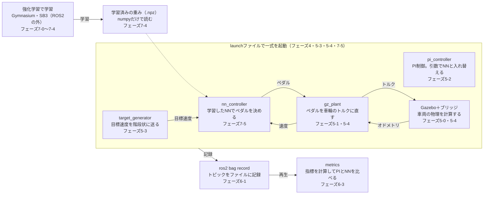
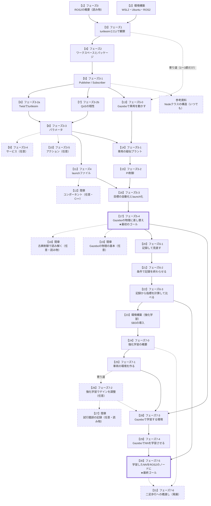

# ros2MinimalPhysicalAi

フィジカルAI（センサで周りを知り、判断し、モータなどを動かすAI）の開発に必要な技術スタックを、ROS2の最低限の構成で一通り身に着けるための学習教材です。Windowsの上のWSL2に入れたUbuntu 24.04とROS2 Jazzyを使います。ゴールは2段階です。最初のゴールは、「慣性のある車両を、目標の速度に追従させるシミュレーション」をROS2のノードで組み立てること（フェーズ5）です。最終ゴールは、その制御を、強化学習で学習させたニューラルネットワーク（NN）に置き換えてROS2のノードとして動かし、元の制御と同じ物差しで比べること（フェーズ7-5）です。


上の図は、この教材の全体像です。フェーズ0〜4で基礎を固め、フェーズ5で最初のゴールの車両シミュレーションを組み立て、フェーズ6で記録して評価します。その先のフェーズ7で、制御を強化学習とニューラルネットワークに置き換え、ROS2のノードとして動かすところ（フェーズ7-5）が最終ゴールです。最終ゴールの一式の構成は、下の「[この教材のゴール](#この教材のゴール)」にあります。各フェーズの詳しい順番は「[読む順番](#読む順番)」にあります。

各手順書では、コマンドや実行手順の直後に「期待する結果」（表示の例と、その読み方）を書いています。そのため、ROS2の環境を用意せずに読み物として読むこともできます。この方針はすべての手順書に共通です。各ページの冒頭には、そのページの表示の出どころ（実際に実行して確かめた表示か、コードと仕様から想定した表示か）だけを「期待する結果の出どころ」として書いています。時刻・プロセスの番号・パス・数値の細部は、実行するたびに変わります。実機の表示と違う場合は、実機の表示を優先してください（「[確認の状況](#確認の状況)」）。

## GitHubで読む

この教材は、**GitHubのページを開いて読むことを前提**にしています。リポジトリをcloneしたり、ファイルをダウンロードしたりする必要はありません。

- **手順書の間の移動**: 手順書の中の他の文書への参照は、リンクになっています。クリックすれば、その文書が開きます。
- **コマンドとサンプルコード**: コードのブロックにマウスを重ねると、右上にコピーのボタンが出ます。コマンドは1行ずつ空行で区切っているので、1行だけを選んでコピーすることもできます。サンプルコードは、手順書の指示に従って、自分のPCのファイルに貼り付けて使います。
- **練習用のファイル**: 練習で使うワークスペース（`ros2_ws/`。ホームディレクトリの下の `~/ros2_ws`）とその中のコードは、フェーズ2から各自のPCで一から作ります。このリポジトリから取ってくるものはありません。
- **図**: 図はSVGの画像で表示されます。同じ内容のmermaid版の図も、図の下の「同じ図（mermaid版）」を開くと表示されます。画面のスクリーンショット（フェーズ5-0の冒頭のGazeboの画面）は図ではないので、mermaid版はありません。このREADMEの冒頭の全体像の絵も、アイコンや挿絵を含むポンチ絵で、mermaidでは同じものを描けないため、mermaid版の代わりに代替テキストと説明の文を添えています。

## この教材を作った理由

筆者は、ROS2の本を1冊読んだり、講座を1つ受けたりしただけでは、ROS2を使えるようになりませんでした。振り返ってみると、つまずいた原因は次の4つにあったと考えています。

**ROS2はミドルウェアなので、学んだ成果が目に見えにくい。** ROS2は、プログラム同士をつなぐための仕組みです。それ自体が何かを動かすアプリではありません。「トピックでメッセージが届いた」「ノードが一覧に出た」という練習を重ねても、自分が何を作れるようになったのかを実感しにくいのです。

**基礎から積み上げると、実際に使う場面までの道のりが長い。** 通信の種類、ビルドの仕組み、launch、パラメータと順に学んでいくと、どれも大事なことではあります。しかし、それらを組み合わせて何かを動かす場面にたどり着くまでに長い時間がかかり、途中で手が止まってしまいます。

**目標を決めずに進むと、豊富なエコシステムを追いかけるうちに挫折する。** ROS2の周りには、シミュレータ、可視化ツール、自律移動やロボットアームのためのパッケージなど、たくさんの道具があります。目指すものが決まっていないと、どれも学ぶべきものに見えてきます。それらを理解しようとしているうちに、息切れしてしまいます。

**入門書は、入口を広くするほど、ゴールがぼやけやすい。** 入門書は多くの読者の入口になるように、幅広い話題を少しずつ扱います。それ自体は入門書の役目ですが、1冊を読み終えたときに「何ができるようになったか」がはっきりしにくくなります。

そこでこの教材では、最初にゴールを2段階で決めました。最終ゴールは、目標の速度に追従する車両のシミュレーションを、ROS2のノードで組み立て、その制御を強化学習で学習させたNNに置き換えて比べる、という一式です（次の「この教材のゴール」の図）。その途中に、ROS2だけで組み立てられる最初のゴール（フェーズ5）を置きました。各フェーズは、この完成形に必要な部品を1つずつ手に入れる順番に並べています。必須の範囲は、最初のゴールと、それを記録で評価するフェーズ6までに絞りました。サービスやアクションのように、ゴールに直接使わない内容は任意にしています。周辺の道具も、ゴールに使うもの（Gazeboなど）だけを実際に動かし、ほかはフェーズ0で役割を紹介するだけにとどめています。

この教材は、ROS2のすべてを網羅するものではありません。1つの完成形を作りきって「ROS2で何かを動かせた」という足場を作り、そこから必要に応じて、公式ドキュメントや他の入門書で範囲を広げていくことを想定しています。

## この教材のゴール

最終ゴール（フェーズ7-5）で動かす一式は、次の図のとおりです。各箱の最後の行の、色の付いた文字は、その部品を作る（または使い方を学ぶ）フェーズです。ノード（ROS2の処理の単位）どうしは、目標速度・ペダル・速度のトピック（名前の付いた、一方向の通信の経路）でつながり、launchファイル（複数のノードをまとめて起動する設定）で一式を起動します。車両は、物理シミュレータのGazeboの中を走ります。Gazeboとの間は、ブリッジ（Gazeboの中の値とROS2のトピックを中継するノード）を通して、車輪のトルク（車輪を回す力）とオドメトリ（車両の位置と速さを表すデータ）をやり取りします。


<details>
<summary>同じ図（mermaid版）</summary>



</details>

最初のゴール（フェーズ5）では、制御器に、PI制御（目標との差と、その差の積み上げから、アクセルとブレーキの踏み方を決める古典的な制御）の `pi_controller` を置き、強化学習とNNの部品と、記録と指標の部品（フェーズ6で作る）を除いた一式を組み立てます。最終ゴールでは、`pi_controller` と同じトピックを受けて送る `nn_controller` を作り、ほかのノードのコードを変えずに、launchファイルの引数で入れ替えます（ワールドとプラントのパラメータは、NNを学習させたときの条件に合わせます）。NNの学習は、ROS2とは別に入れる強化学習（試した結果に点数を付け、点数が上がるように行動の決め方を学ばせる方法）のライブラリで行い、ROS2のノードは書き出した重みのファイルを読むだけです。各部品で使う技術と、それを学ぶフェーズの一覧は、[フェーズ0](docs/phase0_overview.md)の7節にあります。

## 対象読者

ROS2に初めて触れる人を対象にしています。ロボット工学の予備知識は要りません。次の2つを前提にしています。

**1. C++かPythonのどちらかで、プログラムを書いた経験があること**

クラスを定義して使う、関数を書く、といった基本的な書き方が分かれば十分です。両方の言語の経験は要りません。手順書のサンプルは、同じ仕様のノードをPython版とC++版で並べて載せています。そのため、片方の経験があれば、もう片方もサンプルと解説を読みながら追えるように書いています。ただし、C++はフェーズ2・3-1・4と間章（フェーズ4と5の間に置いた、任意の章）で使い、2つのゴールの部品（フェーズ5以降）はPythonで書きます。

**2. Linuxの基本的なコマンドを、十数個ほど使ったことがあること**

手順書では、次のようなコマンドを説明なしで使います。

| コマンド | 使う場面の例 |
|---|---|
| `cd` | 作業するフォルダへ移動する |
| `ls` | フォルダの中身を確かめる |
| `pwd` | 今いるフォルダを確かめる |
| `mkdir -p` | フォルダを作る |
| `cat` | ファイルの中身を表示する |
| `mv` | ファイルを移動する・名前を変える |
| `touch` | 空のファイルを作る |
| `rm` / `rm -rf` | ファイルを消す・フォルダを中身ごと消す（学習環境が手順書の内容とずれたときに、作ったものを消して作り直す） |
| `nano` または `vim` | ターミナルの中でファイルを書き換える（どちらか一方を使えればよい） |
| `grep` | 出力やファイルから、特定の文字を含む行を探す |
| `source` | 設定用のスクリプトを読み込む（ROS2では頻繁に使う） |
| `export` / `echo` | 環境変数を設定する・中身を確かめる |
| `sudo apt install` | パッケージを導入する |

`rm -rf` は、確認なしに中身ごと消し、元に戻せません。手順書の内容と自分の環境がずれて、作り直したいときに使います（たとえば、ワークスペースの生成物の `build/`・`install/`・`log/` を消してビルドし直す、作ったパッケージを消して作り直す）。実行する前に `pwd` と `ls` で、今いる場所と消す対象を確かめます。`sudo` は付けません。

ほかに、ターミナルを複数開いて並べて使うこと、動き続けるコマンドを `Ctrl+C` で止めること、VS Codeなどのテキストエディタでファイルを書くことにも慣れているとスムーズです。Linuxに触れたことがない場合は、先にこれらのコマンドを一通り試してから始めてください。

手順書のサンプルコードは、GitHubのページからコピーして、自分のPCの練習環境のファイルに貼り付けて使います。`touch` と `nano` を使う方法と、VS Codeを使う方法を、[サンプルコードを練習環境に置く方法](docs/howto_place_code.md)にまとめています。そのまま貼り付けて使うことを想定しているので、コードを隅々まで暗記する必要はありません。各行が何をしているかは解説を読んで理解し、書き方そのものは、必要になったときにサンプルを見返せば足ります。

また、サンプルは学習の要点が見えやすいように、エラー処理を最小限にしています。想定していない値（たとえば時定数に0）を与えるとノードが止まることがありますが、止まるのはシミュレーションだけで、起動し直せば元に戻ります。実務のコードでは、入力の検証をもっと厚くします（例は[フェーズ5-1](docs/phase5_1_plant.md)の5-1節の「補足: 起動時の値を検証していない理由」）。

### 用意するもの

- Windows 11のPC（WSL2が使えるWindows 10でもよい）
- 学習の時間。所要時間は、1コマ＝1〜2時間の学習セッションを単位に書いています

### 確認した環境

この教材の作成時に、手順を試したPCの環境です。**必須の条件ではありません**。自分のPCと比べて、ビルドの時間やGUIの動きの目安にしてください。

| 項目 | 内容 |
|---|---|
| OS | Windows 11 Home（25H2、64ビット） |
| CPU | Intel Core i7-1165G7（第11世代） |
| メモリ | 8GB |
| グラフィックス | Intel Iris Xe Graphics（CPUに内蔵。専用のGPUは無い） |
| Linux環境 | WSL2 + Ubuntu 24.04 + ROS 2 Jazzy |

必要なディスクの空きの目安と、WSL2のメモリは既定の設定のままでよいことは、[環境構築の手順書](docs/setup_wsl2_ros2.md)に書いています。

## 読む順番

全体の流れは次の図のとおりです。実線の枠と矢印が、最初のゴール（フェーズ5-4）と最終ゴール（フェーズ7-5）までの道筋で、2つのゴールは太い枠です。点線の枠は任意または発展の文書、点線の矢印は任意の道筋（ラベル付きのものは寄り道）です。枠の先頭の【】の番号は、下の表の「順」と対応しています。



上から順に進めてください。**前提**の列は、先に済ませておく文書です。**区分**が「必須」のものは、最初のゴールの車両シミュレーション（フェーズ5）と、それを記録で評価するフェーズ6までに必要です。「最終ゴールまで」のものは、最初のゴールの後に、車両の制御を、強化学習で学習させたニューラルネットワークに置き換えて、最終ゴール（フェーズ7-5）まで進むための文書です。ROS2とは別に強化学習のライブラリを入れ、学習の計算を待つ時間もかかるので、必須とは分けています。「任意」のものは、飛ばしても先へ進めます。「発展」のものは、最終ゴールの先の文書です。フェーズ7は、ひととおり作成を終えた段階で、今後の見直しで内容を改めることがあります。

| 順 | 文書 | 内容 | 区分 | 前提 | 所要 |
|---|---|---|---|---|---|
| 1 | [フェーズ0: ROS2の概要と全体像](docs/phase0_overview.md) | 通信の仕組みの概要（層を積み重ねた構造）、ROS2でできること、業界ごとの活用、周辺ツール、用語（ここまでがROS2の一般的な話）、この教材のゴール（完成形の構成）、学習の地図。コマンドは使わない | 必須（読み物） | なし | 1コマ |
| 2 | [環境構築: WSL2 + Ubuntu 24.04 + ROS2 Jazzy](docs/setup_wsl2_ros2.md) | WSL2・Ubuntu・ROS2の導入と、ワークスペースの場所の確認 | 必須（2b節・7節は任意） | なし | 2時間程度 |
| 3 | [フェーズ1: turtlesimとCLIで通信を観察する](docs/phase1_cli_turtlesim.md) | 既製のノードを動かし、`ros2` コマンドとrqtで観察する。コードは書かない | 必須 | 2 | 1〜2コマ |
| 4 | [フェーズ2: ワークスペースとパッケージ](docs/phase2_packages.md) | Python・C++のパッケージを作り、`colcon build` から `ros2 run` までを通す | 必須 | 3 | 1コマ |
| 5 | [フェーズ3-1: Publisher / Subscriber](docs/phase3_1_pubsub.md) | トピックで送受信するノードを、PythonとC++の両方で書く | 必須（両言語） | 4 | 1〜2コマ |
| 6 | [フェーズ3-2a: Twistでturtlesimを動かす](docs/phase3_2a_turtlesim.md) | 速度指令 `Twist` を送って亀を動かす | 必須（C++版は任意） | 5 | 半コマ |
| 7 | [フェーズ3-2b: QoSの相性を体験する](docs/phase3_2b_qos.md) | QoSが合わないと黙ってつながらないことを確かめる | 必須（2通りを試せば十分） | 5 | 半コマ |
| 8 | [フェーズ3-3: パラメータ](docs/phase3_3_parameters.md) | 設定値の宣言、実行中の変更、YAMLでの指定 | 必須（C++版は任意） | 6・7 | 1コマ |
| 9 | [フェーズ3-4: サービス](docs/phase3_4_services.md) | 1回の要求に1回の応答を返す通信 | 任意（概要を掴めば十分） | 8 | 1コマ |
| 10 | [フェーズ3-5: アクション](docs/phase3_5_actions.md) | 途中経過つきで、中断できる長い処理の通信 | 任意（概要を掴めば十分） | 8 | 0.5〜2コマ |
| 11 | [フェーズ4: launchファイル](docs/phase4_launch.md) | 複数のノードを1つのlaunchで起動し、Python版とC++版を引数で切り替える | 必須 | 8（9・10は不要） | 1〜2コマ |
| 12 | [間章: コンポーネント](docs/interlude_components.md) | C++のノードを、配置を後から決められる部品として作り直す | 任意（C++のみ。フェーズ5はこの章に依存しない） | 5のC++版・11 | 1〜2コマ |
| 13 | [フェーズ5-0: Gazeboで用意されたロボットを動かす](docs/phase5_0_gazebo.md) | 3D物理シミュレータのGazeboを導入し、2輪の車両をトピックで走らせる | 必須 | 3・5 | 1〜2コマ |
| 14 | [フェーズ5-1: 車両の疑似プラント](docs/phase5_1_plant.md) | 車両に働く力とアクセル・ブレーキの遅れを式にしてノードで計算し、速度をGazeboの車両で見せる | 必須 | 8・13 | 2コマ |
| 15 | [フェーズ5-2: PI制御](docs/phase5_2_pi.md) | PI制御の式と既定のゲインの決め方を学び、ノードでループを閉じて目標速度に追従させる | 必須 | 14 | 2コマ |
| 16 | [フェーズ5-3: 目標の自動化とlaunch化](docs/phase5_3_launch.md) | 目標速度を階段状に送るノードを作り、一式をlaunchで起動して、追従をグラフで読む | 必須 | 11・15 | 1〜2コマ |
| 17 | [フェーズ5-4: プラントをGazeboの物理に差し替える](docs/phase5_4_gazebo_plant.md) | 車両を力で動かすワールドを用意し、PI制御ノードを変えずに、Gazeboの車両とループを閉じて比べる | 必須 | 16 | 2〜3コマ |
| 18 | [間章: 古典制御で車両のモデルとPI制御を読み解く](docs/interlude_classical_control.md) | フェーズ5で見た結果（定常速度、P制御だけで残る偏差、ゲインの目安、目標0で止まりきらないこと、Gazeboの物理との違い）の理由を、一次遅れの式と手計算で確かめる | 任意（読み物。コードは書かない。フェーズ6・7はこの章に依存しない） | 17 | 1コマ |
| 19 | [間章: Gazeboの物理シミュレーションの基本](docs/interlude_gazebo_physics.md) | ワールドとロボットの記述（SDF・URDF・xacro）と、物理エンジンが計算していること（刻み幅・慣性・摩擦・反発・ばねとダンパー・関節の制限と減衰）を、箱を落とす・坂で滑らせる・球を跳ねさせる・ばねでおもりを揺らす・2関節のアームを出し、ros2_controlの位置・軌道のコントローラで動かす小さな体験で確かめる（センサの節は今後追加） | 任意（フェーズ6・7はこの章に依存しない） | 17 | 1〜2コマ |
| 20 | [フェーズ6-1: 記録して見直す](docs/phase6_1_record.md) | フェーズ5-3・5-4の一式を `ros2 bag` で記録し、決めた時間で自動的に終わらせ、再生して `rqt_plot` に重ねて比べる | 必須 | 17 | 1〜2コマ |
| 21 | [フェーズ6-2: 条件で記録を終わらせる](docs/phase6_2_goal.md) | ゴールに着いたことを見張るノードを作り、走った距離を速度の積み上げ（案A）と位置（案B）で求めて、条件で記録を終わらせる | 必須 | 20 | 1コマ |
| 22 | [フェーズ6-3: 記録から指標を計算して比べる](docs/phase6_3_metrics.md) | 解析のノードで記録から追従の指標（行き過ぎ量・整定時間・RMSなど）を計算し、条件ごとに比べる | 必須 | 21 | 1〜2コマ |
| 23 | [環境構築: 強化学習のライブラリ（Stable-Baselines3）](docs/setup_rl_sb3.md) | ROS2とは別の仮想環境に、強化学習のライブラリ（SB3・Gymnasium・PyTorchのCPU版）を入れる | 最終ゴールまで | 2 | 30分程度 |
| 24 | [フェーズ7-0: 強化学習の概要と最初の一歩](docs/phase7_0_rl_intro.md) | 強化学習の用語をつかみ、SB3で振り子を学習させて、自分で式を書いた制御器と比べる | 最終ゴールまで | 23（フェーズ5-2・6-3を読んでいると分かりやすい） | 2コマ |
| 25 | [フェーズ7-1: 車両の環境を作る](docs/phase7_1_vehicle_env.md) | 車両のプラントを、方策がペダルを直接選ぶGymnasiumの環境として包み、目標速度がランダムに変わるシナリオで、`check_env` で点検して、PI制御を方策として当てはめて収益を比べ、SB3の学習につなぐ | 最終ゴールまで | 22・24 | 2コマ |
| 26 | [フェーズ7-2: 強化学習でゲインを調整する](docs/phase7_2_gain_tuning.md) | フェーズ7-1のシナリオで、PI制御のゲインを選ぶ環境を作り、ゲインと収益の表を作ってから、SACにゲインを学習させ、格子の探索や手で決めたゲインと指標で比べ、報酬の重みで追従性と行き過ぎのバランスが変わることを確かめる | 任意（寄り道。28以降はこの文書に依存しない） | 25 | 3〜4コマ |
| 27 | [間章: 試行錯誤の記録](docs/interlude_trial_and_error.md) | フェーズ7の手順書を作る途中の、予備の実験と方針の修正を振り返り、問題の設定や測り方を疑う視点を学ぶ | 任意（中級者向けの読み物。コードは書かない） | 26の2節 | 0.5コマ |
| 28 | [フェーズ7-3: Gazeboで学習する環境を作る](docs/phase7_3_gazebo_env.md) | フェーズ5-4のGazeboの車両に速度に比例する抵抗（車輪の関節の減衰）を足し、画面なし・一時停止のGazeboを、ワールドを操作するサービスで少しずつ進めて、ペダルを選ぶ強化学習の環境にする。点検し、学習にかかる時間を見積もる | 最終ゴールまで | 17・25（環境構築（強化学習）の7節も） | 2コマ |
| 29 | [フェーズ7-4: GazeboでNNの方策を学習させ、PI制御と比べる](docs/phase7_4_gz_nn_policy.md) | フェーズ7-3の環境で、観測からペダルを直接選ぶNNの方策をSACに学習させ、重みを数だけのファイル（`.npz`）に書き出してnumpyだけで計算し、PI制御と指標で比べる。学習を待てない場合は、作成時に学習させた重みを使える | 最終ゴールまで | 28 | 2コマ（自分で学習させる場合は、ほかに計算を待つ時間が約1.6時間。任意の重み0の学習もすると約3.2時間） |
| 30 | [フェーズ7-5: 学習したNNをROS2のノードにする](docs/phase7_5_nn_node.md) | フェーズ7-4の重み（`.npz`）をnumpyだけで計算するノードを作り、PI制御の代わりに置いて、現実の時間で動くGazeboの車両とループを閉じる。PI制御とNNを同じ一式で記録し、フェーズ6-3の指標で比べる | 最終ゴールまで | 22・29 | 2コマ |
| 31 | [フェーズ7-6: 二足歩行への橋渡し](docs/phase7_6_bipedal_bridge.md) | MuJoCoの2次元の二足（Walker2d）をSB3で短く学習させて車両との違いを体験し、二足歩行に進むための知識・道具（Isaac Lab・MuJoCo Playground・rsl_rl・skrl・URDF・ros2_control）・PCの要件を読む | 発展（後半は読み物） | 24（25〜30を読んでいると分かりやすい） | 2コマ（ほかに計算を待つ時間が約20分） |

### 順番についての補足

- **1と2は、どちらを先にしてもかまいません。** フェーズ0はROS2を導入する前でも読めます。ただ、用語の一部は環境構築を済ませた後のほうが実感しやすくなります。
- **6と7は、互いに独立したテーマです。** どちらを先にしてもかまいません。8（パラメータ）の前に両方を済ませます。
- **13（フェーズ5-0）は、3と5が済めば先に進められます。** Gazeboの車両を早く動かしてみたい場合は、6〜12より前に読んでもかまいません。launchファイルは起動するだけなので、書き方（フェーズ4）を知らなくても進められます。
- **3（フェーズ1）を終えた時点で、13（フェーズ5-0）の1〜3節だけを寄り道として試すこともできます。** 3D物理シミュレータの車両が動く様子を楽しむのが目的で、仕組みを完全に理解することは求めません。4節・5節は、5を済ませてから、改めて2節から通して進めます（1節の導入は済んでいるため。範囲はフェーズ5-0の冒頭の注記）。
- **14・15（フェーズ5-1・5-2）は、launchを使わないので、11（フェーズ4）より先に進めてもかまいません。** launchでまとめる16（フェーズ5-3）までに、11を済ませます。
- **最短で必須の範囲（最初のゴールと、その評価のフェーズ6）を終えるなら**、任意の9・10・12・18・19を飛ばし、1→2→3→4→5→6→7→8→11→13→14→15→16→17→20→21→22の順に進めます。**最終ゴールまで進むなら**、続けて23→24→25→28→29→30の順に進めます（任意の26・27は飛ばせます）。29（フェーズ7-4）は、作成時に学習させた重みを使えば、約1.6時間（任意の学習も含めると約3.2時間）の学習を待たずに30へ進めます。

### 必要になったときに読む資料

| 文書 | 内容 | 読める時期 |
|---|---|---|
| [参考資料: Nodeクラスの構造](docs/reference_node_class.md) | `rclpy` と `rclcpp` の `Node` クラスの中身を、クラス図で読み解く | フェーズ3-1（上の表の5）の後、いつでも |
| [参考資料: 標準のデータ型とインターフェース](docs/reference_interfaces.md) | ROS2が標準で用意しているメッセージ・サービス・アクションの型の読み方と調べ方、自分で型を定義して使う方法 | フェーズ3-1（上の表の5）の後、いつでも（自作の節は、サービスとアクションの手順書を読んだ後が分かりやすい） |
| [サンプルコードを練習環境に置く方法](docs/howto_place_code.md) | GitHubのページからコピーしたコードを、`touch` と `nano`、またはVS Codeで練習環境のファイルに置く | フェーズ2の2-7節で、最初にファイルを書き換える前 |
| [Tips集](docs/tips.md) | 本文に入れなかった小さな補足（シミュレーション時刻、`CMakeLists.txt` の読み方、ビルド中の `SetuptoolsDeprecationWarning`、トピック通信の裏側、パラメータを利用者に知らせる方法、ROS2の通信の層の詳細、ROS1との違いとROS1のコードの移植、名前空間が効く範囲、オイラー法の更新の順番、`setup.cfg` の役割） | 関係する手順書を読んでいるとき（項目ごとに独立） |
| [チートシート](docs/cheatsheet.md) | この教材で使うROS2とGazeboのコマンドを目的ごとに並べた早見表と、この教材で作るパッケージ・実行ファイル・launchファイル・主なトピックの一覧 | フェーズ1から、いつでも（コマンドを思い出したいとき） |

## 計画と記録の文書

教材そのものではありませんが、この教材がなぜこの構成になっているかを知りたいときに読む文書です。

| 文書 | 内容 |
|---|---|
| [docs/idea_origin.md](docs/idea_origin.md) | 企画の出発点。ロードマップ（ステップ0〜7）と技術選定の理由 |
| [docs/learning_plan.md](docs/learning_plan.md) | ロードマップを、学習の5テーマとPython/C++の2言語の視点で実行順に並べ直した計画。フェーズごとの完了条件と、手順書の確認状況の一覧もここにある |
| [docs/qa_log.md](docs/qa_log.md) | 構成や方針を決めたときの判断の記録 |

## フォルダの構成

```text
ros2MinimalPhysicalAi/
├── README.md
└── docs/          手順書・参考資料・計画の文書
    └── img/       手順書の図（SVG。本文のmermaid図と同じ内容）、READMEの全体像の絵（SVG）と、Gazeboの画面のスクリーンショット
```

これは、このリポジトリのフォルダの構成です。GitHubで読む場合は、この構成を意識する必要はありません。手順書のコマンドは、この構成とは関係なく、各自のPCのホームディレクトリの下に作る練習用のワークスペース `~/ros2_ws`（作るのは[フェーズ2](docs/phase2_packages.md)の2-1節、場所は[環境構築](docs/setup_wsl2_ros2.md)の6節で確かめる）を起点として書いています。練習コード（`ros2_ws/`）もGitで管理したい場合の方法は、フェーズ2の2-8節にあります。

## 確認の状況

手順書のサンプルコードは、使い捨てのワークスペースで `colcon build` が通ること、Pythonのモジュールが `import` できること、launchファイルが `ros2 launch --print` で読み込めることまで確かめています。ノードを起動した後の表示は、ページによって、使い捨ての環境や実機で実際に実行した表示と、コードとROS2の仕様から想定した表示があります。実機の表示と違う場合は、実機の表示を優先してください。各手順書の確認の状況は、冒頭の「期待する結果の出どころ」と [docs/learning_plan.md](docs/learning_plan.md) の「手順書一覧」に書いています。

## 出典について

文章は自分の言葉で書いたもので、ROS2の公式ドキュメントの転載ではありません。環境構築の手順書の一部には、公式ドキュメント（CC BY 4.0）のコマンドを抜粋しています。フェーズ7の文書には、Stable-Baselines3とGymnasiumの公式の文書（MIT License）のコマンドとコードを抜粋しています（説明は自分の言葉で再構成したものです）。公式ドキュメントに基づいてコマンドやAPIの使い方を書いた手順書には、末尾に出典とライセンスを書いています。

この教材の文章とサンプルコードは、AIのコーディング支援ツール（Claude Code）を使って作成しました。READMEの冒頭の全体像の絵は、Claude Designで作った案を、Claude CodeでSVGに移植したものです。

## ライセンス

商用を含めて自由に使い、改変し、再配布できます。条件は、作者（SanghunIm1991）とライセンスを表示することです。

- サンプルコードとコマンド: [Apache License 2.0](LICENSE-APACHE-2.0)（ROS2本体や、手順書で作るパッケージと同じライセンスです）
- 文章と図: [CC BY 4.0](https://creativecommons.org/licenses/by/4.0/)（ROS 2の公式ドキュメントと同じライセンスです）
- 学習済みの重み（`docs/models/`）: [MIT License](LICENSE-MIT)（学習に使ったStable-Baselines3と同じライセンスです）

公式ドキュメントから抜粋したコマンドなど、第三者の著作物は元のライセンスに従います。対象の範囲と第三者の著作物の一覧、表示の例は [LICENSE](LICENSE) に書いています。抜粋したMIT Licenseの著作物の著作権の表示と全文は [LICENSE-MIT-THIRD-PARTY](LICENSE-MIT-THIRD-PARTY) にあります。
