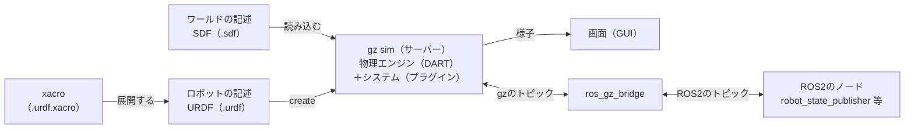

# 間章: Gazeboの物理シミュレーションの基本（フェーズ5の補足）

この章は、フェーズ5-4（[`docs/phase5_4_gazebo_plant.md`](phase5_4_gazebo_plant.md)）までを読み終えた人向けの、任意の章である。フェーズ5では、Gazeboに付属する2輪車のワールドを写し、車輪にトルクをかけて走らせた。車両の形や重さ、地面との摩擦は、付属のファイルに書かれたものをそのまま使い、中身にはほとんど触れなかった。けれども、自分のロボットをシミュレーションしたくなったら、ロボットの形・重さ・関節を自分で書き、地面や物との接触がどう計算されるかを知っておく必要がある。この章では、箱を落とす、坂で滑らせる、球を跳ねさせる、腕を振り下ろす、という小さな体験を通して、ワールドとロボットの書き方と、物理エンジンが何を計算しているかをひととおり見ていく。

- 想定環境: WSL2 + Ubuntu 24.04 + ROS2 Jazzy + Gazebo Harmonic（フェーズ5-0で導入したもの）
- 前提: フェーズ5-4（[`docs/phase5_4_gazebo_plant.md`](phase5_4_gazebo_plant.md)）。フェーズ6・7の本文は、この章に依存しない
- 所要目安: 1〜2コマ
- 言語: なし（XMLのファイルを書き、コマンドで動かす。PythonやC++のコードは書かない）

> **この章の位置づけ**: 小さな体験つきの読み物である。体験に使うファイルは、どれも数十行のXMLで、パッケージやビルドは要らない。練習のファイルは、ワークスペース（`~/ros2_ws`）とは別のフォルダ `~/gz_practice` に置く。サンプルは学習の手がかりとして最小限に書いたもので、公式チュートリアルの転載ではない（要素の名前と書き方は公式の文書と同等。出典は末尾に記載する）。ロボットの関節をROS2から動かす仕組み（ros2_control）とセンサの節は、今後書き足す予定である。

> **期待する結果の出どころ**: `gz sdf`・`xacro`・`check_urdf` の表示は、この章の作成時に実際に実行した表示。2〜3節の位置の数値（`gz model` の表示）は、作成時にGazeboを画面なしで起動し、一時停止したまま決めた刻みだけ進めて読んだ表示。4-4節の角度（`ros2 topic echo` の表示）とノードのログは、作成時に画面なしのGazeboで同じ手順を実行し、15秒進めた後に読んだ表示で、ログの時刻と `stamp` は実行ごとに異なる。Gazeboの画面での見え方は、その数値から筆者が想定したもの。

## 0. この章で得てほしいこと

1. Gazeboのワールドの記述（SDF）の入れ子（ワールド・モデル・リンク・関節）と、リンクが持つ3つの情報（慣性・衝突・見た目）を説明できる。
2. 物理エンジンが刻みごとに動きを計算していることと、刻み幅（`max_step_size`）と実時間の倍率（`real_time_factor`）の意味を説明できる。
3. 摩擦係数と反発係数を書き換えて、滑り方と跳ね方が変わることを、手計算の値と比べて確かめられる。
4. ロボットの記述（URDF）とSDFの違いを説明でき、xacroで書いた2関節のアームをGazeboに出して、関節の角度をROS2のトピックで読める。

完了条件: 2〜4節の体験で、Gazeboが計算した位置・角度が、手計算の値（落下・坂・反発・関節の制限）とどこまで合い、どこがなぜずれるかを説明できる。

## 1. 全体像


<details>
<summary>同じ図（mermaid版）</summary>



</details>

Gazeboでシミュレーションを動かす部品は、大きく4つある。

- **記述のファイル**: 何がどこにあるかを書いたファイル。ワールド全体はSDF（Simulation Description Format）で書く。ロボット1台は、SDFでも書けるが、ROS2の世界ではURDF（Unified Robot Description Format）で書くことが多い。URDFは、そのままでは長くなりやすいので、マクロで短く書けるxacroで書いて、URDFに展開する（4節）。
- **サーバー（`gz sim`）**: 記述を読み込み、物理エンジンで、決まった刻み幅ごとに、すべての物の位置と速度を計算し直す。物理エンジンの既定はDART（3-1節）。物理の計算そのもの、外からのコマンドの受け付け、状態の配信などは、システム（プラグイン）という部品が受け持ち、ワールドやモデルの記述に `<plugin>` で書いて足す。
- **画面（GUI）**: サーバーから届く状態を3Dで描き、再生・一時停止などの操作を受け付ける。`gz sim -s` で起動すると、画面を開かずにサーバーだけが動く。
- **ブリッジ（`ros_gz_bridge`）**: Gazeboのトピック（gz-transport）とROS2のトピックは別の仕組みなので、間で型を変換しながら中継する（フェーズ5-0の4-1節で使った `parameter_bridge`）。

フェーズ5の車両は、この全部を付属のワールドファイルとlaunchファイルで一度に起動していた。この章では、記述のファイルを自分で書き、1つずつ起動して、それぞれの役割を確かめる。

## 2. SDFでワールドとモデルを書く

### 2-1. 入れ子の構造

SDFのファイルは、次のように入れ子になったXMLである。単位は、長さがメートル、質量がキログラム、角度がラジアン、時間が秒（SI単位）。

| 要素 | 意味 | 主な中身 |
|---|---|---|
| `<world>` | ワールド全体 | 物理の設定（`<physics>`）、重力（`<gravity>`）、光（`<light>`）、システム（`<plugin>`）、モデル（`<model>`） |
| `<model>` | ひとまとまりの物（地面、箱、ロボット） | 置く位置（`<pose>`）、動かない物かどうか（`<static>`）、リンク、関節、システム |
| `<link>` | 形と質量を持つ1つの部品（剛体） | 慣性（`<inertial>`）、衝突の形（`<collision>`）、見た目（`<visual>`） |
| `<joint>` | リンクとリンクのつなぎ目（関節） | 親と子のリンク、回る軸（`<axis>`）、動ける範囲（`<limit>`）、減衰（`<dynamics>`） |

リンクの3つの中身は、役割がはっきり分かれている。

- **慣性（`<inertial>`）**: 質量（`<mass>`）と慣性モーメント（回転のしにくさ、`<inertia>`）。物理エンジンが、力から加速度を計算するのに使う。
- **衝突（`<collision>`）**: 物理エンジンが、ぶつかったかどうか（接触）を判定する形。摩擦や反発の係数も、ここの `<surface>` に書く（3節）。
- **見た目（`<visual>`）**: 画面に描く形と色。物理の計算には使われない。

衝突と見た目を分けて書くのは、計算を軽くするためである。見た目は細かな形（メッシュ）にしても、衝突は箱や円柱のような単純な形で近似する、という使い分けがよく行われる。この章のサンプルは、どちらも同じ単純な形にしている。

`<pose>` は `x y z ロール ピッチ ヨー` の6つの数で、位置（m）と向き（rad。x軸・y軸・z軸の周りの回転）を表す。何も指定しなければ、親（ワールドに直接置いたモデルなら、ワールド）から見た位置になる。

### 2-2. 体験: 箱と球を落とす

地面の上2 mの高さに、箱と球を1つずつ置き、落としてみる。まず練習のフォルダを作る。

```bash
mkdir -p ~/gz_practice

cd ~/gz_practice
```

ファイルを作る方法（`touch` と `nano`、またはVS Code）は、[サンプルコードを練習環境に置く方法](howto_place_code.md)と同じである。

ファイル: `gz_practice/drop.sdf`

<!-- file: gz_practice/drop.sdf -->
```xml
<?xml version="1.0" ?>
<!-- 地面の上に、箱と球を2 mの高さから落とすだけのワールド -->
<sdf version="1.11">
  <world name="drop">
    <physics name="1ms" type="ignored">
      <max_step_size>0.001</max_step_size>
      <real_time_factor>1.0</real_time_factor>
    </physics>
    <gravity>0 0 -9.8</gravity>

    <plugin filename="gz-sim-physics-system" name="gz::sim::systems::Physics"/>
    <plugin filename="gz-sim-user-commands-system" name="gz::sim::systems::UserCommands"/>
    <plugin filename="gz-sim-scene-broadcaster-system" name="gz::sim::systems::SceneBroadcaster"/>

    <light type="directional" name="sun">
      <cast_shadows>true</cast_shadows>
      <pose>0 0 10 0 0 0</pose>
      <diffuse>0.8 0.8 0.8 1</diffuse>
      <direction>-0.5 0.1 -0.9</direction>
    </light>

    <model name="ground">
      <static>true</static>
      <link name="link">
        <collision name="collision">
          <geometry><plane><normal>0 0 1</normal><size>20 20</size></plane></geometry>
        </collision>
        <visual name="visual">
          <geometry><plane><normal>0 0 1</normal><size>20 20</size></plane></geometry>
          <material><diffuse>0.7 0.7 0.7 1</diffuse></material>
        </visual>
      </link>
    </model>

    <model name="box">
      <pose>0 0 2 0 0 0</pose>
      <link name="link">
        <inertial>
          <mass>1.0</mass>
          <inertia>
            <ixx>0.00667</ixx><iyy>0.00667</iyy><izz>0.00667</izz>
            <ixy>0</ixy><ixz>0</ixz><iyz>0</iyz>
          </inertia>
        </inertial>
        <collision name="collision">
          <geometry><box><size>0.2 0.2 0.2</size></box></geometry>
        </collision>
        <visual name="visual">
          <geometry><box><size>0.2 0.2 0.2</size></box></geometry>
          <material><diffuse>0.2 0.4 0.9 1</diffuse></material>
        </visual>
      </link>
    </model>

    <model name="ball">
      <pose>1 0 2 0 0 0</pose>
      <link name="link">
        <inertial auto="true">
          <density>500</density>
        </inertial>
        <collision name="collision">
          <geometry><sphere><radius>0.1</radius></sphere></geometry>
        </collision>
        <visual name="visual">
          <geometry><sphere><radius>0.1</radius></sphere></geometry>
          <material><diffuse>0.9 0.3 0.2 1</diffuse></material>
        </visual>
      </link>
    </model>
  </world>
</sdf>
```

ファイルの中身を、上から順に読む。

- `<physics>`: 物理エンジンの設定。1刻みを0.001秒（1 ms）にし、現実の時間と同じ速さで進める（3-1節）。`type` は今のGazeboでは使われないので、`ignored` と書いておく。
- `<gravity>`: 重力加速度のベクトル（m/s²）。z軸の負の向き（下向き）に9.8。書かなければ、この値が既定である。
- `<plugin>` の3行: このワールドで動かすシステム。物理の計算（`Physics`）、モデルを出したり消したりするコマンドの受け付け（`UserCommands`）、画面への状態の配信（`SceneBroadcaster`）。`Physics` を書き忘れると、何も落ちない。
- `ground`: `<static>true</static>` の動かないモデル。無限に広い平面（`<plane>`）を衝突の形にし、見た目は20 m四方にする。
- `box`: 一辺0.2 m、質量1 kgの箱。慣性モーメントは、直方体の式 $I = m(a^2 + b^2)/12$ に $m = 1$、 $a = b = 0.2$ を入れた値（約0.00667 kg·m²）。
- `ball`: 半径0.1 mの球。質量と慣性モーメントを書く代わりに、`<inertial auto="true">` と密度（500 kg/m³。水の半分）を書き、衝突の形から自動で計算させている（2-3節）。

文法を確かめてから、Gazeboで開く。

```bash
gz sdf -k drop.sdf
```

**期待する結果**:

```text
Valid.
```

`Valid.` と出れば、SDFの文法として正しい。要素の名前の綴りや入れ子を間違えると、どこが違うかが表示される。

```bash
# T1
cd ~/gz_practice

gz sim drop.sdf
```

**期待する結果**:

Gazeboの画面が開き、灰色の地面の上に、青い箱と赤い球が浮いて見える。`gz sim` は一時停止した状態で始まるので、まだ落ちない。左下の▶を押すと、2つは同時に落ち始め、約0.6秒で地面に着いて止まる。止まったら、ウィンドウを閉じる（またはT1で `Ctrl+C`）。次の手順は落ちる前の状態から始めるので、もう一度 `gz sim drop.sdf` で開き直す。

画面の再生ボタンの代わりに、決めた刻みの数だけ進めることもできる。別のターミナルから、ワールドを操作するサービスに「300刻み（0.3秒）進めて、また止める」を送り、箱の位置を読む。

```bash
# T2
gz service -s /world/drop/control --reqtype gz.msgs.WorldControl --reptype gz.msgs.Boolean --timeout 5000 --req 'multi_step: 300, pause: true'

gz model -m box -p
```

**期待する結果**:

```text
$ gz service -s /world/drop/control --reqtype gz.msgs.WorldControl --reptype gz.msgs.Boolean --timeout 5000 --req 'multi_step: 300, pause: true'
data: true

$ gz model -m box -p

Requesting state for world [drop]...

Model: [8]
  - Name: box
  - Pose [ XYZ (m) ] [ RPY (rad) ]:
    [0.000000 0.000000 1.557530]
    [0.000000 -0.000000 0.000000]
```

`data: true` は、サービスが要求を受け付けたという応答。`Pose` の1行目が位置（x, y, z）、2行目が向き（ロール, ピッチ, ヨー）で、箱の中心の高さ $z$ が2 mから1.5575 mに下がった。`Model: [8]` の番号は、Gazeboの中でモデルに付けられた番号で、ファイルの書き方によって変わる。画面では、箱と球が少しだけ下がって止まって見える。

`multi_step` も、`<real_time_factor>` に従って現実の時間と同じ速さで進む。300刻みなら0.3秒かかるので、`gz model` は、画面の動きが止まってから実行する。同じように、さらに300刻み、400刻みと進めて読むと、高さは次のように変わる（球も、箱と同じ高さになる）。

| 進めた時間 | 箱の中心の高さ（Gazebo） | 自由落下の式 $z = 2 - \frac{1}{2} g t^2$ |
|---|---|---|
| 0秒 | 2.000000 m | 2.000 m |
| 0.3秒 | 1.557530 m | 1.559 m |
| 0.6秒 | 0.233060 m | 0.236 m |
| 1.0秒 | 0.095492 m | （地面に着いている） |

**読み方**: 

- 0.3秒・0.6秒の高さは、自由落下の式と、1〜3 mmの差で合う。差は、物理エンジンが連続した時間でなく、0.001秒の刻みで計算していることから来る。Gazeboの既定の物理エンジン（DART）は、刻みごとに、まず重力で速度を更新し、その新しい速度で位置を進める（半陰的オイラー法。考え方は[Tips集の9-5節](tips.md#9-5-力を先に更新する形が好まれる場面と精度を上げる方法)）。この計算で $n$ 刻み進めた高さは $z = 2 - g \Delta t^2 \frac{n(n+1)}{2}$ になり、 $n = 300$、 $\Delta t = 0.001$ を入れると1.557530 m、 $n = 600$ では0.233060 mと、表のGazeboの値と小数第6位まで一致する。
- 1.0秒の時点で、箱の中心は0.1 m（箱の半分の高さ）でなく0.0955 mにあり、地面に約4.5 mmめり込んでいる。物理エンジンは、接触した物どうしが少し重なることを許し、重なりを刻みごとに少しずつ押し戻す（作成時に3秒まで進めると、0.0962 mまで戻った）。重なりを一気に押し戻すと、跳ね飛ぶような大きな力が出てしまうためである。ロボットの足が地面に数ミリ沈んで見えるのも、同じ理由による。

### 2-3. 慣性を自動で計算させる

`ball` のように `<inertial auto="true">` と書くと、Gazeboは衝突の形と密度から、質量と慣性モーメントを計算する。計算した値は、`gz sdf -p` に `--expand-auto-inertials` を付けると表示できる（`-p` はファイルを読み込んで、解釈した結果のSDFを表示するオプション）。

```bash
gz sdf -p --expand-auto-inertials drop.sdf
```

**期待する結果**（`ball` の部分だけを抜粋）:

```text
    <model name='ball'>
      <pose>1 0 2 0 0 0</pose>
      <link name='link'>
        <inertial auto='true'>
          <density>500</density>
          <pose>0 0 0 0 0 0</pose>
          <mass>2.0943951023931957</mass>
          <inertia>
            <ixx>0.0083775804095727845</ixx>
            <ixy>0</ixy>
            <ixz>0</ixz>
            <iyy>0.0083775804095727845</iyy>
            <iyz>0</iyz>
            <izz>0.0083775804095727845</izz>
          </inertia>
        </inertial>
```

質量は、球の体積 $\frac{4}{3}\pi r^3$ に密度をかけた $500 \times \frac{4}{3}\pi \times 0.1^3 \approx 2.094$ kg、慣性モーメントは球の式 $\frac{2}{5} m r^2 \approx 0.00838$ kg·m² で、どちらも手計算と合う。

質量と慣性モーメントは、物理の計算の土台である。慣性モーメントを実際より小さく書くと、少しの力で激しく回転し、シミュレーションが不安定になる（よくある失敗）。単純な形なら自動の計算に任せるか、公式で計算した値を書く。メッシュの形の部品では、CADなどで求めた値を書く。

## 3. 物理でできること

### 3-1. 物理エンジンと刻み幅

`<physics>` の主な設定は、次のとおり（既定値は、`gz sdf -d` で表示されるSDFの仕様で確かめた）。

| 要素 | 既定値 | 意味 |
|---|---|---|
| `<max_step_size>` | 0.001 | 1刻みで進めるシミュレーションの時間（秒）。小さいほど正確だが、計算が増える |
| `<real_time_factor>` | 1 | 現実の時間に対する、シミュレーションの時間の進む速さの目標。1なら現実と同じ速さ |
| `<real_time_update_rate>` | 1000 | 現実の1秒あたりに計算する刻みの数の目標。0にすると、できる限り速く進める |

画面の右下には、実際に出ている速さ（RTF、Real Time Factor）が表示される。計算が重くて目標に追いつかないと、RTFは1より小さくなる（フェーズ5-0の2-1節）。フェーズ7-3では、学習を速く進めるため、起動の引数で刻みの数の目標を大きくして、現実より速く進めた。

物理エンジンは、`gz sim` の `--physics-engine` で選べる。ヘルプの表示（`gz sim --help`）のとおり、既定はDART（`gz-physics-dartsim-plugin`）で、Jazzyの導入では、ほかにBullet（`gz-physics-bullet-featherstone-plugin` 等）と、衝突の判定を簡単にして速くしたTPEが入っている。エンジンによって、使える機能（関節の種類、摩擦の扱い等）と結果が少しずつ違う。この章の数値は、すべてDARTのものである。

### 3-2. 体験: 摩擦の違う坂

20度の坂に、摩擦係数の違う2つの箱を置く。

ファイル: `gz_practice/slope.sdf`

<!-- file: gz_practice/slope.sdf -->
```xml
<?xml version="1.0" ?>
<!-- 20度の坂に、摩擦係数の違う2つの箱を置くワールド -->
<sdf version="1.11">
  <world name="slope">
    <plugin filename="gz-sim-physics-system" name="gz::sim::systems::Physics"/>
    <plugin filename="gz-sim-user-commands-system" name="gz::sim::systems::UserCommands"/>
    <plugin filename="gz-sim-scene-broadcaster-system" name="gz::sim::systems::SceneBroadcaster"/>

    <light type="directional" name="sun">
      <pose>0 0 10 0 0 0</pose>
      <diffuse>0.8 0.8 0.8 1</diffuse>
      <direction>-0.5 0.1 -0.9</direction>
    </light>

    <model name="ground">
      <static>true</static>
      <link name="link">
        <collision name="collision">
          <geometry><plane><normal>0 0 1</normal><size>20 20</size></plane></geometry>
        </collision>
        <visual name="visual">
          <geometry><plane><normal>0 0 1</normal><size>20 20</size></plane></geometry>
          <material><diffuse>0.7 0.7 0.7 1</diffuse></material>
        </visual>
      </link>
    </model>

    <!-- 坂: 長さ4 mの板を、y軸の周りに20度（0.349066 rad）傾けて固定する -->
    <model name="slope">
      <static>true</static>
      <pose>0 0 1 0 0.349066 0</pose>
      <link name="link">
        <collision name="collision">
          <geometry><box><size>4 2 0.1</size></box></geometry>
        </collision>
        <visual name="visual">
          <geometry><box><size>4 2 0.1</size></box></geometry>
          <material><diffuse>0.6 0.5 0.4 1</diffuse></material>
        </visual>
      </link>
    </model>

    <!-- 滑りやすい箱（摩擦係数0.2）。位置は坂の座標系で、板の上面に載せる -->
    <model name="box_slippery">
      <pose relative_to="slope">-1 -0.5 0.15 0 0 0</pose>
      <link name="link">
        <inertial>
          <mass>1.0</mass>
          <inertia>
            <ixx>0.00667</ixx><iyy>0.00667</iyy><izz>0.00667</izz>
            <ixy>0</ixy><ixz>0</ixz><iyz>0</iyz>
          </inertia>
        </inertial>
        <collision name="collision">
          <geometry><box><size>0.2 0.2 0.2</size></box></geometry>
          <surface>
            <friction><ode><mu>0.2</mu><mu2>0.2</mu2></ode></friction>
          </surface>
        </collision>
        <visual name="visual">
          <geometry><box><size>0.2 0.2 0.2</size></box></geometry>
          <material><diffuse>0.2 0.6 0.9 1</diffuse></material>
        </visual>
      </link>
    </model>

    <!-- 滑りにくい箱（摩擦係数0.8） -->
    <model name="box_grippy">
      <pose relative_to="slope">-1 0.5 0.15 0 0 0</pose>
      <link name="link">
        <inertial>
          <mass>1.0</mass>
          <inertia>
            <ixx>0.00667</ixx><iyy>0.00667</iyy><izz>0.00667</izz>
            <ixy>0</ixy><ixz>0</ixz><iyz>0</iyz>
          </inertia>
        </inertial>
        <collision name="collision">
          <geometry><box><size>0.2 0.2 0.2</size></box></geometry>
          <surface>
            <friction><ode><mu>0.8</mu><mu2>0.8</mu2></ode></friction>
          </surface>
        </collision>
        <visual name="visual">
          <geometry><box><size>0.2 0.2 0.2</size></box></geometry>
          <material><diffuse>0.9 0.6 0.2 1</diffuse></material>
        </visual>
      </link>
    </model>
  </world>
</sdf>
```

drop.sdfとの違いを読む。

- `<physics>` と `<gravity>` を書いていない。どちらも3-1節の表と2-2節の既定値（刻み0.001秒、重力9.8 m/s²）になる。
- 坂は、厚さ0.1 mの板を、`<pose>` のピッチ（y軸の周りの回転）で0.349066 rad（20度）傾けたもの。y軸の周りに正の向きに回すと、x軸の正の側が下がるので、x軸の正の向きが下り坂になる。
- 箱の `<pose relative_to="slope">` は、坂のモデルの座標系から見た位置である。坂の座標系では、板の上面が $z = 0.05$ にあるので、一辺0.2 mの箱の中心を $z = 0.15$ に置けば、ちょうど上面に載る。傾いた坂の上の座標を手で計算しなくて済み、坂の角度を変えても箱が一緒に付いてくる。
- 摩擦係数は、衝突の形の `<surface>` の `<friction>` に書く。`<ode>` は、Gazeboの昔の物理エンジン（ODE）の名残の名前だが、DARTでもこの値が使われる。`<mu>` と `<mu2>` は、接触面の中の直交する2つの向きの摩擦係数で、ふつうは同じ値にする。書かなければ、どちらも1である。

坂の上の箱が滑り出すかどうかは、斜面の角度 $\theta$ の正接 $\tan\theta$ と、摩擦係数 $\mu$ の比べっこで決まる。 $\tan 20^\circ \approx 0.364$ なので、 $\mu = 0.2$ の箱は滑り、 $\mu = 0.8$ の箱は止まったままのはずである。滑る箱の、斜面に沿った加速度は $a = g(\sin\theta - \mu\cos\theta) = 9.8 \times (0.342 - 0.2 \times 0.940) \approx 1.51$ m/s² で、1秒で $\frac{1}{2} a t^2 \approx 0.755$ m 滑る。

```bash
# T1
cd ~/gz_practice

gz sim slope.sdf
```

```bash
# T2
gz service -s /world/slope/control --reqtype gz.msgs.WorldControl --reptype gz.msgs.Boolean --timeout 5000 --req 'multi_step: 1000, pause: true'

gz model -m box_slippery -p

gz model -m box_grippy -p
```

**期待する結果**（T2の表示。進める前の位置は、どちらも x が−0.888390、z が1.482970）:

```text
$ gz service -s /world/slope/control --reqtype gz.msgs.WorldControl --reptype gz.msgs.Boolean --timeout 5000 --req 'multi_step: 1000, pause: true'
data: true

$ gz model -m box_slippery -p

Requesting state for world [slope]...

Model: [12]
  - Name: box_slippery
  - Pose [ XYZ (m) ] [ RPY (rad) ]:
    [-0.178212 -0.500000 1.224490]
    [-0.000000 0.349066 0.000000]

$ gz model -m box_grippy -p

Requesting state for world [slope]...

Model: [16]
  - Name: box_grippy
  - Pose [ XYZ (m) ] [ RPY (rad) ]:
    [-0.888390 0.500000 1.482970]
    [-0.000000 0.349066 -0.000000]
```

**読み方**: 画面では、1秒の間に、青い箱だけが坂を滑り下り、橙の箱はそのまま止まっている。青い箱の x は−0.888390から−0.178212へ0.710178 m進んだ。斜面に沿った距離に直すと $0.710178 / \cos 20^\circ \approx 0.756$ m で、手計算の0.755 mと合う。ピッチは0.349066 radのままなので、転がらずに、坂と平行なまま滑っている。この後も進めると、青い箱は坂の下の端から地面に落ちる。モデルの番号（`[12]`・`[16]`）は、ファイルの書き方によって変わる。

**2つの面の摩擦係数の組み合わせ方**: 接触では、坂の面と箱の面の2つの摩擦係数がある。この坂は摩擦係数を書いていないので1で、箱の0.2と組み合わせた結果が0.2になった。DARTでは、2つのうち**小さいほう**が使われる（作成時に、坂の摩擦係数を0.5にして確かめた。2つの積が使われるなら0.1になり、滑る距離が変わるはずだが、結果は同じだった）。物理エンジンによって組み合わせ方が違うので、別のエンジンを使うときは、同じように確かめる。

### 3-3. 体験: 反発

反発係数の違う2つの球を、跳ね返す地面に落とす。

ファイル: `gz_practice/bounce.sdf`

<!-- file: gz_practice/bounce.sdf -->
```xml
<?xml version="1.0" ?>
<!-- 反発係数の違う2つの球を、跳ね返す地面に落とすワールド -->
<sdf version="1.11">
  <world name="bounce">
    <plugin filename="gz-sim-physics-system" name="gz::sim::systems::Physics"/>
    <plugin filename="gz-sim-user-commands-system" name="gz::sim::systems::UserCommands"/>
    <plugin filename="gz-sim-scene-broadcaster-system" name="gz::sim::systems::SceneBroadcaster"/>

    <light type="directional" name="sun">
      <pose>0 0 10 0 0 0</pose>
      <diffuse>0.8 0.8 0.8 1</diffuse>
      <direction>-0.5 0.1 -0.9</direction>
    </light>

    <!-- 地面の反発係数を1にする（球の値との積が使われる） -->
    <model name="ground">
      <static>true</static>
      <link name="link">
        <collision name="collision">
          <geometry><plane><normal>0 0 1</normal><size>20 20</size></plane></geometry>
          <surface>
            <bounce><restitution_coefficient>1.0</restitution_coefficient></bounce>
          </surface>
        </collision>
        <visual name="visual">
          <geometry><plane><normal>0 0 1</normal><size>20 20</size></plane></geometry>
          <material><diffuse>0.7 0.7 0.7 1</diffuse></material>
        </visual>
      </link>
    </model>

    <!-- よく跳ねる球（反発係数0.8） -->
    <model name="ball_bouncy">
      <pose>0 0 2 0 0 0</pose>
      <link name="link">
        <inertial auto="true"><density>500</density></inertial>
        <collision name="collision">
          <geometry><sphere><radius>0.1</radius></sphere></geometry>
          <surface>
            <bounce><restitution_coefficient>0.8</restitution_coefficient></bounce>
          </surface>
        </collision>
        <visual name="visual">
          <geometry><sphere><radius>0.1</radius></sphere></geometry>
          <material><diffuse>0.9 0.3 0.2 1</diffuse></material>
        </visual>
      </link>
    </model>

    <!-- あまり跳ねない球（反発係数0.3） -->
    <model name="ball_dull">
      <pose>1 0 2 0 0 0</pose>
      <link name="link">
        <inertial auto="true"><density>500</density></inertial>
        <collision name="collision">
          <geometry><sphere><radius>0.1</radius></sphere></geometry>
          <surface>
            <bounce><restitution_coefficient>0.3</restitution_coefficient></bounce>
          </surface>
        </collision>
        <visual name="visual">
          <geometry><sphere><radius>0.1</radius></sphere></geometry>
          <material><diffuse>0.3 0.3 0.8 1</diffuse></material>
        </visual>
      </link>
    </model>
  </world>
</sdf>
```

反発係数 $e$（`<restitution_coefficient>`、0〜1）は、ぶつかった直後の速さが、ぶつかる直前の何倍になるかを表す。既定は0（まったく跳ねない）。跳ね上がる高さは速さの2乗に比例するので、落ちた高さの $e^2$ 倍になる。球の底は1.9 mの高さから落ちるので、 $e = 0.8$ なら $0.64 \times 1.9 \approx 1.22$ m、 $e = 0.3$ なら $0.09 \times 1.9 \approx 0.17$ m まで跳ね上がるはずである。

```bash
# T1
cd ~/gz_practice

gz sim bounce.sdf
```

```bash
# T2
gz service -s /world/bounce/control --reqtype gz.msgs.WorldControl --reptype gz.msgs.Boolean --timeout 5000 --req 'multi_step: 1100, pause: true'

gz model -m ball_bouncy -p
```

**期待する結果**:

```text
$ gz service -s /world/bounce/control --reqtype gz.msgs.WorldControl --reptype gz.msgs.Boolean --timeout 5000 --req 'multi_step: 1100, pause: true'
data: true

$ gz model -m ball_bouncy -p

Requesting state for world [bounce]...

Model: [8]
  - Name: ball_bouncy
  - Pose [ XYZ (m) ] [ RPY (rad) ]:
    [0.000000 0.000000 1.316000]
    [0.000000 -0.000000 0.000000]
```

**読み方**: 画面では、2つの球が同時に落ち、約0.6秒で地面に当たる。赤い球は高く跳ね上がり、青い球は少しだけ跳ねてすぐに落ち着く。1.1秒の時点（跳ね返りの頂点の近く）で、赤い球の中心は1.316 m、底は半径0.1 mを引いた1.216 mで、手計算の1.22 mと合う。作成時に0.1秒ごとに読んだところ、青い球の中心は0.8秒の時点で最も高い0.267 m（底は0.167 m）で、手計算の0.17 mと合った。赤い球はこの後も跳ね続け、2回目は底が $0.64 \times 1.216 \approx 0.78$ m の高さまで（作成時の値では、2.0〜2.1秒に中心が約0.88 m）と、跳ねるたびに低くなる。

**2つの面の反発係数の組み合わせ方**: DARTでは、2つの面の反発係数の**積**が使われる。そのため、このワールドでは地面の反発係数を1にしている。作成時に、地面の反発係数を書かずに（既定の0で）同じ球を落としたところ、 $0.8 \times 0 = 0$ で、まったく跳ねなかった。摩擦（3-2節。小さいほう）と組み合わせ方が違うので、跳ねさせたいのに跳ねないときは、相手の面の値を確かめる。

### 3-4. そのほかにできること

物理のふるまいは、ここまでの要素のほかにも、関節の設定と、システム（プラグイン）で足せる。Gazeboに付属する例のワールド（`/opt/ros/jazzy/opt/gz_sim_vendor/share/gz/gz-sim8/worlds/`）に、それぞれの書き方の手本がある。

| できること | 書く場所 | 例のワールド |
|---|---|---|
| 関節の動ける範囲・力と速さの上限 | 関節の `<axis>` の `<limit>` | この章の4-3節 |
| 関節の減衰（速さに比例する抵抗）・摩擦・ばね | 関節の `<axis>` の `<dynamics>`（4節で使う。フェーズ7-3でも使う） | `joint_position_controller.sdf` |
| 関節に力（トルク）をかける | システム `ApplyJointForce`（フェーズ5-4で使った） | `apply_joint_force.sdf` |
| リンクに力をかける | システム `ApplyLinkWrench` | `apply_link_wrench.sdf` |
| 水の浮力 | システム `Buoyancy` | `buoyancy.sdf` |
| 翼の揚力と抗力 | システム `LiftDrag` | `lift_drag.sdf` |
| 風 | ワールドの `<wind>` とシステム `WindEffects` | `wind.sdf` |
| 接触の検出（何と何が触れたか） | 接触センサとシステム `Contact` | `contact_sensor.sdf` |

例のワールドは、`gz sim apply_link_wrench.sdf` のように、ファイル名だけで開ける（Gazeboが付属のフォルダから探す）。中身を読むときは、上のフォルダのファイルを開く。作成時には、この表の例のワールドが付属のフォルダにあることまでを確かめた（表の機能は、関節の制限・減衰と `ApplyJointForce` のほかは、この教材では動かしていない）。

## 4. URDFとxacroでロボットを書く

### 4-1. URDFとSDFの違い

ROS2の世界では、ロボットの形と関節を、SDFでなくURDFで書くことが多い。URDFは、ROS（ROS1）の時代からの、ロボット1台を記述するXMLの書き方である。

| | SDF | URDF |
|---|---|---|
| 記述できる範囲 | ワールド全体（光・物理の設定・複数のモデル） | ロボット1台だけ |
| リンクのつながり | 自由（輪になったつながりも書ける） | 木の形だけ（親は1つ） |
| 使う道具 | Gazebo | ROS2の道具（`robot_state_publisher`、RViz、MoveIt、ros2_control）と、Gazebo（読み込むときにSDFに変換する） |
| Gazebo特有の設定（システム・摩擦など） | そのまま書ける | `<gazebo>` の中に書く（変換のときにSDFに写される） |

URDFは、ROS2の道具の多くが読める共通の形式なので、ロボットの記述は1つのURDFに書き、Gazeboにも、ROS2のノードにも同じものを渡す、という使い方が一般的である。要素の名前は、SDFとよく似ている（`<link>`・`<joint>`・`<inertial>`・`<collision>`・`<visual>`）。違いは、位置を `<pose>` でなく `<origin xyz="..." rpy="..."/>` の属性で書くこと、関節の位置が子のリンクの座標系の原点になること、などである。

### 4-2. xacroで短く書く

URDFには、変数や繰り返しの仕組みが無い。同じ形の腕を2本書くと、ほぼ同じ数十行が2回並び、長さを変えるときに、何か所も直すことになる。xacro（XML Macros）は、URDFに次の仕組みを足した書き方で、`xacro` コマンドで普通のURDFに展開してから使う。

- `<xacro:property name="arm_len" value="0.5"/>`: 名前を付けた値（変数）。`${arm_len}` で使う。
- `${arm_mass*arm_r*arm_r/2}`: 式。値を計算して埋め込む（`pi` も使える）。
- `<xacro:macro name="arm_link" params="name">`: マクロ（部品のひな形）。`<xacro:arm_link name="link1"/>` と書くと、中身が展開される。

### 4-3. 体験: 2関節のアームを書く

台（高さ1 mの柱）の上に、長さ0.5 mの腕を2本つないだアームを書く。腕は、x軸の向きに水平に伸びた姿勢で現れ、重力で振り下ろされる。

ファイル: `gz_practice/arm.urdf.xacro`

<!-- file: gz_practice/arm.urdf.xacro -->
```xml
<?xml version="1.0"?>
<!-- 台に取り付けた2関節のアーム。腕は水平に伸びた姿勢で現れ、重力で振り下ろされる -->
<robot name="arm" xmlns:xacro="http://www.ros.org/wiki/xacro">

  <xacro:property name="arm_len" value="0.5"/>
  <xacro:property name="arm_r" value="0.03"/>
  <xacro:property name="arm_mass" value="1.0"/>

  <!-- x軸の向きに伸びる円柱の腕（質量・慣性・衝突・見た目をまとめて書く） -->
  <xacro:macro name="arm_link" params="name">
    <link name="${name}">
      <inertial>
        <origin xyz="${arm_len/2} 0 0"/>
        <mass value="${arm_mass}"/>
        <inertia ixx="${arm_mass*arm_r*arm_r/2}" ixy="0" ixz="0"
                 iyy="${arm_mass*(3*arm_r*arm_r + arm_len*arm_len)/12}" iyz="0"
                 izz="${arm_mass*(3*arm_r*arm_r + arm_len*arm_len)/12}"/>
      </inertial>
      <collision>
        <origin xyz="${arm_len/2} 0 0" rpy="0 ${pi/2} 0"/>
        <geometry><cylinder radius="${arm_r}" length="${arm_len}"/></geometry>
      </collision>
      <visual>
        <origin xyz="${arm_len/2} 0 0" rpy="0 ${pi/2} 0"/>
        <geometry><cylinder radius="${arm_r}" length="${arm_len}"/></geometry>
      </visual>
    </link>
  </xacro:macro>

  <link name="world"/>

  <link name="base">
    <inertial>
      <origin xyz="0 0 0.5"/>
      <mass value="5.0"/>
      <inertia ixx="${5.0*(0.1*0.1 + 1.0*1.0)/12}" ixy="0" ixz="0"
               iyy="${5.0*(0.1*0.1 + 1.0*1.0)/12}" iyz="0"
               izz="${5.0*(0.1*0.1 + 0.1*0.1)/12}"/>
    </inertial>
    <collision>
      <origin xyz="0 0 0.5"/>
      <geometry><box size="0.1 0.1 1.0"/></geometry>
    </collision>
    <visual>
      <origin xyz="0 0 0.5"/>
      <geometry><box size="0.1 0.1 1.0"/></geometry>
    </visual>
  </link>

  <joint name="fix_base" type="fixed">
    <parent link="world"/>
    <child link="base"/>
  </joint>

  <xacro:arm_link name="link1"/>
  <xacro:arm_link name="link2"/>

  <joint name="joint1" type="revolute">
    <parent link="base"/>
    <child link="link1"/>
    <origin xyz="0 0.1 1.0"/>
    <axis xyz="0 1 0"/>
    <limit lower="-1.0" upper="1.0" effort="100" velocity="10"/>
    <dynamics damping="0.5"/>
  </joint>

  <joint name="joint2" type="revolute">
    <parent link="link1"/>
    <child link="link2"/>
    <origin xyz="${arm_len} 0.07 0"/>
    <axis xyz="0 1 0"/>
    <limit lower="-2.5" upper="2.5" effort="100" velocity="10"/>
    <dynamics damping="0.5"/>
  </joint>

  <!-- Gazeboで関節の角度を送るシステム（ROS2へはブリッジで中継する） -->
  <gazebo>
    <plugin filename="gz-sim-joint-state-publisher-system"
            name="gz::sim::systems::JointStatePublisher"/>
  </gazebo>
</robot>
```

ファイルの中身を読む。

- **腕のマクロ `arm_link`**: 質量1 kg、半径0.03 m、長さ0.5 mの円柱を、リンクの原点からx軸の向きに伸ばす。円柱は、そのままではz軸の向きに伸びるので、`rpy="0 ${pi/2} 0"`（y軸の周りに90度）で横に倒し、中心を `${arm_len/2}`（0.25 m）だけずらす。慣性モーメントは円柱の式で、軸の周りが $m r^2 / 2$、軸に直交する向きが $m(3r^2 + L^2)/12$ である。このマクロを `link1`・`link2` の2回使う。
- **`world` と `fix_base`**: `world` という名前の、中身の無いリンクに、固定の関節（`type="fixed"`）で台をつなぐと、台はワールドに固定される（Gazeboに読み込むとき、`world` は特別な名前として、ワールドそのものを指す）。これが無いと、台ごと倒れる。
- **関節 `joint1`・`joint2`**: `type="revolute"` は、動ける範囲のある回転の関節。`<origin>` が関節の位置（親のリンクの座標系で）で、子のリンクの原点もここになる。`joint1` は柱の上端、`joint2` は `link1` の先端（x = 0.5 m）にある。y の値（0.1・0.07）は、腕どうしと柱が見た目で重ならないように、横にずらしたもの。回る軸はどちらもy軸（`<axis xyz="0 1 0"/>`）で、角度が正の向きに増えると、腕の先が下がる。
- **`<limit>`**: `joint1` は−1.0〜1.0 rad（約±57度）しか回らない。`effort` と `velocity` は、関節に出せる力と速さの上限（URDFの回転の関節では、書くことが必須）。
- **`<dynamics damping="0.5">`**: 関節の減衰。角速度に比例する抵抗のトルク（N·m·s/rad）で、これが無いと、腕はいつまでも揺れ続ける。
- **`<gazebo>`**: Gazeboにだけ伝えたい設定。ここでは、関節の角度をGazeboのトピックに送るシステム `JointStatePublisher` を足す。`reference` 属性を付けずに書くと、モデル全体に付く。

腕が水平な姿勢（角度0）から放すと、`joint1` は重力で正の向きに回り、上限の1.0 radで止まるはずである。`link2` は、`joint1` が止まった後も回り続け、真下に垂れて落ち着くはずである。`link1` が水平から1.0 rad下がっているので、`link2` が真下（水平から $\pi/2 \approx 1.571$ rad）を向くときの `joint2` の角度は、 $\pi/2 - 1.0 \approx 0.571$ rad になる。

xacroをURDFに展開し、URDFとして正しいかを `check_urdf` で確かめる。`xacro` と `check_urdf` は、それぞれ `ros-jazzy-xacro`・`ros-jazzy-urdfdom` のパッケージに含まれ、フェーズ5-0の1-2節のGazeboの導入で、依存するパッケージとして一緒に入る（作成時の環境で確かめた。見つからない場合は、`sudo apt install` でこの2つを入れる）。

```bash
cd ~/gz_practice

xacro arm.urdf.xacro > arm.urdf

check_urdf arm.urdf
```

**期待する結果**（`check_urdf` の分）:

```text
robot name is: arm
---------- Successfully Parsed XML ---------------
root Link: world has 1 child(ren)
    child(1):  base
        child(1):  link1
            child(1):  link2
```

`Successfully Parsed XML` と、リンクの木の形（`world` の子が `base`、その子が `link1`、その子が `link2`）が出れば、URDFとして正しい。`arm.urdf` を開くと、`${...}` の式が計算された値（例: `link1` の `iyy` は0.02105833333333333）に置き換わり、マクロが2本の腕に展開されているのが分かる。

Gazeboが読み込むときのSDFへの変換は、`gz sdf -p` で見られる。

```bash
gz sdf -p arm.urdf
```

**期待する結果**（`joint1` の部分だけを抜粋）:

```text
    <joint name='joint1' type='revolute'>
      <pose relative_to='base'>0 0.10000000000000001 1 0 0 0</pose>
      <parent>base</parent>
      <child>link1</child>
      <axis>
        <xyz>0 1 0</xyz>
        <limit>
          <lower>-1</lower>
          <upper>1</upper>
          <effort>100</effort>
          <velocity>10</velocity>
        </limit>
        <dynamics>
          <damping>0.5</damping>
          <friction>0</friction>
          <spring_reference>0</spring_reference>
          <spring_stiffness>0</spring_stiffness>
        </dynamics>
      </axis>
    </joint>
```

URDFの `<origin>` が、SDFの `<pose relative_to='base'>` に変わっている。ほかに、`fix_base` は親を `world` とする固定の関節になり、`<gazebo>` の中の `<plugin>` は、モデルの直下に写されている（この抜粋の外）。

### 4-4. 体験: Gazeboに出して、関節の角度をROS2で読む

アームを、Gazeboの空のワールドに出し、関節の角度をROS2のトピックで読む。4つのターミナルを使う。

```bash
# T1
gz sim -r empty.sdf
```

`empty.sdf` は、Gazeboに付属する、地面と光だけのワールド（ワールド名は `empty`）。`-r` を付けると、一時停止せずに、すぐに時間が進み始める。

```bash
# T2
cd ~/gz_practice

ros2 run robot_state_publisher robot_state_publisher --ros-args -p robot_description:="$(xacro arm.urdf.xacro)"
```

`robot_state_publisher` は、パラメータ `robot_description` で受け取ったURDFを、同じ名前のトピック `/robot_description`（型は [`std_msgs/msg/String`](https://github.com/ros2/common_interfaces/blob/jazzy/std_msgs/msg/String.msg)）に送っておくノードである。このトピックは、後から購読したノードにも最後の値が届く設定（QoSの `transient_local`）で送られるので、T4の `create` を後から起動しても受け取れる。本来の役目は、関節の角度（`/joint_states`）を受け取って、各リンクの位置関係（TF）を計算して配ることで、RVizでロボットを表示するときなどに使う。`$(xacro arm.urdf.xacro)` は、xacroを展開した結果の文字列を、その場でパラメータに渡すシェルの書き方である。

```bash
# T3
ros2 run ros_gz_bridge parameter_bridge /world/empty/model/arm/joint_state@sensor_msgs/msg/JointState[gz.msgs.Model --ros-args -r /world/empty/model/arm/joint_state:=/joint_states
```

`JointStatePublisher` が送るGazeboのトピック `/world/<ワールド名>/model/<モデル名>/joint_state` を、ROS2の [`sensor_msgs/msg/JointState`](https://github.com/ros2/common_interfaces/blob/jazzy/sensor_msgs/msg/JointState.msg) に変換して中継する。`[` は、GazeboからROS2への一方向の中継を表す（フェーズ5-0の4-1節）。`-r` で、ROS2の側のトピック名を、ROSの慣習の名前 `/joint_states` に付け替えている。

```bash
# T4
ros2 run ros_gz_sim create -topic robot_description -name arm
```

**期待する結果**（T2〜T4の表示。先頭の数字は時刻で、実行ごとに異なる）:

```text
# T2（robot_state_publisher）
[INFO] [1791773676.514197905] [robot_state_publisher]: Robot initialized
# T3（parameter_bridge）
[INFO] [1791773676.505908554] [ros_gz_bridge]: Creating GZ->ROS Bridge: [/world/empty/model/arm/joint_state (gz.msgs.Model) -> /world/empty/model/arm/joint_state (sensor_msgs/msg/JointState)] (Lazy 0)
# T4（create）
[INFO] [1791773679.361088633] [ros_gz_sim]: Requesting list of world names.
[INFO] [1791773679.565705610] [ros_gz_sim]: Waiting messages on topic [robot_description].
[INFO] [1791773680.242149835] [ros_gz_sim]: Entity creation successful.
```

T1では、地面だけのGazeboの画面が開き、時間が進んでいる。T2とT3は、起動したときの1行だけを表示し、その後は何も出さずに動き続ける。T3の行に出るROS2の側のトピック名は、付け替える前の名前のままだが、実際には `/joint_states` に送られている。

`create` は、トピック `/robot_description` からURDFを受け取り、動いているワールドにモデル `arm` として出して、終わる。`Entity creation successful.` が出れば成功である。T1の画面では、柱の上に水平な腕が現れ、すぐに振り下ろされる。`link1` は斜め下（約57度）で止まり、`link2` は振り子のように何度か揺れて、真下に垂れて落ち着く。

腕が落ち着いたら（10秒ほど待つ）、関節の角度を読む。

```bash
# T4
ros2 topic echo /joint_states --once
```

**期待する結果**（`stamp` はシミュレーションの時刻で、読んだ時刻によって変わる）:

```text
header:
  stamp:
    sec: 15
    nanosec: 0
  frame_id: ''
name:
- fix_base
- joint1
- joint2
position:
- 0.0
- 1.0000000000000195
- 0.5797281298591915
velocity:
- 0.0
- -1.0198786259962844e-13
- -6.5156213757688874e-15
effort:
- 0.0
- 0.0
- 0.0
---
```

**読み方**:

- `name` と `position` は、同じ順番で対応している。固定の関節 `fix_base` も並ぶが、角度は常に0である。
- `joint1` は1.0 radで、`<limit>` の上限で止まっている。
- `joint2` は約0.580 radで、手計算の0.571 radより、約0.009 rad（約0.5度）大きい。`velocity` がほぼ0なので、揺れている途中ではなく、この角度で止まっている。このずれは、刻みごとの計算から来るものである。作成時に、関節の減衰を4倍（2.0）にすると、ずれも約4倍（0.034 rad）になり、刻み幅を半分（0.0005秒）にすると、ずれも半分（0.0045 rad）になった。連続の時間の物理では、減衰は動いているときだけ効くので、止まった位置を変えないはずである。`joint1` を上限に押し付けたまま、刻みごとに計算するうちに、減衰の力が、わずかに残る形になっていると考えられる（DARTの内部の計算までは確かめていない）。シミュレーションの結果は、刻み幅や物理エンジンの設定で少し変わるので、実機と比べるときは、どのくらいずれうるかを、刻み幅を変えて確かめておく。

止めるときは、T3・T2・T1の順に `Ctrl+C` で止める（T4の `create` と `ros2 topic echo --once` は、自分で終わる）。

## 5. この章のまとめ

- Gazeboのワールドは、SDFで、ワールド → モデル → リンク・関節の入れ子に書く。リンクは、慣性（質量と慣性モーメント）・衝突の形・見た目の3つを持ち、物理の計算に使うのは慣性と衝突の形である。
- 物理エンジン（既定はDART）は、刻み幅（既定0.001秒）ごとに、まず速度を、次に位置を更新する。落下の位置は、この計算の式と小数第6位まで一致した。接触では、物どうしが数ミリ重なることを許し、少しずつ押し戻す。
- 摩擦係数と反発係数は、衝突の形の `<surface>` に書く。DARTでは、2つの面の摩擦係数は小さいほう、反発係数は積が使われる。坂で滑る距離と、跳ね上がる高さは、手計算と合った。
- ロボット1台は、ROS2の道具と共通のURDFで書き、xacroで短く書いて展開する。Gazeboは、読み込むときにSDFに変換する。Gazebo特有の設定は `<gazebo>` に書く。
- `create` でURDFをワールドに出し、`JointStatePublisher` とブリッジで、関節の角度をROS2の `/joint_states` として読めた。関節の制限は正確に効き、止まった角度には、刻み幅に比例する小さなずれがあった。

## 6. つまずきやすい点

| 症状 | 確認すること |
|---|---|
| `gz sdf -k` がエラーを出す | 要素の綴りと入れ子。`<collision>` の中に `<geometry>` があるか。数の並び（`<pose>` は6つ、`<size>` は箱なら3つ）が合っているか |
| ▶を押しても何も落ちない | ワールドに `gz-sim-physics-system` の `<plugin>` があるか（2-2節）。モデルに `<static>true</static>` を付けていないか |
| `gz service` が `Service call timed out` になる | ワールド名（`/world/<名前>/control` の `<名前>`）が、SDFの `<world name="...">` と同じか。T1でGazeboが開いているか |
| `gz model` で読んだ位置が、表の値より手前の位置になる | `multi_step` は現実の時間の速さで進むので、進み終わる前に読んでいる。画面の動きが止まってから読む |
| 跳ねるはずの球が跳ねない | 相手（地面）の反発係数が0のままでないか。DARTでは2つの積が使われる（3-3節） |
| `create` が `Waiting messages on topic [robot_description]` で止まる | T2の `robot_state_publisher` が動いているか。T2のxacroの展開でエラーが出ていないか |
| アームが台ごと倒れる | URDFに `world` のリンクと、台へつなぐ固定の関節があるか（4-3節） |
| `/joint_states` に何も届かない | URDFの `<gazebo>` に `JointStatePublisher` があるか。T3のトピック名のワールド名（`empty`）とモデル名（`arm`。`create` の `-name`）が合っているか |

## 7. 次へ

この章は任意の補足なので、本筋はフェーズ6-1（[`docs/phase6_1_record.md`](phase6_1_record.md)）へ進む。フェーズ7-3（[`docs/phase7_3_gazebo_env.md`](phase7_3_gazebo_env.md)）では、フェーズ5-4の車両の車輪の関節に、この章の4-3節と同じ考え方の減衰（SDFでは、関節の `<axis>` の `<dynamics>` の中の `<damping>` の要素）を足して使う。

## 8. 公式ドキュメント・参考資料

確認状況（2026-10-12）: Gazeboの「SDF worlds」「Building your own robot」「Spawn URDF」「Spawn a Gazebo model from ROS 2」のページは、この章の作成時に本文を確認した。要素の既定値は、導入したSDFormat（14.9.0）の仕様の表示（`gz sdf -d`）で、`create` のオプションは `ros2 run ros_gz_sim create --help` で確認した。URDFとxacroのROS 2のチュートリアルは、原稿（`ros2/ros2_documentation` のjazzyブランチ）が実在することを確かめた。摩擦と反発の係数の組み合わせ方と、4-4節の角度のずれは、作成時の実験で確かめたもので、DARTのソースは読んでいない。

### 公式

- [SDF worlds — Gazebo Harmonic](https://gazebosim.org/docs/harmonic/sdf_worlds/)（ワールドのファイルの書き方。物理の設定・システム・光・モデルの読み込み）
- [Building your own robot — Gazebo Harmonic](https://gazebosim.org/docs/harmonic/building_robot/)（SDFでモデル・リンク・慣性・衝突と見た目・関節を書くチュートリアル）
- [Spawn URDF — Gazebo Harmonic](https://gazebosim.org/docs/harmonic/spawn_urdf/)（URDFをSDFに変換してワールドに出す仕組み。Gazeboのサービスで出す方法）
- [Spawn a Gazebo model from ROS 2 — Gazebo Harmonic](https://gazebosim.org/docs/harmonic/ros2_spawn_model/)（ROS 2からモデルを出す方法。Jazzyのlaunchファイル `gz_spawn_model.launch.py` も紹介している）
- [SDFormat Specification](https://sdformat.org/spec)（SDFの要素の一覧と既定値）
- [gz::sim::systems::Physics — Gazebo Sim 8 APIリファレンス](https://gazebosim.org/api/sim/8/classgz_1_1sim_1_1systems_1_1Physics.html)（物理のシステム）
- [gz::sim::systems::JointStatePublisher — Gazebo Sim 8 APIリファレンス](https://gazebosim.org/api/sim/8/classgz_1_1sim_1_1systems_1_1JointStatePublisher.html)（関節の状態を送るシステム。トピック名の決まり）
- [Building a visual robot model from scratch — ROS 2 Documentation: Jazzy](https://docs.ros.org/en/jazzy/Tutorials/Intermediate/URDF/Building-a-Visual-Robot-Model-with-URDF-from-Scratch.html)（URDFの書き方のチュートリアル）
- [Using Xacro to clean up your code — ROS 2 Documentation: Jazzy](https://docs.ros.org/en/jazzy/Tutorials/Intermediate/URDF/Using-Xacro-to-Clean-Up-a-URDF-File.html)（xacroのプロパティ・式・マクロ）
- [ros/xacro（GitHub）](https://github.com/ros/xacro)（xacroのソースと説明）

> 出典: ワールドとロボットのファイルは、上記の公式の文書とSDFの仕様の要素の名前と書き方にならって独自に書いたもので、転載ではない。`gz sdf`・`xacro`・`check_urdf`・ノードのログの表示は、導入したツールの出力を載せたもの（SDFormat・Gazebo Sim・ros_gz はApache License 2.0、xacro・urdfdom・robot_state_publisher はBSD License）。文章は独自に書いたもの。
