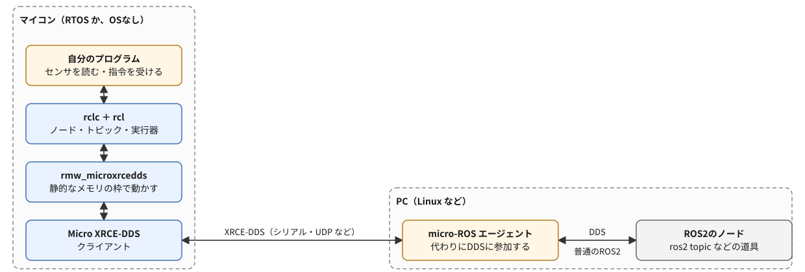

# 間章: micro-ROSでマイコンをROS2につなぐ（入門・読み物）

この章は、フェーズ5-4（[`docs/phase5_4_gazebo_plant.md`](phase5_4_gazebo_plant.md)）までを読み終えた人向けの、任意の読み物である。ここまでの教材では、ノードはすべてPCの上で動き、車両もGazeboの中のものだった。実際のロボットでは、モーターを回す、センサの値を読む、といった体に近い仕事を、小さなマイコン（マイクロコントローラ）が受け持つことが多い。マイコンには、PCのようなOSも、何ギガバイトものメモリも無い。それでも、マイコンの上のプログラムを、PCのノードと同じようにトピックでやり取りできる「ROS2のノード」にできれば、`ros2 topic echo` でセンサの値を見たり、PCのノードから指令を送ったりする、これまでと同じ作り方がそのまま使える。それを実現するのがmicro-ROSである。この章では、特定のマイコンに限らず、micro-ROSの仕組みと、プログラムの書き方、開発の道具の選び方、小さなマイコンで気をつけることを、読み物として見ていく。

- 想定環境: なし（この章では、コマンドを実行せず、パッケージも導入しない）。micro-ROSを実際に使うときは、ROS2 Jazzyの入ったPCと、micro-ROSに対応したマイコンのボードが要る（3節・4節）
- 前提: フェーズ5-4（[`docs/phase5_4_gazebo_plant.md`](phase5_4_gazebo_plant.md)）。内容としては、トピック・QoS・タイマー・実行器（executor）の考え方（フェーズ3-1・3-2b、フェーズ4まで）が分かれば読める。フェーズ6・7の本文は、この章に依存しない
- 所要目安: 0.5〜1コマ
- 言語: C（5節の骨組みのコードを読む。書いて動かす実習は無い）

> **この章の位置づけ**: 実習の無い読み物で、マイコンの種類を限定しない。説明は、micro-ROSの公式サイトの文書と、各リポジトリの説明（出典は末尾に記載する）から、要点を自分の言葉でまとめ直したものである。公式サイトの文書は、改変を認めないライセンス（CC BY-ND 4.0）なので、文章もコードも転載・翻訳せず、リンクだけにしている。5節のコードは、公式の例を写したものではなく、`rclc`（Apache License 2.0）の関数を使って独自に書いた骨組みである。

> **確かめた範囲**: この章には、実行する手順と期待する結果は無い。5節のコードは、作成時に、`ros2/rclc` のjazzyブランチのヘッダーと、ROS2 Jazzyのヘッダーを使って、コンパイラの文法の点検（`gcc -std=c99 -Wall -Wextra -fsyntax-only`。実行もリンクもしない）を警告なしで通した。マイコンへの書き込みと、エージェントにつないで動かすことは、作成時にはしていない。対応するボード・道具・枝（ブランチ）の名前は、作成時（2026-10-16）の各リポジトリの説明で確かめたもので、今後変わることがある。

## 0. この章で得てほしいこと

1. 普通のROS2をマイコンでそのまま動かせない理由と、micro-ROSが「クライアント」と「エージェント」に分けることで、それをどう解決しているかを説明できる。
2. micro-ROSの層（自分のプログラム・`rclc` と `rcl`・`rmw_microxrcedds`・Micro XRCE-DDSのクライアント）と、PCの側のエージェントの役目を説明できる。
3. 開発の道具（`micro_ros_setup`・`micro_ros_platformio`・`micro_ros_arduino`・ESP-IDFやZephyrの部品）の違いと、使うボードに合わせた選び方を説明できる。
4. `rclc` で書いたノードの骨組み（準備 → ノード → パブリッシャー・サブスクリプション・タイマー → 実行器 → 回す）を読み、`rclpy` のノードとの対応を説明できる。
5. 小さなマイコンで気をつけること（静的なメモリの枠・メッセージの大きさ・QoS・エージェントとのつながりの確認）を説明できる。

完了条件: 5節の骨組みのコードの各行が、`rclpy` のどの書き方に当たるかを説明でき、6節の表の項目を見て、自分の使いたいマイコンとメッセージで、どこに気をつければよいかを挙げられる。

## 1. マイコンで普通のROS2が動かない理由

PCの上のROS2のノードは、通信の土台にDDS（Data Distribution Service。フェーズ0の2節で見た、ROS2の下の層の通信の仕組み）を使っている。DDSは、ネットワークの中の相手を自動で探し、QoSに合わせて届け方を変える、高機能な仕組みである。その分、プログラムもメモリも大きく、ふつうは、Linuxのような OS の上で、何十〜何百メガバイトのメモリを使って動かす前提になっている。

一方、ロボットで使われるマイコンのメモリは、RAMが数十〜数百キロバイト、プログラムを置くフラッシュメモリが数百キロバイト〜数メガバイトといった大きさで、PCより何桁も小さい。OSも、小さなリアルタイムOS（RTOS。FreeRTOS・Zephyr・NuttXなど）か、OSなし（Arduinoのように、`setup()` と `loop()` だけで動かす形。ベアメタルとも呼ぶ）である。DDSをそのまま載せる余裕は無い。

micro-ROSは、この問題を、通信の仕事を2つに分けて解く。

- マイコンの側には、DDS-XRCE（DDS for eXtremely Resource Constrained Environments。資源のとても限られた機器のためのDDSの規格）の**クライアント**だけを置く。クライアントは、相手を探したり、たくさんの相手と直接やり取りしたりせず、決まった1つの相手と、シリアル（USBやUART）・UDPなどの通信路で、小さなメッセージを送り合うだけにする。
- PCの側には、**エージェント**（micro-ROSエージェント）を動かす。エージェントは、つながってきたクライアントの代わりにDDSに参加し、クライアントのノード・パブリッシャー・サブスクリプションを、DDSの中に作る。

PCのROS2のノードから見ると、エージェントが作ったものは、普通のROS2のノードやトピックと区別がつかない。そのため、`ros2 node list` や `ros2 topic echo` などの道具も、そのまま使える。

micro-ROSが主な対象にしているのは、RAMが数十キロバイト以上ある、32ビットの中くらいのマイコンである。RAMの少ない8ビットのマイコンは、この対象から外れる。たとえば、Arduino UNO R3（ATmega328P。RAMが2キロバイト）は、作成時の対応ボードの一覧に無い。そうしたマイコンをROS2とつなぐには、マイコンはシリアルで文字や数を送受信するだけにして、PCの側に、シリアルとトピックを中継するノードを自分で書く、という形がよく使われる（この章では扱わない）。

## 2. 全体像



<details>
<summary>同じ図（mermaid版）</summary>


</details>

マイコンの中は、PCのROS2と同じ層の分け方になっている（フェーズ0の2節の、`rclpy`・`rclcpp` → `rcl` → `rmw` → DDS の積み重ね）。違うのは、各層の中身である。

| 層 | PCのROS2 | micro-ROS（マイコン） |
|---|---|---|
| クライアントライブラリ（ノードを書くためのAPI） | `rclpy`（Python）・`rclcpp`（C++） | `rclc`（C）。ROS2の共通の土台の `rcl` に、よく使う手順をまとめた関数と、マイコン向けの実行器を足したもの |
| 共通の土台 | `rcl` | `rcl`（PCと同じもの） |
| ミドルウェアとのつなぎ（rmw） | `rmw_fastrtps_cpp` など | `rmw_microxrcedds`。使うメモリを、起動前に決めた大きさの枠（静的なメモリ）の中に収める |
| 通信 | DDS（Fast DDSなど） | Micro XRCE-DDSのクライアント（C99のライブラリ）。相手はエージェントだけ |
| OS | Linux・Windows・macOS | FreeRTOS・Zephyr・NuttXなどのRTOSか、OSなし（Arduinoなど） |

`rcl` がPCと同じものなので、ノード・トピック・サービス・パラメータ・タイマーといった考え方も、PCのROS2と同じである。公式の説明によると、`rclc` と `rcl` は、初期化が済んだ後は、動的なメモリの確保（`malloc` のような、実行中にメモリを借りる操作）をせずに使えるように作られている。マイコンでは、実行中にメモリが足りなくなったり、細切れになったりするのを避けるため、これが大事になる。

## 3. エージェントとつながり方

### 3-1. 通信路

クライアントとエージェントの間の通信路（トランスポート）は、作成時の説明では、次のものが用意されている。

| 通信路 | よく使う場面 |
|---|---|
| シリアル（USBのシリアル・UART） | ボードをUSBでPCにつなぐ。いちばん手軽 |
| UDP（Wi-Fi・有線のEthernet） | Wi-FiやEthernetの付いたボード（ESP32など）を、無線や有線のネットワークでつなぐ |
| TCP | UDPの代わりにTCPを使う |
| 自作（カスタム） | ボードに独自の通信の方法がある場合に、送る・受け取るなどの関数を自分で書いて足す |

マイコンの側は、プログラムを書き込む前に、どの通信路を使い、エージェントがどこにいるか（シリアルなら機器、UDPならPCのIPアドレスとポート）を決めておく。

### 3-2. エージェントを動かす

エージェントは、PCの側で動かすROS2のノードの一種（パッケージ `micro_ros_agent`）である。作成時のROS2 Jazzyのaptには、このパッケージは無く（`apt-cache policy` で確かめた）、次のどちらかで用意する。

- **ソースからビルドする**: micro-ROSのビルドの道具 `micro_ros_setup`（4節）を、自分のワークスペースに置いてビルドし、その中のスクリプト（`create_agent_ws.sh`・`build_agent.sh`）でエージェントのパッケージを取ってきてビルドする。
- **Dockerのイメージを使う**: 公式のイメージ `microros/micro-ros-agent` に、ROS2の版の名前（`jazzy` など）のタグが用意されている。

起動するときは、通信路と、その設定を引数で渡す。シリアルなら `ros2 run micro_ros_agent micro_ros_agent serial --dev <機器のパス>`、UDPなら `ros2 run micro_ros_agent micro_ros_agent udp4 --port <ポート番号>` の形である（この章では実行しない）。

エージェントとマイコンがつながると、PCの側では、マイコンのノードとトピックが、普通のROS2のものと同じように見える。5節の骨組みなら、`ros2 node list` に `/mcu_node` が、`ros2 topic list` に `/mcu_counter` と `/mcu_command` が並び、`ros2 topic echo /mcu_counter` で、マイコンが送る数を読めるはずである。

### 3-3. WSL2で使う場合の注意

この教材の環境（WSL2）で、USBでつないだボードを使う場合は、もう1つ準備が要る。WSL2のLinuxからは、PCのUSBの機器がそのままでは見えないので、Windowsの側に `usbipd-win` を導入し、USBの機器をWSLに渡す必要がある。渡す前に、一度だけ、管理者の権限で機器を共有の対象にし（`usbipd bind`。この設定は再起動しても残る）、使うたびに `usbipd attach --wsl` で渡す（再起動や、ケーブルの抜き差しの後は、渡し直す）。`usbipd-win` は、Windowsに常駐のサービスと、ローカルのネットワークからの接続（TCPの3240番）を許すファイアウォールの規則を加える。導入する前に、使うPCの方針と照らして、入れてよいかを判断し、使い終わったら機器を外し（`usbipd detach`）、共有が要らなくなったら、共有の対象からも外す（`usbipd unbind`）のがよい。また、Linuxでシリアルの機器を読み書きするには、ふつう、ユーザーが `dialout` のグループに入っている必要がある。

UDPで、Wi-Fiのボードを使う場合は、ボードがPCのエージェントに届く必要がある。WSL2の既定のネットワークの形では、WSLの中のプログラムは、Windowsとは別のアドレスを持つので、ボードから届くようにするには、ネットワークの設定を考える必要がある（この章では扱わない）。

## 4. 開発の道具とボード

### 4-1. 道具の種類

micro-ROSを使うマイコンのプログラムは、マイコン向けに組み立て直した（クロスコンパイルした）micro-ROSのライブラリと一緒にビルドして、ボードに書き込む。そのための道具が、いくつか用意されている。使うボードと、そのボードで普段使っている開発環境に合わせて選ぶ。

| 道具 | 向いている場面 | 作成時に確かめたこと |
|---|---|---|
| [`micro_ros_setup`](https://github.com/micro-ROS/micro_ros_setup) | RTOS（FreeRTOS・Zephyr・NuttX）で、ボードに合わせた一式を作る。ROS2のパッケージなので、`ros2 run` で使う | jazzyの枝がある。手順は「作る（create）→ 設定する（configure）→ ビルドする（build）→ 書き込む（flash）」の4段階。エージェントのビルドにも使う |
| [`micro_ros_platformio`](https://github.com/micro-ROS/micro_ros_platformio) | PlatformIO（VS Codeなどで使う、マイコンの開発環境）でArduinoの形のプログラムを書く | `platformio.ini` の `board_microros_distro` で `jazzy` を選べる。通信路は `board_microros_transport` で選ぶ（既定は `serial`） |
| [`micro_ros_arduino`](https://github.com/micro-ROS/micro_ros_arduino) | Arduino IDEで書く | 対応するボードごとに、組み立て済みのライブラリが配られている。jazzyの枝がある |
| [ESP-IDFの部品](https://github.com/micro-ROS/micro_ros_espidf_component)・[Zephyrの部品](https://github.com/micro-ROS/micro_ros_zephyr_module) | ESP32の公式の開発環境（ESP-IDF）や、Zephyrで作るプロジェクトに組み込む | どちらもjazzyの枝がある |

どの道具でも、プログラムの書き方（5節の `rclc`）は同じである。違うのは、ビルドの仕方・通信路の設定の仕方・メモリの枠の設定（6-1節）の置き場所である。

micro-ROSの公式サイトのチュートリアルの多くは、作成時には、ROS2 Humbleの時代に書かれたもの（ページに「Written for Humble」の印がある）で、Jazzyで使うときは、各リポジトリのjazzyの枝の説明を合わせて読むのがよい。5節の `rclc_timer_init_default2` のように、関数が替わっていることもある。

### 4-2. ボードの選び方

対応するボードは、道具ごとに一覧がある（作成時の `micro_ros_platformio` の一覧では、Teensy 4.x・ESP32・Raspberry Pi Pico・Arduino Nano RP2040 Connect・Arduino Portenta H7・Arduino Due・Arduino Zeroなど。`micro_ros_arduino` の一覧には、コミュニティによる対応として、Arduino UNO R4もある）。一覧は更新されるので、使う前に、その道具のリポジトリの説明で確かめる。

ボードを選ぶときは、次の点を見る。

- **メモリ**: RAMが数十キロバイト以上あるか。少ないボードは、一覧で、メモリを節約する設定（`colcon_lowmem.meta`・`colcon_verylowmem.meta` など。6-1節）が指定されている。
- **通信路**: USBのシリアルだけでよいか、Wi-FiやEthernetが要るか。
- **開発環境**: 普段使っている、または学びたい開発環境（Arduino・PlatformIO・ESP-IDF・Zephyrなど）の道具があるか。

## 5. プログラムの書き方（rclc）

### 5-1. 流れ

`rclc` で書くノードは、次の順に部品を作り、最後に実行器を回し続ける。

1. **準備**（`rclc_support_init`）: 通信の準備をして、エージェントにつなぐ。
2. **ノード**（`rclc_node_init_default`）: ノードを作る。
3. **パブリッシャー・サブスクリプション・タイマー**（`rclc_publisher_init_default` など）: 送る・受け取る・決まった周期で呼ぶ部品を作る。
4. **実行器**（`rclc_executor_init`・`rclc_executor_add_...`）: コールバックを呼ぶ係を作り、どの部品のコールバックを呼ぶかを登録する。
5. **回す**（`rclc_executor_spin_some` を繰り返す）: 届いたメッセージや、時間になったタイマーのコールバックを呼ぶ。

`rclpy` のノード（フェーズ3-1）と比べると、次のように対応する。

| `rclc`（C） | `rclpy`（Python） | 違い |
|---|---|---|
| `rclc_support_init` | `rclpy.init()` | micro-ROSでは、ここでエージェントにつなぐ。エージェントが動いていないと失敗する |
| `rclc_node_init_default` | `Node('名前')` | ノードは、クラスでなく、構造体の変数として作る |
| `rclc_publisher_init_default`・`rclc_publisher_init_best_effort` | `create_publisher` | QoSは、関数の名前で選ぶ（`default` は `reliable`、`best_effort` は `best_effort`）。細かく決めるときは `rclc_publisher_init` にQoSの構造体を渡す |
| `rclc_subscription_init_default` | `create_subscription` | コールバックは、ここではなく、実行器に登録するときに渡す |
| `rclc_timer_init_default2` | `create_timer` | 周期はナノ秒で渡す（`RCL_MS_TO_NS(1000)` は1秒）。最後の引数は、すぐに動かし始めるか |
| `rclc_executor_init`・`rclc_executor_add_timer`・`rclc_executor_add_subscription` | （`rclpy.spin` が自動でする） | 実行器に登録する部品の数（ハンドルの数）を、先に決めて渡す |
| `rclc_executor_spin_some` を繰り返す | `rclpy.spin(node)` | 自分のループの中で、少しずつ回す。間に、自分の処理（センサを読むなど）を挟める |

### 5-2. 骨組みのコード

1秒ごとに数を1つずつ増やしてトピック `mcu_counter` に送り、トピック `mcu_command` で受け取った数を覚えておくノードの骨組みである。メッセージの型は、どちらも [`std_msgs/msg/Int32`](https://github.com/ros2/common_interfaces/blob/jazzy/std_msgs/msg/Int32.msg) を使う。

ファイル: なし（読むための例。実際に使うときは、使う道具の決まった場所に書く。たとえば `micro_ros_platformio` なら、PlatformIOのプロジェクトの `src/main.cpp` に、5-3節のArduinoの形に直して書く）

```c
// micro-ROSのノードの骨組み。1秒ごとに数を送り、受け取った指令の数を覚えておく
#include <stdbool.h>

#include <rcl/rcl.h>
#include <rclc/rclc.h>
#include <rclc/executor.h>
#include <std_msgs/msg/int32.h>

static rcl_publisher_t publisher;
static rcl_subscription_t subscription;
static std_msgs__msg__Int32 send_msg;
static std_msgs__msg__Int32 recv_msg;
static int32_t last_command = 0;

// タイマーのコールバック。数を1つ増やして送る
static void timer_callback(rcl_timer_t * timer, int64_t last_call_time)
{
  (void) last_call_time;
  if (timer == NULL) {
    return;
  }
  send_msg.data++;
  (void) rcl_publish(&publisher, &send_msg, NULL);
}

// 購読のコールバック。受け取った指令の数を覚えておく
static void subscription_callback(const void * msgin)
{
  const std_msgs__msg__Int32 * msg = (const std_msgs__msg__Int32 *) msgin;
  last_command = msg->data;
}

// 部品を順に作り、実行器（executor）を回し続ける
int main(void)
{
  rcl_allocator_t allocator = rcl_get_default_allocator();
  rclc_support_t support;
  rcl_node_t node;
  rcl_timer_t timer;
  rclc_executor_t executor = rclc_executor_get_zero_initialized_executor();

  // エージェントとつながらないと、ここで失敗する
  if (rclc_support_init(&support, 0, NULL, &allocator) != RCL_RET_OK) {
    return 1;
  }
  rclc_node_init_default(&node, "mcu_node", "", &support);
  rclc_publisher_init_best_effort(
    &publisher, &node, ROSIDL_GET_MSG_TYPE_SUPPORT(std_msgs, msg, Int32), "mcu_counter");
  rclc_subscription_init_default(
    &subscription, &node, ROSIDL_GET_MSG_TYPE_SUPPORT(std_msgs, msg, Int32), "mcu_command");
  rclc_timer_init_default2(&timer, &support, RCL_MS_TO_NS(1000), timer_callback, true);

  // 実行器に、タイマーと購読の2つを登録する
  rclc_executor_init(&executor, &support.context, 2, &allocator);
  rclc_executor_add_timer(&executor, &timer);
  rclc_executor_add_subscription(
    &executor, &subscription, &recv_msg, subscription_callback, ON_NEW_DATA);

  send_msg.data = 0;
  while (true) {
    rclc_executor_spin_some(&executor, RCL_MS_TO_NS(100));
  }
}
```

読むときの要点は、次のとおりである。

- **部品は、関数の外の変数（`static`）か、`main` の中の変数として、先に用意しておく**。`rclpy` のように、実行中に部品を次々と作るのではなく、起動するときに必要な数だけ作る。コールバックから使う部品（`publisher`・送るメッセージ）は、関数の外に置いている。
- **型の情報**（`ROSIDL_GET_MSG_TYPE_SUPPORT(std_msgs, msg, Int32)`）: Cには、Pythonのように型そのものを引数に渡す書き方が無いので、この決まった書き方で、型を表す情報を渡す。メッセージの型は、`std_msgs__msg__Int32` のように、パッケージ・`msg`・型の名前を2つの下線でつないだ名前の構造体になる。
- **QoS**: 送る側を `best_effort`、受け取る側を `reliable`（`default`）にしている。センサの値のように、たくさん送って1つ欠けても困らないものは `best_effort` にすると、届いたかの確認（6-3節）を待たずに済む。PCの側で受け取る自作のノードのQoSとの相性は、フェーズ3-2b（QoSの相性）と同じ規則で決まる（送る側が `best_effort` なら、受け取る側も `best_effort` にする）。`ros2 topic echo` は、QoSを指定しなければ、送る側のQoSを調べて合わせて購読する（送る側に `reliable` でないものがあれば `best_effort` にする）ので、そのまま読める。
- **実行器のハンドルの数**（`rclc_executor_init` の3つ目の引数 `2`）: 登録する部品の数（ここではタイマーと購読の2つ）。足りないと、登録が失敗する。
- **受け取ったメッセージの置き場所**（`recv_msg`）: サブスクリプションを実行器に登録するときに、受け取ったメッセージを書き込む変数を渡す。`ON_NEW_DATA` は、新しいメッセージが届いたときだけコールバックを呼ぶという指定。
- **失敗の確かめ方**: この骨組みでは、短くするため、最初の `rclc_support_init` だけで戻り値を確かめている。実際には、すべての関数の戻り値が `RCL_RET_OK` かを確かめ、失敗したら、LEDを点滅させて止まる、などの処理をする（公式の例では、確かめる処理をマクロにまとめて書いている）。

Jazzyの `rclc` では、タイマーを作る関数が `rclc_timer_init_default2` に替わり、自動で動かし始めるかの引数（最後の `true`）が増えた。Humbleの時代の例に出てくる `rclc_timer_init_default` は、非推奨（使うと警告が出る）になっている（作成時に、jazzyの枝のヘッダーで確かめた）。

### 5-3. Arduinoの形で書く場合

`micro_ros_platformio` や `micro_ros_arduino` で、Arduinoの形（`setup()` と `loop()`）で書く場合は、5-2節の `main` を2つに分ける。

- `setup()` の最初で、通信路を決める関数を呼ぶ。シリアルなら、`Serial.begin(115200)` の後に `set_microros_serial_transports(Serial)` を呼ぶ（`micro_ros_platformio` の場合。Wi-Fiなら、ネットワークの名前・パスワード・エージェントのIPアドレスとポートを渡す関数を使う）。続けて、5-2節の `rclc_support_init` から実行器への登録までを書く。
- `loop()` で、`rclc_executor_spin_some` を呼ぶ。`loop()` は何度も呼ばれるので、5-2節の `while` のループは書かない。

Wi-Fiのパスワードのような値を、プログラムに直接書いた場合は、そのファイルを公開のリポジトリに入れないように気をつける。

## 6. 小さなマイコンで気をつけること

### 6-1. 静的なメモリの枠

`rmw_microxrcedds` は、ノード・パブリッシャー・サブスクリプションなどを、種類ごとに、ビルドのときに決めた数の枠（メモリのプール）の中に作る。枠の数を超えて作ろうとすると、作る関数が失敗する。枠の数は、ビルドの設定のファイル（`colcon.meta` など。道具によって置き場所が違う）で、次のような値として決める。

| 設定 | 決めること |
|---|---|
| `RMW_UXRCE_MAX_NODES` | ノードの数の上限 |
| `RMW_UXRCE_MAX_PUBLISHERS`・`RMW_UXRCE_MAX_SUBSCRIPTIONS` | パブリッシャー・サブスクリプションの数の上限 |
| `RMW_UXRCE_MAX_SERVICES`・`RMW_UXRCE_MAX_CLIENTS` | サービスの提供側・呼ぶ側の数の上限 |
| `RMW_UXRCE_MAX_HISTORY` | 受け取ったメッセージを、読むまで溜めておく数 |
| `RMW_UXRCE_STREAM_HISTORY` | 届いたかを確かめる通信（6-3節の `reliable`）で使う枠（MTUの大きさの区切り）の数。送り直しと、分けて送る大きなメッセージ（6-2節）に使う |

枠を増やすとメモリを多く使うので、メモリの少ないボードでは、使う数に合わせて小さくする。4-2節の一覧の `colcon_lowmem.meta`・`colcon_verylowmem.meta` は、枠を小さくした設定のファイルである。

### 6-2. メッセージの大きさとメモリ

1回に送れるメッセージの大きさには、限りがある。通信路ごとの1回の送信の大きさ（MTU。`UCLIENT_SERIAL_TRANSPORT_MTU` などの設定）が基準で、公式の説明によると、`best_effort` では、MTUから12バイトを引いた大きさまでになる。`reliable` では、メッセージを分けて送れるので、MTUと `RMW_UXRCE_STREAM_HISTORY`（6-1節）から決まる、より大きな値までになる。どちらにしても、大きなメッセージ（画像など）は、マイコンでは扱いにくい。

文字列（`string`）や、長さの決まっていない配列（`int32[]` など）を含むメッセージは、受け取る側で、中身を書き込むメモリを、あらかじめ用意しておく必要がある。PythonやC++のように、届いた長さに合わせて自動でメモリが確保されるわけではない。用意の仕方は、手で確保する方法と、補助のパッケージ `micro_ros_utilities` を使う方法が、公式の文書で説明されている。この章の骨組みのように、数だけの型（`std_msgs/msg/Int32` など）を使えば、この手間は要らない。

### 6-3. QoS

`reliable` で送ると、メッセージごとに、届いたかの確認を待つので、通信が遅い・不安定なときは、`rcl_publish` や実行器を回す関数が、その分だけ待つことがある。`best_effort` は、確認を待たないので速く、メモリも少なく済むが、通信の誤りで欠けることがある。周期的に送るセンサの値は `best_effort`、取りこぼすと困る指令は `reliable`、のように使い分ける。

### 6-4. エージェントとのつながりと時刻

- **つながりの確認**: `rmw_uros_ping_agent`（待つ時間と、試す回数を渡す）で、エージェントが応答するかを確かめられる。初期化の前でも使えるので、起動したら、エージェントが見つかるまで待ってから `rclc_support_init` を呼ぶ、という書き方ができる。エージェントを止めたり、ケーブルが抜けたりすると、マイコンの側の部品は使えなくなるので、途切れたら部品を作り直す、という処理も、必要に応じて書く。
- **時刻の合わせ方**: マイコンには、正しい時刻を知る仕組みが無いことが多い。`rmw_uros_sync_session` で、エージェントのPCの時刻に合わせられる（ネットワークの遅れも考えに入れて合わせる）。メッセージの `header.stamp` に時刻を入れる場合に使う。

## 7. この章のまとめ

- 普通のROS2の通信の土台（DDS）は、マイコンには大きすぎる。micro-ROSは、マイコンにはDDS-XRCEのクライアントだけを置き、PCのエージェントが、その代わりにDDSに参加する。PCのノードと道具からは、マイコンのノードとトピックが普通のものと同じに見える。
- マイコンの中は、自分のプログラム → `rclc` と `rcl` → `rmw_microxrcedds` → Micro XRCE-DDSのクライアント、の層になっていて、`rcl` はPCのROS2と同じものである。通信路には、シリアル・UDP・TCP・自作がある。
- 開発の道具は、RTOSなら `micro_ros_setup`、PlatformIOなら `micro_ros_platformio`、Arduino IDEなら `micro_ros_arduino`、ESP-IDFやZephyrなら、それぞれの部品を使う。主な対象は、RAMが数十キロバイト以上ある32ビットのマイコンで、対応するボードは道具ごとの一覧で確かめる。
- `rclc` のノードは、準備 → ノード → パブリッシャー・サブスクリプション・タイマー → 実行器への登録 → 回す、の順に書く。部品は起動するときに必要な数だけ作り、QoSは関数の名前で選ぶ。Jazzyでは、タイマーを作る関数が `rclc_timer_init_default2` に替わった。
- 小さなマイコンでは、部品の数の枠（`RMW_UXRCE_MAX_*`）、メッセージの大きさ（MTU）と、文字列・配列のメモリの用意、QoSの使い分け、エージェントとのつながりの確認に気をつける。

## 8. つまずきやすい点

実際にmicro-ROSを使い始めたときに、よく出会う症状と、確かめることを挙げる（作成時に、この章の内容を実行して確かめたものではなく、仕組みから考えた確かめどころである）。

| 症状 | 確かめること |
|---|---|
| マイコンの `rclc_support_init` が失敗する | PCのエージェントが動いているか。エージェントの通信路と設定（シリアルの機器のパス・UDPのポート）が、マイコンに書き込んだ設定と合っているか。シリアルなら、ほかのプログラム（シリアルモニタなど）が、同じ機器を使っていないか |
| 部品を作る関数の一部だけが失敗する | 作ろうとした数が、6-1節の枠（`RMW_UXRCE_MAX_PUBLISHERS` など）を超えていないか。実行器に登録する数が、`rclc_executor_init` に渡したハンドルの数を超えていないか |
| PCの `ros2 topic echo` に何も出ない | エージェントの表示で、マイコンがつながったか。`ros2 topic list` に、マイコンのトピックがあるか。トピックの名前が、マイコンのプログラムと合っているか |
| `ros2 topic echo` では読めるのに、PCの自作のノードで受け取れない | 送る側と受け取る側のQoSの相性（フェーズ3-2b。送る側が `best_effort` なら、受け取る側も `best_effort` にする。`ros2 topic echo` は、送る側に合わせて購読するので読める。5-2節） |
| 文字列や配列のメッセージが、空のまま・途中で切れて届く | 受け取る側で、中身を書き込むメモリを用意したか（6-2節）。メッセージが、送れる大きさ（6-2節。`best_effort` ならMTUから12バイトを引いた大きさ）を超えていないか |
| WSL2で、USBでつないだボードが見えない | Windowsの側で、`usbipd-win` で機器をWSLに渡したか（3-3節）。ユーザーが `dialout` のグループに入っているか |
| ビルドで `rclc_timer_init_default` が非推奨という警告が出る | Jazzyでは `rclc_timer_init_default2` を使う（5-2節） |

## 9. 次へ

この章は任意の読み物なので、本筋はフェーズ6-1（[`docs/phase6_1_record.md`](phase6_1_record.md)）へ進む。

## 10. 公式ドキュメント・参考資料

確認状況（2026-10-16）: micro-ROSの公式サイトの文書のうち、「Features and Architecture」「Supported Hardware」「License Overview」「Introduction to Client Library」「Micro XRCE-DDS」「micro-ROS Build System」「External Build Systems」「First micro-ROS Application on Linux」、`rclc` のプログラミングの各ページ（Publishers and subscribers・Executor and timers・Quality of service・micro-ROS utilities）、「Middleware Configuration」「Handling messages memory in micro-ROS」は、原稿（GitHubの `micro-ROS/micro-ROS.github.io`）で本文を確認し、公開しているサイト（`micro.vulcanexus.org`）で、同じパスのページが開けることを確かめた。`micro_ros_arduino`・`micro_ros_platformio` の対応ボードの一覧と設定は、各リポジトリの説明で、jazzyの枝の有無とライセンスは、GitHubのリポジトリの情報で確かめた。`rclc` の関数の引数と、`rclc_timer_init_default` の非推奨は、`ros2/rclc` のjazzyの枝のヘッダーで確かめた。メモリを節約する設定のファイルの名前（`colcon_lowmem.meta`・`colcon_verylowmem.meta`）は、`micro_ros_platformio`・`micro_ros_arduino` の対応ボードの表で、`micro_ros_agent` がJazzyのaptに無いことは `apt-cache policy` で、`ros2 topic echo` のQoSの選び方は、導入したros2cli（`ros2topic`）のソースで、`usbipd bind` に管理者の権限が要ることは、`usbipd-win` の説明で確かめた。8節の症状と確かめどころは、実際に起こして確かめたものではない。

### 公式

- [micro-ROS](https://micro.vulcanexus.org/)（公式サイト。文書は CC BY-ND 4.0。作成時には、前のアドレス `micro.ros.org` から、このアドレスに移っていた）
  - [Features and Architecture](https://micro.vulcanexus.org/docs/overview/features/)（特徴と層の構成）
  - [Supported Hardware](https://micro.vulcanexus.org/docs/overview/hardware/)（対象のマイコンと、対応するボード）
  - [Micro XRCE-DDS](https://micro.vulcanexus.org/docs/concepts/middleware/Micro_XRCE-DDS/)（クライアントとエージェント、通信路）
  - [micro-ROS Build System](https://micro.vulcanexus.org/docs/concepts/build_system/)・[External Build Systems](https://micro.vulcanexus.org/docs/concepts/build_system/external_build_systems/)（`micro_ros_setup` の4段階と、ほかの開発環境の部品）
  - [First micro-ROS Application on Linux](https://micro.vulcanexus.org/docs/tutorials/core/first_application_linux/)（マイコンを使わず、PCの上でmicro-ROSのノードとエージェントを動かすチュートリアル。最初に試すのに向く）
  - [Programming with rcl and rclc の Overview](https://micro.vulcanexus.org/docs/tutorials/programming_rcl_rclc/overview/)（`rclc` でのノード・パブリッシャー・実行器・QoS・時刻合わせなどの書き方）
  - [Middleware Configuration](https://micro.vulcanexus.org/docs/tutorials/advanced/microxrcedds_rmw_configuration/)（6-1節の枠の数とMTUの設定）
  - [Handling messages memory in micro-ROS](https://micro.vulcanexus.org/docs/tutorials/advanced/handling_type_memory/)（6-2節の文字列・配列のメモリの用意）
- [micro-ROS/micro_ros_setup（GitHub）](https://github.com/micro-ROS/micro_ros_setup)・[micro-ROS/micro-ROS-Agent（GitHub）](https://github.com/micro-ROS/micro-ROS-Agent)（ビルドの道具とエージェント。Apache License 2.0）
- [micro-ROS/micro_ros_platformio（GitHub）](https://github.com/micro-ROS/micro_ros_platformio)・[micro-ROS/micro_ros_arduino（GitHub）](https://github.com/micro-ROS/micro_ros_arduino)（Arduinoの形で書く場合の道具と、対応するボードの一覧）
- [micro-ROS/micro-ROS-demos（GitHub、jazzyの枝）](https://github.com/micro-ROS/micro-ROS-demos/tree/jazzy/rclc)（`rclc` の例の集まり）
- [ros2/rclc（GitHub、jazzyの枝）](https://github.com/ros2/rclc/tree/jazzy)（`rclc` のソースと説明。実行器の詳しい説明もある）
- [eProsima Micro XRCE-DDS（GitHub）](https://github.com/eProsima/Micro-XRCE-DDS)（通信の土台のDDS-XRCEの実装）
- [dorssel/usbipd-win（GitHub）](https://github.com/dorssel/usbipd-win)（3-3節のWSL2でUSBの機器を使う道具。サービスとファイアウォールの規則の説明もある）

> 出典: この章の説明と表は、上記の公式の文書と各リポジトリの説明から、事実を独自にまとめ直したもので、転載・翻訳ではない（micro-ROSの公式サイトの文書はCC BY-ND 4.0のため、文章とコードを改変して載せることはせず、リンクに留めた）。5節のコードは、`rclc`（Apache License 2.0）の関数を使って独自に書いたもので、公式の例の写しではない。関数・設定・道具の名前は、各ソフトウェアのものである。
