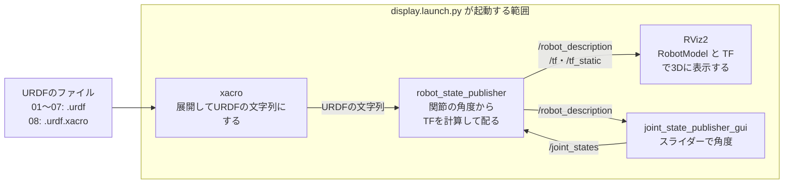

# 間章: URDFでロボットを記述し、RViz2で見る（フェーズ5の補足）

この章は、フェーズ5-4（[`docs/phase5_4_gazebo_plant.md`](phase5_4_gazebo_plant.md)）までを読み終えた人向けの、任意の章である。フェーズ5では、Gazeboに付属する2輪車を走らせ、速度の数字やグラフで動きを確かめてきた。車体や車輪の形は付属のファイルに書かれていて、どの部品がどこに付き、どの関節がどう回るのかを、ROS2の側から見る場面は無かった。実際のロボットの開発では、ロボットの形と関節を1つのファイルに書き、関節の角度から各部品の位置を計算して、3Dの画面で見ながら確かめる、という作業を何度も繰り返す。その標準の道具が、ロボットの記述の形式URDFと、可視化のツールRViz2である。この章では、ROS2の公式チュートリアルが使うパッケージ `urdf_tutorial` を導入し、円柱1本から始めてR2D2に似たロボットができあがるまでの8つのファイルを順に開いて、URDFの書き方と、RViz2に映るまでの仕組みを見ていく。

- 想定環境: WSL2 + Ubuntu 24.04 + ROS2 Jazzy。2節で、`urdf_tutorial` のパッケージを追加で導入する
- 前提: フェーズ5-4（[`docs/phase5_4_gazebo_plant.md`](phase5_4_gazebo_plant.md)）。内容としては、トピック・パラメータ・launchの使い方（フェーズ4まで）が分かれば読める。フェーズ6・7の本文は、この章に依存しない
- 所要目安: 1〜2コマ
- 言語: なし（用意されたファイルを開いて読み、コマンドで表示する。コードやファイルは書かない）

> **この章の位置づけ**: ROS 2の公式チュートリアルのURDFの章のうち、`urdf_tutorial` を使う4本（見た目を作る・関節を動かす・衝突と物理の性質・xacro。出典は末尾に記載する）の流れに沿った、読み物と小さな体験である。使うファイルは、どれも `urdf_tutorial` に入っているもので、自分では書かない。本文に載せたファイルの中身は、要点だけを抜粋したもので、全体は、各自の環境に導入したファイル（2-2節）か、GitHubの `urdf_tutorial`（末尾の参考資料）で読む。説明は、公式チュートリアルを日本語に訳したものではなく、要点を自分の言葉でまとめ直したものである。

> **期待する結果の出どころ**: `apt list`・`ls`・`cat`・`diff`・`grep`・`sed`・`check_urdf`・`xacro`・`ros2 launch --show-args` の表示は、この章の作成時に実際に実行した表示。4-4節のトピックとTFの表示は、作成時に、`display.launch.py` が起動するノードのうち、RViz2を除く `robot_state_publisher` と `joint_state_publisher` を画面なしで起動して読んだ表示で、時刻（`stamp`・`At time`）は実行ごとに異なる（スライダーのウィンドウを出す `joint_state_publisher_gui` も、ウィンドウを出さない設定で起動し、同じ関節の名前と角度を送ることを確かめた）。3-1節の `display.launch.py` のログは、作成時に各ノードを画面なしで個別に起動したときのログから組み立てたもので（RViz2の2行も、ウィンドウを出さない設定で起動したときに出た行）、行の順番・時刻・pidは実行ごとに変わる。7-3節の表示は、3-1節と4-4節の表示から想定したもので、作成時には、この形で起動していない。RViz2の画面は、作成時には開いて確かめていない。画面の見え方は、公式チュートリアルの説明と画面の例、`urdf_tutorial` のRViz2の設定のファイルから、筆者が想定したもの。10節のRobotCADの導入と使い方は、作成時には導入して確かめておらず、期待する結果は、RobotCADとFreeCADの公式の説明とソース（2026-10-17）から筆者が想定したもの。

## 0. この章で得てほしいこと

1. URDFの基本の要素（`<robot>`・`<link>`・`<joint>`・`<visual>`・`<origin>`・`<material>`）を読み、リンクが関節で木の形につながることを説明できる。
2. 関節の原点（`<joint>` の `<origin>`）と、形の原点（`<visual>` の `<origin>`）の違いを説明できる。
3. 固定以外の関節の種類（`continuous`・`revolute`・`prismatic`）と、`<axis>`・`<limit>` の意味を説明できる。
4. `robot_state_publisher`・`joint_state_publisher`・RViz2が、トピック（`/robot_description`・`/joint_states`・`/tf`・`/tf_static`）でつながり、スライダーの角度がRViz2の絵になるまでの流れを説明できる。
5. 衝突の形（`<collision>`）と慣性（`<inertial>`）が何のためにあるかと、xacroの3つの仕組み（プロパティ・式・マクロ）を説明できる。

完了条件: 2〜6節の体験で、8つのファイルを順に表示し、ファイルの中身の違い（`diff` の表示）と、RViz2の絵の違いを対応づけて説明できる。4節で、スライダーで動かした関節の角度が `/joint_states` に載り、`robot_state_publisher` が計算したTFでRViz2の絵が動く流れを、トピックの表示で確かめられる。

## 1. 全体像


<details>
<summary>同じ図（mermaid版）</summary>



</details>

この章で使う部品と仕組みは、次の5つである。

- **URDF**（Unified Robot Description Format）: ロボットの形と関節を書く、XMLの書き方。ロボットは、部品（リンク）を関節でつないだ木の形として書く。ROS2の多くの道具（RViz2・Gazebo・MoveIt・ros2_control）が読める、共通の形式である。
- **`robot_state_publisher`**: URDFをパラメータ `robot_description` で受け取り、同じ中身をトピック `/robot_description`（型は [`std_msgs/msg/String`](https://github.com/ros2/common_interfaces/blob/jazzy/std_msgs/msg/String.msg)）に送っておくノード。さらに、関節の角度（`/joint_states`）を受け取って、各リンクの位置と向きを計算し、TFとして配る。
- **TF**: ロボットの部品ごとの座標系（フレーム）の間の、位置と向きの関係（座標変換）を、ROS2の中で配る仕組み（tf2）。動く関節の先のフレームはトピック `/tf` に、固定の関節の先のフレームは `/tf_static` に送られる（型はどちらも [`tf2_msgs/msg/TFMessage`](https://github.com/ros2/geometry2/blob/jazzy/tf2_msgs/msg/TFMessage.msg)）。
- **`joint_state_publisher`**: URDFから固定でない関節を探し、その角度を `/joint_states`（型は [`sensor_msgs/msg/JointState`](https://github.com/ros2/common_interfaces/blob/jazzy/sensor_msgs/msg/JointState.msg)）に送るノード。GUI版の `joint_state_publisher_gui` は、関節ごとのスライダーのウィンドウを出し、スライダーの値を送る。実際のロボットやGazeboでは、関節の角度はセンサやシミュレータから届くので、このノードは、それが無いときに手で角度を決めるための道具である。
- **RViz2**: TFと、センサのデータ・ロボットのモデルなどを、3Dの画面に重ねて描く可視化のツール。この章では、ロボットの形を描く表示（RobotModel）と、フレームの軸を描く表示（TF）を使う。

`urdf_tutorial` の `display.launch.py` は、指定したURDFのファイルをxacroで展開し（xacroは6節。展開する仕組みの無いURDFでも、そのまま通る）、`robot_state_publisher`・`joint_state_publisher_gui`・RViz2の3つを起動する。この章では、ファイルを替えながら、このlaunchを何度も起動する。

## 2. 導入して、入ったものを確かめる

### 2-1. 導入する

`urdf_tutorial` は、aptで導入できる。依存するパッケージ（表示用のlaunchをまとめた `urdf_launch` と、`joint_state_publisher`・`joint_state_publisher_gui`）も、まとめて入る。RViz2・`robot_state_publisher`・xacroは、ROS2のデスクトップ版（環境構築で導入したもの）に入っている。

```bash
sudo apt update

sudo apt install -y ros-jazzy-urdf-tutorial
```

**期待する結果**: パスワードを入力すると、パッケージの一覧の更新と、ダウンロード・導入の表示が続き、エラーが出ずにプロンプトに戻る。表示の中身は、PCの状態によって異なる。

入ったことを確かめる。

```bash
apt list --installed 'ros-jazzy-urdf-*' 'ros-jazzy-joint-state-publisher*'
```

**期待する結果**（版の番号は、導入した時期によって異なる）:

```text
WARNING: apt does not have a stable CLI interface. Use with caution in scripts.

Listing...
ros-jazzy-joint-state-publisher-gui/noble,now 2.4.3-1noble.20260912.164400 amd64 [installed,automatic]
ros-jazzy-joint-state-publisher/noble,now 2.4.3-1noble.20260912.164308 amd64 [installed,automatic]
ros-jazzy-urdf-launch/noble,now 0.1.2-1noble.20260920.235444 amd64 [installed,automatic]
ros-jazzy-urdf-parser-plugin/noble,now 2.10.1-2noble.20260911.045403 amd64 [installed,automatic]
ros-jazzy-urdf-tutorial/noble,now 1.1.0-3noble.20260921.023408 amd64 [installed]
```

`ros-jazzy-urdf-tutorial` と、`[installed,automatic]`（依存として自動で入ったもの）の `joint_state_publisher`・`joint_state_publisher_gui`・`urdf_launch` が並べば成功である。`urdf_parser_plugin` は、デスクトップ版に前から入っているもので、名前が `urdf-` で始まるので一緒に表示される。先頭の `WARNING` は、`apt` をスクリプトから使うときの注意で、気にしなくてよい。

### 2-2. 入ったファイルを確かめる

パッケージのファイルは、`ros2 pkg prefix --share` が示すフォルダの下にある。2つ目のターミナルを開き、そのフォルダの `urdf` に移る。この章では、このターミナル（T2）でファイルを読み、1つ目のターミナル（T1）でlaunchを起動する。

```bash
# T2
cd $(ros2 pkg prefix --share urdf_tutorial)/urdf

pwd

ls
```

**期待する結果**:

```text
/opt/ros/jazzy/share/urdf_tutorial/urdf
01-myfirst.urdf
02-multipleshapes.urdf
03-origins.urdf
04-materials.urdf
05-visual.urdf
06-flexible.urdf
07-physics.urdf
08-macroed.urdf.xacro
```

8つのファイルは、番号の順に少しずつ書き足したもので、公式チュートリアルの4本に、次のように対応している。この章の節の番号も、それに合わせた。

| ファイル | 内容 | 公式チュートリアル | この章 |
|---|---|---|---|
| `01-myfirst.urdf` | 円柱1本 | 見た目を作る（Building a visual robot model from scratch） | 3-1節 |
| `02-multipleshapes.urdf` | 箱を関節でつなぐ | 同上 | 3-2節 |
| `03-origins.urdf` | 原点をずらして並べる | 同上 | 3-3節 |
| `04-materials.urdf` | 色を付ける | 同上 | 3-4節 |
| `05-visual.urdf` | 車輪・頭・つかむ手を足して仕上げる | 同上 | 3-5節 |
| `06-flexible.urdf` | 関節を動くようにする | 関節を動かす（Building a movable robot model） | 4節 |
| `07-physics.urdf` | 衝突の形と慣性を足す | 衝突と物理の性質（Adding physical and collision properties） | 5節 |
| `08-macroed.urdf.xacro` | 07と同じロボットをxacroで短く書く | xacro（Using Xacro to clean up your code） | 6節 |

同じパッケージの `meshes` には、つかむ手の形のファイル（`.dae`）、`rviz` には、RViz2の設定のファイル `urdf.rviz`、`launch` には、表示用の `display.launch.py` が入っている。

### 2-3. launchの引数を確かめる

```bash
# T1
ros2 launch urdf_tutorial display.launch.py --show-args
```

**期待する結果**:

```text
Arguments (pass arguments as '<name>:=<value>'):

    'gui':
        Flag to enable joint_state_publisher_gui. Valid choices are: ['true', 'false']
        (default: 'true')

    'rvizconfig':
        Absolute path to rviz config file
        (default: PathJoinSubstitution('FindPackageShare(pkg='urdf_tutorial'), 'rviz', 'urdf.rviz''))

    'model':
        Path to robot urdf file relative to urdf_tutorial package
        (default: 'PathJoinSubstitution(''urdf', '01-myfirst.urdf'')')

    'jsp_gui':
        Flag to enable joint_state_publisher_gui. Valid choices are: ['true', 'false']
        (default: 'true')

    'rviz_config':
        Absolute path to rviz config file
        (default: PathJoinSubstitution('FindPackageShare(pkg='urdf_launch'), 'config', 'urdf.rviz''))

    'urdf_package':
        The package where the robot description is located

    'urdf_package_path':
        The path to the robot description relative to the package root
```

使うのは、上の3つ（`gui`・`rvizconfig`・`model`）である。後ろの4つは、中で取り込んでいる `urdf_launch` の `display.launch.py` の引数で、`urdf_tutorial` の側から値が渡される（フェーズ5-3の3-4節と同じく、`--show-args` は、取り込んだlaunchの引数も並べる）。

- `model`: 表示するファイルの、**`urdf_tutorial` のパッケージのフォルダからの相対パス**（例: `urdf/01-myfirst.urdf`）。
- `gui`: `true`（既定）ならスライダーのウィンドウを出す `joint_state_publisher_gui`、`false` ならウィンドウを出さない `joint_state_publisher` を起動する。
- `rvizconfig`: RViz2の設定のファイル。既定は、`urdf_tutorial` の `rviz/urdf.rviz`。

`model` の既定値の表示は、`urdf/01-myfirst.urdf` でなく、`PathJoinSubstitution(...)` という文字列になっている。これは、このlaunchの既定値の書き方の不具合で、`model:=` を省いて起動すると、この文字列がそのままファイルの名前として使われ、xacroが `No such file or directory` で失敗する（作成時に、同じ文字列を渡して確かめた）。そのため、この章では毎回 `model:=` を付けて起動する。

## 3. 見た目を作る（チュートリアル1）

### 3-1. 円柱1本のロボット

まず、ファイルの中身を見る。

```bash
# T2
cat 01-myfirst.urdf
```

**期待する結果**:

```text
<?xml version="1.0"?>
<robot name="myfirst">
  <link name="base_link">
    <visual>
      <geometry>
        <cylinder length="0.6" radius="0.2"/>
      </geometry>
    </visual>
  </link>
</robot>
```

`myfirst` という名前のロボット（`<robot>`）に、`base_link` という名前のリンク（`<link>`）が1つだけある。リンクの見た目（`<visual>`）の形（`<geometry>`）は、長さ0.6 m・半径0.2 mの円柱（`<cylinder>`）である。URDFの長さの単位はm、角度の単位はラジアンで、形には、円柱のほかに箱（`<box>`）・球（`<sphere>`）・形のファイル（`<mesh>`）がある。

URDFとして正しく読めるかは、`check_urdf` で確かめられる。

```bash
# T2
check_urdf 01-myfirst.urdf
```

**期待する結果**:

```text
robot name is: myfirst
---------- Successfully Parsed XML ---------------
root Link: base_link has 0 child(ren)
```

`Successfully Parsed XML` が出れば、読めている。最後の行は、木の根のリンク（root Link）が `base_link` で、子のリンクが0個であることを示す。

表示する。WSLgのウィンドウが2つ開く。

```bash
# T1
ros2 launch urdf_tutorial display.launch.py model:=urdf/01-myfirst.urdf
```

**期待する結果**（T1の表示。各ノードを個別に起動したときのログから組み立てたもので、行の順番・時刻・pidは実行ごとに変わる。RViz2のログの行は、PCのグラフィックスによって異なる）:

```text
[INFO] [launch]: All log files can be found below /home/<ユーザー名>/.ros/log/<日時>-<ホスト名>-<番号>
[INFO] [launch]: Default logging verbosity is set to INFO
[INFO] [robot_state_publisher-1]: process started with pid [2037]
[INFO] [joint_state_publisher_gui-2]: process started with pid [2683]
[INFO] [rviz2-3]: process started with pid [2693]
[robot_state_publisher-1] [INFO] [1792158465.893837079] [robot_state_publisher]: Robot initialized
[joint_state_publisher_gui-2] [INFO] [1792158553.651820342] [joint_state_publisher]: Waiting for robot_description to be published on the robot_description topic...
[joint_state_publisher_gui-2] [INFO] [1792158553.664694755] [joint_state_publisher]: Centering
[joint_state_publisher_gui-2] [INFO] [1792158556.051518420] [joint_state_publisher]: Got description, configuring robot
[joint_state_publisher_gui-2] [INFO] [1792158556.083243829] [joint_state_publisher]: Centering
[rviz2-3] [INFO] [1792158555.737592266] [rviz2]: Stereo is NOT SUPPORTED
[rviz2-3] [INFO] [1792158555.737691374] [rviz2]: OpenGl version: 4.5 (GLSL 4.5)
```

3つのノードが起動し、`robot_state_publisher` が `Robot initialized`（URDFを読み込んだ）、`joint_state_publisher` が `Got description, configuring robot`（`/robot_description` からURDFを受け取って、関節を探した）を出せば成功である。`Centering` は、スライダーを初期値（0。範囲に0が入らない関節は、範囲の中央。4-4節）に戻したという表示である。

画面では、次の2つのウィンドウが開く。

- **RViz2**: 中央の暗い色の3Dの画面に、格子（Grid）と、その中心に立つ円柱が描かれる。円柱の形の原点は、既定では形の中心にあるので、円柱の下半分は格子より下にある。左の「Displays」の欄には、「Global Options」・「Grid」・「RobotModel」・「TF」が並ぶ。
- **Joint State Publisher**: スライダーのウィンドウ。このロボットには動く関節が無いので、スライダーは無く、「Randomize」と「Center」のボタンだけがある（4節で使う）。

RViz2の画面の読み方の要点は、次のとおりである（画面の例は、公式チュートリアルの「Building a visual robot model from scratch」のページにある）。

- **Fixed Frame**（「Global Options」の中）: 3Dの画面の基準にするフレーム。格子の中心がこのフレームの原点になる。`urdf.rviz` では `base_link` に設定されている。基準は本来、世界に対して動かないフレーム（地図の `map` など）を選ぶものだが、この章のロボットは床の上を走らないので、ロボットの根のリンクを基準にしている。
- **RobotModel**: `/robot_description`（「Description Topic」の欄）のURDFと、TFから、ロボットの形を描く表示。`urdf.rviz` では、少し透けるように、不透明度（Alpha）を0.8にしている。
- **TF**: フレームごとに、赤・緑・青の矢印（x・y・z軸）と名前を描く表示。リンクが1つなら、`base_link` の軸だけが描かれる。
- **マウスの操作**: 左ボタンでドラッグすると視点が回り、中ボタン（ホイールを押す）でドラッグすると視点の中心が動き、ホイールを回すか右ボタンでドラッグすると近づく・遠ざかる。
- 表示の名前の左の三角を開くと、設定の項目が並ぶ。問題があると、「Status」の項目に `Warning` や `Error` と、その理由が出る。

確かめたら、T1で `Ctrl+C` を押して止める（2つのウィンドウも閉じる）。以降の節も、表示を確かめたら同じように止めてから、次のファイルを起動する。

### 3-2. 箱を関節でつなぐ

1つ前のファイルとの違いを `diff` で見る。`<` の行が前のファイル、`>` の行が後のファイルの中身である。

```bash
# T2
diff 01-myfirst.urdf 02-multipleshapes.urdf
```

**期待する結果**:

```text
2c2
< <robot name="myfirst">
---
> <robot name="multipleshapes">
9a10,23
> 
>   <link name="right_leg">
>     <visual>
>       <geometry>
>         <box size="0.6 0.1 0.2"/>
>       </geometry>
>     </visual>
>   </link>
> 
>   <joint name="base_to_right_leg" type="fixed">
>     <parent link="base_link"/>
>     <child link="right_leg"/>
>   </joint>
> 
```

ロボットの名前のほかに、2つの要素が足されている。

- リンク `right_leg`（右脚）: 0.6 m × 0.1 m × 0.2 mの箱（`<box size="x y z"/>`）。
- 関節 `base_to_right_leg`: 親（`<parent>`）の `base_link` に、子（`<child>`）の `right_leg` をつなぐ、固定（`type="fixed"`）の関節。

URDFでは、リンクを並べただけでは、どこに置くかが決まらない。リンクは必ず関節で親につなぎ、子のリンクの位置は、親のリンクの位置を基準に決まる。親は1つだけで、根のリンクも1つだけなので、ロボット全体は、根から枝分かれする木の形になる（輪になったつながりは書けない）。

```bash
# T1
ros2 launch urdf_tutorial display.launch.py model:=urdf/02-multipleshapes.urdf
```

**期待する結果**: T1には、3-1節と同じ形のログが出る。RViz2では、円柱と、横に寝た箱が重なって描かれる。関節にも形にも位置を指定していないので、2つのリンクの原点が同じ場所（`base_link` の原点）にあり、重なってしまう。

### 3-3. 原点をずらして並べる

```bash
# T2
diff 02-multipleshapes.urdf 03-origins.urdf
```

**期待する結果**:

```text
2c2
< <robot name="multipleshapes">
---
> <robot name="origins">
15a16
>       <origin rpy="0 1.57075 0" xyz="0 0 -0.3"/>
21a23
>     <origin xyz="0 -0.22 0.25"/>
```

`<origin>`（原点）が2か所に足されている。1つ目（16行目）は `right_leg` の `<visual>` の中、2つ目（23行目）は関節 `base_to_right_leg` の中である。`xyz` は位置（m）、`rpy` は向きで、x軸・y軸・z軸のまわりの回転（ロール・ピッチ・ヨー。ラジアン）である。この2つは、意味が違う。

- **関節の原点**（`<joint>` の中）: 子のリンクのフレームを、親のリンクのフレームのどこに置くか。ここでは、`base_link` から、y方向に−0.22 m（ロボットの右側）、z方向に0.25 m（上）の位置に、`right_leg` のフレームの原点を置く。`rpy` を書いていないので、向きは親と同じである。
- **形の原点**（`<visual>` の中）: リンクのフレームの中で、形の中心をどこに置くか。ここでは、箱の中心を、`right_leg` のフレームの原点から0.3 m下げ、y軸のまわりに1.57075ラジアン（ほぼπ/2、90度）回して、長い辺を縦にしている。こうすると、脚の上端がフレームの原点（関節の位置）に来る。

関節の原点はTF（フレームの位置関係）を決め、形の原点は、そのフレームの中での絵の置き方だけを決める。

```bash
# T1
ros2 launch urdf_tutorial display.launch.py model:=urdf/03-origins.urdf
```

**期待する結果**: RViz2では、円柱の右上の横に、縦長の箱が、上端を付けてぶら下がって描かれる。TFの表示では、`base_link` の軸のほかに、少し右上（関節の位置）に `right_leg` の軸が描かれる。脚の箱は、軸の位置から下に伸びている。

### 3-4. 色を付ける

```bash
# T2
diff 03-origins.urdf 04-materials.urdf
```

**期待する結果**:

```text
2c2,12
< <robot name="origins">
---
> <robot name="materials">
> 
>   <material name="blue">
>     <color rgba="0 0 0.8 1"/>
>   </material>
> 
>   <material name="white">
>     <color rgba="1 1 1 1"/>
>   </material>
> 
> 
7a18
>       <material name="blue"/>
16a28
>       <material name="white"/>
23a36,51
>   </joint>
> 
>   <link name="left_leg">
>     <visual>
>       <geometry>
>         <box size="0.6 0.1 0.2"/>
>       </geometry>
>       <origin rpy="0 1.57075 0" xyz="0 0 -0.3"/>
>       <material name="white"/>
>     </visual>
>   </link>
> 
>   <joint name="base_to_left_leg" type="fixed">
>     <parent link="base_link"/>
>     <child link="left_leg"/>
>     <origin xyz="0 0.22 0.25"/>
```

- `<robot>` の直下に、名前を付けた色（`<material>`）を2つ定義している。`rgba` は、赤・緑・青・不透明度の4つの値で、それぞれ0〜1である。`blue` は青0.8、`white` は全部1。
- 各リンクの `<visual>` の中の `<material name="..."/>` で、定義した色を名前で使う。円柱は青、脚は白になる。色は、`<visual>` の中で直接定義してもよい。
- 左脚（`left_leg`）も足している。右脚と同じ形で、関節の原点のyだけが+0.22 m（ロボットの左側）になっている。

```bash
# T1
ros2 launch urdf_tutorial display.launch.py model:=urdf/04-materials.urdf
```

**期待する結果**: RViz2では、青い円柱の左右に、白い脚が1本ずつぶら下がって描かれる（RobotModelの不透明度が0.8なので、少し透けて見える）。

### 3-5. 仕上げる

05では、足先の台・車輪・つかむ手・頭を足して、ロボットを仕上げている。ファイルは245行あり、`diff` の表示も長いので、新しく出てくる形だけを探す。

```bash
# T2
grep -n -E 'sphere|mesh' 05-visual.urdf
```

**期待する結果**:

```text
170:        <mesh filename="package://urdf_tutorial/meshes/l_finger.dae"/>
184:        <mesh filename="package://urdf_tutorial/meshes/l_finger_tip.dae"/>
198:        <mesh filename="package://urdf_tutorial/meshes/l_finger.dae"/>
212:        <mesh filename="package://urdf_tutorial/meshes/l_finger_tip.dae"/>
220:        <sphere radius="0.2"/>
```

- 頭（220行目）は、半径0.2 mの球（`<sphere>`）である。
- つかむ手の指（170〜212行目）は、形のファイル（`<mesh>`）で描く。`package://urdf_tutorial/meshes/...` は、「パッケージ `urdf_tutorial` のフォルダの下の `meshes/...`」という意味の書き方で、PCごとにインストール先が違っても同じURDFで読める。左右の指は同じファイルを使い、右の指（`right_gripper`・`right_tip`）は、`<visual>` の形の原点を `rpy="-3.1415 0 0"` にして、x軸のまわりに半回転させ、左右対称に置いている（`grep -n -B4 'l_finger' 05-visual.urdf` で、各指の `<origin>` を見られる）。

木の形は、`check_urdf` で見られる。

```bash
# T2
check_urdf 05-visual.urdf
```

**期待する結果**:

```text
robot name is: visual
---------- Successfully Parsed XML ---------------
root Link: base_link has 4 child(ren)
    child(1):  left_leg
        child(1):  left_base
            child(1):  left_back_wheel
            child(2):  left_front_wheel
    child(2):  right_leg
        child(1):  right_base
            child(1):  right_back_wheel
            child(2):  right_front_wheel
    child(3):  gripper_pole
        child(1):  left_gripper
            child(1):  left_tip
        child(2):  right_gripper
            child(1):  right_tip
    child(4):  head
        child(1):  box
```

根の `base_link`（胴体）に、4つの枝（左脚・右脚・つかむ手の棒 `gripper_pole`・頭 `head`）がつながり、脚の先には足先の台（`*_base`）と前後の車輪、棒の先には左右の指と指先（`*_tip`）、頭には目の箱（`box`）がつながっている。リンクは全部で16個ある。

```bash
# T1
ros2 launch urdf_tutorial display.launch.py model:=urdf/05-visual.urdf
```

**期待する結果**: RViz2では、R2D2に似たロボット（青い胴体・白い球の頭・左右の脚と黒い車輪・前に伸びた棒の先の指）が描かれる。TFの表示では、16個のリンクのフレームの軸と名前が重なって並ぶ（多すぎて読みにくい場合は、7-1節の方法（TFの表示の「Show Names」・「Show Axes」のチェックを外す）で減らせる）。関節はまだすべて固定なので、スライダーのウィンドウにはスライダーが無い。

## 4. 関節を動かす（チュートリアル2）

### 4-1. 関節の種類

URDFの関節は、`type` で動き方を決める。

| `type` | 動き方 | 必要な要素 |
|---|---|---|
| `fixed` | 動かない（3節のすべての関節） | なし |
| `continuous` | 軸のまわりに、制限なく回る（車輪など） | `<axis>` |
| `revolute` | 軸のまわりに、決めた範囲だけ回る（腕・指など） | `<axis>`・`<limit>`（範囲はラジアン） |
| `prismatic` | 軸の向きに、決めた範囲だけ伸び縮みする（伸びる腕など） | `<axis>`・`<limit>`（範囲はm） |
| `planar` | 平面の中を動く（2つの値で決まる） | `<axis>`（平面に垂直な向き） |
| `floating` | 空間の中を自由に動く（6つの値で決まる） | なし |

`planar` と `floating` は、1つの数で位置が決まらないので、公式チュートリアルでは扱っていない（`joint_state_publisher` も、スライダーを作らない）。

`<axis xyz="..."/>` は、回る（伸び縮みする）向きのベクトルで、関節のフレーム（関節の原点に置かれた、子のリンクのフレーム）で表す。書かなければ x軸（`1 0 0`）になる。`<limit>` の `lower`・`upper` は動ける範囲、`velocity`・`effort` は速さと力の上限である。速さと力の上限は、RViz2での表示には使われないが、`revolute` と `prismatic` では書く決まりになっている。

### 4-2. 関節を動くようにした違い

05と06の違いは、関節の部分だけである（`diff` の表示は44行）。後半を見る。

```bash
# T2
diff 05-visual.urdf 06-flexible.urdf
```

**期待する結果**（抜粋。この前には、残りの3つの車輪の関節が、同じ形で並ぶ）:

```text
139c142,143
<   <joint name="left_back_wheel_joint" type="fixed">
---
>   <joint name="left_back_wheel_joint" type="continuous">
>     <axis rpy="0 0 0" xyz="0 1 0"/>
145c149
<   <joint name="gripper_extension" type="fixed">
---
>   <joint name="gripper_extension" type="prismatic">
147a152
>     <limit effort="1000.0" lower="-0.38" upper="0" velocity="0.5"/>
160c165,167
<   <joint name="left_gripper_joint" type="fixed">
---
>   <joint name="left_gripper_joint" type="revolute">
>     <axis xyz="0 0 1"/>
>     <limit effort="1000.0" lower="0.0" upper="0.548" velocity="0.5"/>
188c195,197
<   <joint name="right_gripper_joint" type="fixed">
---
>   <joint name="right_gripper_joint" type="revolute">
>     <axis xyz="0 0 -1"/>
>     <limit effort="1000.0" lower="0.0" upper="0.548" velocity="0.5"/>
225c234
<   <joint name="head_swivel" type="fixed">
---
>   <joint name="head_swivel" type="continuous">
227a237
>     <axis xyz="0 0 1"/>
```

8つの関節が、固定から動く関節に変わっている。

- 4つの車輪（`*_wheel_joint`）: y軸（`0 1 0`。車軸の向き）のまわりに回る `continuous`。`<axis>` の `rpy` は、URDFの仕様（末尾の参考資料の「urdf/XML」）の `<axis>` には無い属性で、向きは `xyz` だけで決まる。
- 頭（`head_swivel`）: z軸（`0 0 1`。上向き）のまわりに回る `continuous`。首を振るように回る。
- つかむ手の棒（`gripper_extension`）: `prismatic`。`<axis>` を書いていないので、x軸（前向き）の向きに、−0.38〜0 mの範囲で引っ込む。
- 左右の指（`left_gripper_joint`・`right_gripper_joint`）: `revolute`。0〜0.548ラジアン（約31度）の範囲で開く。軸の向きが左右で逆（`0 0 1` と `0 0 -1`）なので、同じ角度で、左右対称に開く。

### 4-3. スライダーで動かす

```bash
# T1
ros2 launch urdf_tutorial display.launch.py model:=urdf/06-flexible.urdf
```

**期待する結果**: T1には、3-1節と同じ形のログが出る。RViz2には、3-5節と同じロボットが描かれる。スライダーのウィンドウには、固定でない8つの関節のスライダーが並び、どれも0の位置にある。

- スライダーを動かすと、RViz2のロボットの、その関節の先が動く。`head_swivel` なら頭と目の箱が回り、`gripper_extension` なら棒と指が胴体の中へ引っ込み、`left_gripper_joint` なら左の指が開く。
- 車輪と頭（`continuous`）のスライダーは、−π〜π（約−3.14〜3.14）の範囲である。制限の無い関節でも、スライダーには範囲が要るので、1回転分にしている。
- 「Randomize」を押すと、すべてのスライダーが範囲の中のでたらめな値になり、「Center」を押すと初期値に戻る。

### 4-4. 裏側をトピックで見る

スライダーの値がRViz2の絵になるまでを、トピックで確かめる。T1のlaunchは動かしたまま、T2で次を実行する。

```bash
# T2
ros2 topic list -t
```

**期待する結果**:

```text
/joint_states [sensor_msgs/msg/JointState]
/parameter_events [rcl_interfaces/msg/ParameterEvent]
/robot_description [std_msgs/msg/String]
/rosout [rcl_interfaces/msg/Log]
/tf [tf2_msgs/msg/TFMessage]
/tf_static [tf2_msgs/msg/TFMessage]
```

1節の図の4つのトピック（`/joint_states`・`/robot_description`・`/tf`・`/tf_static`）が並ぶ。残りの2つは、どのノードにもある標準のトピックである（RViz2の設定によっては、RViz2が送るトピックが加わることがある）。

```bash
# T2
ros2 topic echo /joint_states --once
```

**期待する結果**（スライダーを動かす前の表示。`stamp` は送った時刻で、実行ごとに異なる）:

```text
header:
  stamp:
    sec: 1792158476
    nanosec: 786070509
  frame_id: ''
name:
- right_front_wheel_joint
- right_back_wheel_joint
- left_front_wheel_joint
- left_back_wheel_joint
- gripper_extension
- left_gripper_joint
- right_gripper_joint
- head_swivel
position:
- 0.0
- 0.0
- 0.0
- 0.0
- 0.0
- 0.0
- 0.0
- 0.0
velocity: []
effort: []
---
```

`name` に固定でない8つの関節の名前が、`position` に同じ順で角度（`prismatic` の `gripper_extension` は長さ）が並ぶ。スライダーを動かしてから、もう一度実行すると、動かした関節の値が変わっている。`joint_state_publisher` は、URDFから固定でない関節を探し、それぞれの初期値を0（範囲に0が入らない関節は、範囲の中央）にして、1秒に10回（パラメータ `rate` の既定値）送る。

`robot_state_publisher` は、この角度とURDFの関節の原点・軸から、各リンクのフレームの位置と向きを計算して、TFとして送る。2つのフレームの間の関係は、`tf2_echo` で読める。ここでは、胴体（`base_link`）から見た左の指（`left_gripper`）のフレームを読む。

```bash
# T2
ros2 run tf2_ros tf2_echo base_link left_gripper
```

**期待する結果**（スライダーをすべて0にしたときの表示。`At time` の時刻は実行ごとに異なる。止めるまで、1秒ごとに同じ形の表示が続く）:

```text
[INFO] [1792158511.993934040] [tf2_echo]: Waiting for transform base_link ->  left_gripper: Invalid frame ID "base_link" passed to canTransform argument target_frame - frame does not exist
[INFO] [1792158513.973777115] [tf2_echo]: Waiting for transform base_link ->  left_gripper: Invalid frame ID "base_link" passed to canTransform argument target_frame - frame does not exist
At time 1792158514.885905782
- Translation: [0.390, 0.010, 0.200]
- Rotation: in Quaternion (xyzw) [0.000, 0.000, 0.000, 1.000]
- Rotation: in RPY (radian) [0.000, -0.000, 0.000]
- Rotation: in RPY (degree) [0.000, -0.000, 0.000]
- Matrix:
  1.000  0.000  0.000  0.390
  0.000  1.000  0.000  0.010
  0.000  0.000  1.000  0.200
  0.000  0.000  0.000  1.000
```

最初の数行の `Waiting for transform ... frame does not exist` は、`tf2_echo` が起動した直後で、まだTFを1つも受け取っていないという表示で、すぐに消える。その後の `Translation` が位置（m）、`Rotation` が向きである。左の指のフレームは、胴体から見て前に0.39 m、左に0.01 m、上に0.2 mにある。これは、URDFの2つの関節の原点の足し算（`gripper_extension` の `0.19 0 0.2` と、`left_gripper_joint` の `0.2 0.01 0`。4-2節の `diff` の表示の外の行）になっている。

スライダーで `gripper_extension` を−0.38にすると、`Translation` のxが0.39から0.01に減り、`left_gripper_joint` を開くと、`Rotation` のRPYのヨー（3つ目）が増えるはずである（URDFの関節の軸と範囲から考えた値で、作成時には、スライダーを動かして確かめていない）。止めるときは、T2で `Ctrl+C` を押す。

TFが2つのトピックに分かれているのは、送る回数を減らすためである。固定の関節の先のフレーム（脚・足先の台・指先・目の箱）の関係は変わらないので、`robot_state_publisher` は、`/tf_static` に一度だけ送り、後から購読したノードにも届く設定（QoSの `transient_local`）にしている。動く関節の先のフレーム（車輪・頭・棒・指）の関係は、`/joint_states` を受け取るたびに計算し直して、`/tf` に送る。

## 5. 衝突と物理の性質（チュートリアル3）

07では、06のロボットの16個のリンクのすべてに、衝突の形（`<collision>`）と慣性（`<inertial>`）を足している。RViz2での見た目は06と同じで、この2つは、物理シミュレーション（Gazeboなど）や、動きの計画（MoveItなど）で、物どうしがぶつかるかを調べたり、力から動きを計算したりするために使う。

```bash
# T2
grep -c '<collision>' 07-physics.urdf

grep -c '<inertial>' 07-physics.urdf
```

**期待する結果**:

```text
16
16
```

胴体（`base_link`）の部分を見る。

```bash
# T2
sed -n '14,30p' 07-physics.urdf
```

**期待する結果**:

```text
  <link name="base_link">
    <visual>
      <geometry>
        <cylinder length="0.6" radius="0.2"/>
      </geometry>
      <material name="blue"/>
    </visual>
    <collision>
      <geometry>
        <cylinder length="0.6" radius="0.2"/>
      </geometry>
    </collision>
    <inertial>
      <mass value="10"/>
      <inertia ixx="1e-3" ixy="0.0" ixz="0.0" iyy="1e-3" iyz="0.0" izz="1e-3"/>
    </inertial>
  </link>
```

### 5-1. 衝突の形

`<collision>` は、`<visual>` と同じ階層に書き、形（`<geometry>`）と原点（`<origin>`）の書き方も `<visual>` と同じである。多くの場合は、見た目と同じ形にするが、あえて変えることもある。

- **計算を軽くするため**: 細かな形のファイル（`<mesh>`）どうしがぶつかるかの計算は重いので、衝突の形には、円柱・箱・球などの単純な形を使う。
- **近づけたくない範囲を作るため**: 壊れやすい部品のまわりに、見た目より大きな衝突の形を置いておくと、動きを計画する道具が、その範囲に物を近づけないようにする。

RViz2では、RobotModelの表示の項目の「Collision Enabled」にチェックを入れると衝突の形が、「Visual Enabled」のチェックを外すと見た目が描かれなくなるので、2つを見比べられる。

### 5-2. 慣性

`<inertial>` は、リンクの質量（`<mass>`。kg）と、回しにくさ（慣性モーメント。`<inertia>`）を書く。慣性モーメントは3×3の対称な行列なので、対角の3つ（`ixx`・`iyy`・`izz`）と、対角の外の3つ（`ixy`・`ixz`・`iyz`）の6つで表す。`<origin>` を書くと、重心の位置と、慣性モーメントを表すフレームの向きを、リンクのフレームからずらせる。

公式チュートリアルは、慣性モーメントの値の決め方について、次の目安を挙げている。

- 円柱・箱・球のような単純な形なら、質量が中に均一に散らばっていると考えて、形ごとの式で計算できる。複雑な形なら、形を作ったソフトウェアで計算できることが多い。
- 分からないときの仮の値として、中くらいのリンクなら、対角の3つを1e-3以下にするとよい（1辺0.1 m・質量0.6 kgの箱に当たる）。対角を1にする（単位行列）のは、ずっと大きすぎて（同じ大きさの箱で質量600 kgに当たる）、よくない。
- 慣性を0や0に近い値にすると、シミュレーションでロボットの形が崩れることがある。

07の値は、この仮の値（1e-3）をすべてのリンクに使ったもので、物理として正しい値ではない。たとえば胴体を、質量10 kg・半径0.2 m・長さ0.6 mの均一な円柱と考えると、横の軸のまわりの慣性モーメントは、 $10 \times (3 \times 0.2^2 + 0.6^2) / 12 = 0.4$ kg·m²（筆者の計算）で、1e-3の400倍になる。RViz2での表示には慣性は使われないので、このチュートリアルでは形をそろえることを優先している。シミュレーションに使うときは、形と質量から計算した値に直す。

### 5-3. 接触と関節の動きの性質

公式チュートリアルは、さらに2つの要素を紹介している。どちらも07のファイルには書かれていない。

- **接触の係数**: `<collision>` の中の `<contact_coefficients>` の属性で、摩擦係数（`mu`）・硬さ（`kp`）・減衰（`kd`）を書く。
- **関節の動きの性質**: `<joint>` の中の `<dynamics>` の属性で、静止摩擦（`friction`）と減衰（`damping`）を書く。単位は、`prismatic` ならNとN·s/m、回る関節ならN·mとN·m·s/rad。書かなければ0になる。

07を表示して、5-1節の「Collision Enabled」と「Visual Enabled」を切り替えてみる。

```bash
# T1
ros2 launch urdf_tutorial display.launch.py model:=urdf/07-physics.urdf
```

**期待する結果**: RViz2には、06と同じロボットが描かれ、スライダーも06と同じ8つが並ぶ。「Collision Enabled」にチェックを入れると、見た目と同じ位置に衝突の形が重なって描かれる。07の衝突の形は、ほとんどが見た目と同じ形で、指は、形のファイルと同じものを使っている（`grep -n -A3 '<collision>' 07-physics.urdf` で、各リンクの衝突の形を見られる）。

## 6. xacroで短く書く（チュートリアル4）

### 6-1. xacroの3つの仕組み

07は417行あり、同じ形の脚・車輪・指を、名前と位置だけ変えて何度も書いている。脚の長さを変えたくなったら、脚の形・関節の位置・足先の台の位置を、左右で何か所も直すことになる。xacro（XML Macros）は、URDFに、次の3つの仕組みを足した書き方で、`xacro` コマンドで普通のURDFに展開してから使う。08は、07と同じロボットを、xacroで237行に書いたものである。

- **プロパティ**（名前を付けた値）: `<xacro:property name="..." value="..."/>` で定義し、`${名前}` で使う。
- **式**: `${...}` の中で、四則演算・符号の反転・かっこと、`sin`・`cos` などの関数、円周率 `pi` を使える。
- **マクロ**（部品のひな形）: `<xacro:macro name="..." params="...">` で定義し、`<xacro:名前 引数="..."/>` と書くと、中身が展開される。引数は、プロパティと同じく `${...}` で使う。

xacroのファイルは、先頭の `<robot>` に、xacroの名前空間（`xmlns:xacro="..."`）を書く決まりになっている。

```bash
# T2
sed -n '4,9p;23,28p' 08-macroed.urdf.xacro
```

**期待する結果**（4〜9行目と23〜28行目）:

```text
  <xacro:property name="width" value="0.2" />
  <xacro:property name="leglen" value="0.6" />
  <xacro:property name="polelen" value="0.2" />
  <xacro:property name="bodylen" value="0.6" />
  <xacro:property name="baselen" value="0.4" />
  <xacro:property name="wheeldiam" value="0.07" />
  <xacro:macro name="default_inertial" params="mass">
    <inertial>
      <mass value="${mass}" />
      <inertia ixx="1e-3" ixy="0.0" ixz="0.0" iyy="1e-3" iyz="0.0" izz="1e-3" />
    </inertial>
  </xacro:macro>
```

前半は、胴体の半径（`width`）・脚の長さ（`leglen`）などの寸法のプロパティである。後半の `default_inertial` は、5-2節の仮の慣性を、質量だけを引数にして書くマクロで、各リンクの中で `<xacro:default_inertial mass="10"/>` のように使う。

脚は、1本分をマクロ `leg` にまとめ、左右で2回使っている。

```bash
# T2
sed -n '90,94p;119,120p' 08-macroed.urdf.xacro
```

**期待する結果**（`leg` のマクロの中の関節の部分（90〜94行目）と、マクロを使う2行（119〜120行目））:

```text
    <joint name="base_to_${prefix}_leg" type="fixed">
      <parent link="base_link"/>
      <child link="${prefix}_leg"/>
      <origin xyz="0 ${reflect*(width+.02)} 0.25" />
    </joint>
  <xacro:leg prefix="right" reflect="-1" />
  <xacro:leg prefix="left" reflect="1" />
```

ここに、xacroのよく使う工夫が3つある。

- **名前の頭に引数を付ける**: `base_to_${prefix}_leg` は、`prefix="right"` なら `base_to_right_leg` になる。同じ形の部品に、別々の名前を付けられる。
- **位置を寸法から計算する**: 関節のyの位置を、胴体の半径に0.02 mを足した値（`width+.02`）で計算している。胴体を太くすれば、脚の位置も自動で外へずれる。
- **左右を符号で切り替える**: `reflect` を−1（右）と1（左）にして掛けると、同じマクロで、左右対称の位置に置ける。

### 6-2. 展開して確かめる

`xacro` コマンドで展開すると、普通のURDFが表示される。脚の関節の部分を探す。

```bash
# T2
xacro 08-macroed.urdf.xacro | grep -A4 'joint name="base_to_.*_leg"'
```

**期待する結果**:

```text
  <joint name="base_to_right_leg" type="fixed">
    <parent link="base_link"/>
    <child link="right_leg"/>
    <origin xyz="0 -0.22 0.25"/>
  </joint>
--
  <joint name="base_to_left_leg" type="fixed">
    <parent link="base_link"/>
    <child link="left_leg"/>
    <origin xyz="0 0.22 0.25"/>
  </joint>
```

`${reflect*(width+.02)}` が、右で−0.22、左で0.22に計算され、3-4節の04（と07）の脚の関節と同じ値になっている。展開した結果の木の形（`check_urdf` の表示）も、3-5節の05と同じ16個のリンクになる。

`check_urdf` は、xacroを展開しないので、xacroのファイルを直接渡すと失敗する。

```bash
# T2
check_urdf 08-macroed.urdf.xacro
```

**期待する結果**:

```text
Error:   length [${bodylen}] is not a valid float
         at line 173 in ./urdf_parser/src/link.cpp
Error:   Could not parse visual element for Link [base_link]
```

`${bodylen}` が数でないまま読まれている。xacroのファイルを点検するときは、`xacro` で展開した結果をファイルに書き出してから、`check_urdf` に渡す（例: `xacro 08-macroed.urdf.xacro > ~/macroed.urdf` の後に `check_urdf ~/macroed.urdf`）。

### 6-3. 表示する

```bash
# T1
ros2 launch urdf_tutorial display.launch.py model:=urdf/08-macroed.urdf.xacro
```

**期待する結果**: RViz2には、07と同じロボットが描かれ、スライダーも同じ8つが並ぶ。`display.launch.py` は、01〜07のときも、毎回ファイルを `xacro` に通してから `robot_state_publisher` に渡していた（1節の図）。xacroの仕組みを使っていないファイルは、展開しても中身が変わらないので、違いが見えなかっただけである。

## 7. RViz2の表示を変える

### 7-1. 表示の項目を変える

06〜08のどれかを表示した状態で、RViz2の左の「Displays」の欄の項目を変えると、表示の働きが分かる。

- **TFの名前と軸を減らす**: TFの表示の三角を開き、「Show Names」のチェックを外すと名前が、「Show Axes」のチェックを外すと軸が消える。「Frames」の中では、フレームごとに表示を切り替えられる。
- **Fixed Frameを変える**: 「Global Options」の「Fixed Frame」を `base_link` から `head` に変えて、スライダーで `head_swivel` を動かす。今度は、頭が止まって見え、胴体と脚のほうが回る。Fixed Frameは画面の基準なので、基準にしたフレームが動かないように描かれる。
- **表示を足す**: 左下の「Add」を押すと、足せる表示の種類の一覧が出る（センサの点群・カメラの画像・地図など）。この章のロボットにはセンサが無いので、ここでは一覧を眺めるだけでよい。

変えた設定は、メニューの「File」の「Save Config As」で、別の名前の設定のファイルに保存でき、次から `rviz2 -d <ファイル>` か、`display.launch.py` の引数 `rvizconfig:=<ファイルの絶対パス>` で開ける。`urdf_tutorial` の `urdf.rviz` は、書き換えない（パッケージのファイルは、更新のときに上書きされる）。

### 7-2. RViz2だけを開いた場合

`display.launch.py` を使わずに、設定のファイルを指定せずに `rviz2` だけを起動すると、自分で保存した既定の設定（ホームの `.rviz2/default.rviz`）が無い場合は、`rviz_common` に付属の `default.rviz` で開き、Fixed Frameは `map` になっている。このロボットのTFには `map` のフレームが無いので、「Global Status」に、Fixed Frameが無いという意味のエラーが出る。ロボットを描くには、次の2つが要る。

- 「Fixed Frame」を、ロボットにあるフレーム（`base_link` など）に変える。
- 「Add」でRobotModelを足し、その「Description Topic」を `/robot_description` にする（足した直後の値は、作成時には確かめていない。空なら選ぶ）。

`urdf_tutorial` の `urdf.rviz` は、この2つを設定済みの設定のファイルである。

### 7-3. 自分のURDFを表示する場合

`display.launch.py` の `model` は、`urdf_tutorial` のパッケージのフォルダからの相対パスなので、ホームのフォルダなどに置いた自分のファイルは渡せない。その場合は、1節の図の3つのノードを、別々のターミナルで起動すればよい（`<ファイル>` は、自分のURDFかxacroのファイルのパス）。

`$(xacro <ファイル>)` は、xacroで展開した結果の文字列を、その場でパラメータに渡すシェルの書き方である。`joint_state_publisher_gui` は、`robot_state_publisher` が送る `/robot_description` を受け取って、スライダーを作る（4-4節）。RViz2の設定は `urdf_tutorial` のものを借りているので、Fixed Frameは `base_link` になる。根のリンクの名前が違う場合は、7-1節の方法でFixed Frameを変える。

```bash
# T1
ros2 run robot_state_publisher robot_state_publisher --ros-args -p robot_description:="$(xacro <ファイル>)"

# T2
ros2 run joint_state_publisher_gui joint_state_publisher_gui

# T3
rviz2 -d $(ros2 pkg prefix --share urdf_tutorial)/rviz/urdf.rviz
```

**期待する結果**: T1に `Robot initialized`、T2に `Got description, configuring robot` が出て、3-1節と同じ2つのウィンドウが開き、RViz2に自分のロボットが描かれる。止めるときは、T3・T2・T1の順に `Ctrl+C` で止める。

## 8. この章のまとめ

- URDFは、ロボットを、リンク（`<link>`）を関節（`<joint>`）でつないだ木の形として書く。根のリンクは1つで、子のリンクの位置は、親のリンクのフレームを基準に、関節の原点（`<origin>`）で決まる。
- リンクの見た目（`<visual>`）は、形（円柱・箱・球・形のファイル）と、リンクのフレームの中での形の原点と、色（`<material>`）で書く。関節の原点はTFを決め、形の原点は絵の置き方だけを決める。
- 動く関節は、`continuous`（制限なく回る）・`revolute`（範囲を決めて回る）・`prismatic`（範囲を決めて伸び縮みする）で、軸（`<axis>`）と範囲（`<limit>`）を書く。
- `robot_state_publisher` は、URDFを `/robot_description` に配り、`/joint_states` の角度から各リンクのフレームを計算して、固定の関節の先は `/tf_static` に一度、動く関節の先は `/tf` に繰り返し送る。`joint_state_publisher_gui` は、スライダーの値を `/joint_states` に送る。RViz2は、URDFとTFから、Fixed Frameを基準にロボットを描く。
- 衝突の形（`<collision>`）と慣性（`<inertial>`）は、シミュレーションや動きの計画に使う。衝突の形は単純な形にすることが多く、慣性は、形と質量から計算した値を書く（チュートリアルの1e-3は仮の値）。
- xacroは、プロパティ・式・マクロで、URDFの繰り返しを減らす。`xacro` コマンドで普通のURDFに展開してから使い、`display.launch.py` も、毎回xacroを通している。

## 9. つまずきやすい点

| 症状 | 確認すること |
|---|---|
| `display.launch.py` が `No such file or directory: .../PathJoinSubstitution(...)` で失敗する | `model:=` を付け忘れている（2-3節）。`model:=urdf/01-myfirst.urdf` のように、毎回付ける |
| `display.launch.py` が、ファイルが無いというエラーで失敗する（`model:=` は付けた） | `model` は、`urdf_tutorial` のパッケージのフォルダからの相対パス（`urdf/` から書く）。ファイル名の番号と綴り（`06-flexible.urdf` など）が合っているか。自分のファイルは渡せない（7-3節） |
| `Package 'urdf_tutorial' not found` と出る | 2-1節の導入が済んでいるか。導入した後に開いたターミナルか（開いたままのターミナルでは、`source /opt/ros/jazzy/setup.bash` をし直す） |
| RViz2の画面にロボットが出ない・「Global Status」がエラー | 「Fixed Frame」が、ロボットにあるフレーム（`base_link` など）か（7-2節）。RobotModelの「Description Topic」が `/robot_description` か。T1に `Robot initialized` が出ているか |
| 一部のリンクだけ、原点に重なって描かれ、RobotModelの「Status」に `No transform from [...]` と出る | そのリンクの先の動く関節の角度が届いていない。`joint_state_publisher_gui`（または `joint_state_publisher`）が動いているか。`ros2 topic echo /joint_states --once` で、その関節の名前が載っているか（4-4節） |
| スライダーのウィンドウにスライダーが無い | 表示しているファイルの関節が、すべて固定（`fixed`）か。01〜05は固定だけなので、スライダーは無い（3-5節）。06以降を表示する |
| `check_urdf` が `is not a valid float` で失敗する | xacroのファイルを直接渡している。`xacro` で展開してから渡す（6-2節） |
| FreeCADのAppImageが起動せず、`libfuse.so.2` が見つからないというエラーが出る | 10-3節の(1)の `libfuse2t64` を入れたか |
| RobotCADを選んでも、一部の道具が使えない・足りないパッケージが表示される | 10-3節の(6)の「Check and install dependencies」で、足りないパッケージを入れたか |
| RViz2の画面が真っ黒のまま・すぐに落ちる | WSLgで、OpenGLの描画がうまくいっていないことがある。T1で `export LIBGL_ALWAYS_SOFTWARE=1` を実行してから起動すると、GPUを使わずにソフトウェアで描くので、遅くはなるが表示されることがある |

## 10. 参考: CADの画面でURDFを作る（RobotCAD）

この章では、用意されたURDFを読んで表示した。自分のロボットを作るときも、小さなうちは、テキストのエディタでURDFやxacroを書けば足りる。ところが、部品が増え、形が複雑になると、関節の原点の座標を数字で合わせるのも、形と質量から慣性を計算するのも、手では大変になる。そこで、CADの画面で部品を組み立て、そこからURDFを書き出す道具が使われる。

ROS 2の公式の文書には、こうした書き出しの道具の一覧（「Exporting an URDF File」。末尾の参考資料）がある。Blender用のPhobos、FreeCAD用のRobotCAD、Fusion 360用・Onshape用・SolidWorks用の道具などが並んでいる。どれもコミュニティが作ったもので、ROS 2の開発者は保守しておらず、品質も保証していない（同じ文書の注意書き）。この節では、その中から、無料のCADのFreeCADで動き、ROS 2のパッケージまで作るRobotCADを紹介する。

> **この節の扱い**: 参考の紹介で、この章の体験には含めない。この節の内容は、2026-10-17の時点のRobotCAD（12.10.3）とFreeCAD（1.1.4）の公式の説明とソースから、筆者がまとめたもので、作成時には導入して確かめていない。期待する結果も、それらから想定したものである。道具の更新は速いので、導入する前に、末尾の参考資料のRobotCADのREADMEで、最新の手順を確かめる。

### 10-1. RobotCADでできること

RobotCADは、FreeCADに足して使う作業の画面（ワークベンチ）である。FreeCADでROS用の記述を作るCROSSから分かれた（フォークした）もので、ROS 2向けの機能が足されている。ライセンスはLGPL-2.1-or-laterである。主にできることは、次のとおり。

- FreeCADで作った部品を選んで、リンクと関節を作り、リンクの親子と、関節の原点を画面で決める。この章の `<link>`・`<joint>`・`<origin>` にあたる。
- 材料を割り当てて、質量・慣性・重心を自動で計算する。5-2節で、手で書くのが大変だと述べた `<inertial>` を、形から求められる。
- 部品の外形を囲む箱・球・円柱から、衝突の形（5-1節）を作る。
- 「Export to URDF」で、ROS 2のパッケージを書き出す（RobotCADのソースの記述から、パッケージの名前は `_description` で終えるものと想定されている）。パッケージには、URDF（xacro）・形のファイル（`meshes/`）・RViz2の設定・Gazeboのワールドと、`launch/display.launch.py`・`launch/gazebo.launch.py` などのlaunchが入る。

書き出したパッケージの表示の仕組みは、この章と同じである。launchが `robot_state_publisher` にURDFを渡し、関節の角度からTFを計算し、RViz2がそれを描く（1節の図）。

### 10-2. 導入する前に確かめること

- **セキュリティ**: 次の点を踏まえて、導入するかどうかを決める。
  - RobotCADは、コミュニティが作った第三者のプログラムで、FreeCADの中で動く。FreeCADもRobotCADも、自分のユーザーの権限で動き、ホームのフォルダの下のファイルを読み書きできる。
  - アドオンの管理画面から入れると、その時点の `main` ブランチの最新のコードが入る。版は固定されず、この節が前提にした版（12.10.3）と同じとは限らない。
  - 初めて使うときに、足りないPythonのパッケージ（`xacro`・`urdf_parser_py`・`mujoco` など）を、PyPIからダウンロードして入れる。入る先は、FreeCADの専用のフォルダ（`~/.local/share/FreeCAD/AdditionalPythonPackages/py311`）で、システムのPythonやROS 2の環境には入らない（RobotCADのソースの記述から）。これらのパッケージも、自分の権限で動く。
  - 10-3節の(1)は、`sudo` で管理者の権限を使って、Ubuntuのパッケージを入れる操作である。
- **大きさ**: FreeCADの実行ファイル（AppImage）は、1つで約820 MB（約780 MiB）ある。
- **画面**: FreeCADは画面のあるアプリなので、WSL2では、WSLgでウィンドウが開く（3-1節のRViz2と同じ）。
- **CROSSとは同時に使えない**: CROSSを入れている場合は、先に外す（RobotCADのREADMEの注意）。
- **FreeCADの版**: RobotCADのREADMEは、FreeCADの1.1系のAppImageを勧めているので、この節ではそれを使う。AppImageは、インストールせずに、ファイル1つで動く形式である。1.1系のAppImageの中のPythonは3.11で、ファイル名の `py311` がそれを表す。READMEには「FreeCADの中のPythonは3.12以上」という記述もあるが、アドオンの定義（`package.xml`）の下限は3.11なので、この節では3.11の版を使う。別のPythonの版のAppImageを選ぶと、上の依存の入る先のフォルダの名前（`py311`）も変わる。

### 10-3. 導入の手順

**(1) AppImageを動かすための部品を入れる**。AppImageは、FUSE 2というファイルシステムの仕組みを使う。Ubuntu 24.04では、そのライブラリが `libfuse2t64` という名前になっている。

```bash
sudo apt update

sudo apt install -y libfuse2t64
```

**期待する結果**: aptの表示の最後に、エラーが出ずに終わる（すでに入っていれば、`libfuse2t64 is already the newest version` と出る）。

**(2) FreeCADのAppImageと、そのチェックサムを取ってくる**。置き場所は `~/apps` とする。ファイルの名前と版は、FreeCADのGitHubのリリースのページ（末尾の参考資料）で、最新の安定版を確かめてから書き換える。

```bash
mkdir -p ~/apps

cd ~/apps

wget https://github.com/FreeCAD/FreeCAD/releases/download/1.1.4/FreeCAD_1.1.4-Linux-x86_64-py311.AppImage

wget https://github.com/FreeCAD/FreeCAD/releases/download/1.1.4/FreeCAD_1.1.4-Linux-x86_64-py311.AppImage-SHA256.txt

sha256sum -c FreeCAD_1.1.4-Linux-x86_64-py311.AppImage-SHA256.txt
```

**期待する結果**（`sha256sum` の分）:

```text
FreeCAD_1.1.4-Linux-x86_64-py311.AppImage: OK
```

`OK` と出れば、ダウンロードの途中でファイルが壊れていない。ただし、チェックサムも同じリリースのページから取っているので、配布元でファイルがすり替えられた場合までは見分けられない。`FAILED` と出た場合は、ファイルを消して取り直し、それでも合わなければ使わない。

**(3) 実行できるようにして、起動する**。

```bash
chmod +x ~/apps/FreeCAD_1.1.4-Linux-x86_64-py311.AppImage

~/apps/FreeCAD_1.1.4-Linux-x86_64-py311.AppImage
```

**期待する結果**: FreeCADのウィンドウが開く。起動したターミナルは、FreeCADを閉じるまで戻らない。

**(4) RobotCADのリポジトリを、アドオンの管理画面に登録する**。FreeCADのメニューの「Edit」→「Preferences」で設定の画面を開き、「Addon Manager」の設定の「Custom repositories」の欄の「+」を押して、次の2つを書く。

- リポジトリのURL: `https://github.com/drfenixion/freecad.robotcad`
- ブランチ: `main`

**(5) RobotCADを入れる**。メニューの「Tools」→「Addon Manager」で、アドオンの管理画面を開き、「RobotCAD」を探して「Install」を押す。入ったら、FreeCADを閉じて、(3)の2つ目のコマンドで起動し直す。

**(6) 足りないPythonのパッケージを入れる**。作業の画面の一覧（ツールバーの、ワークベンチを選ぶ欄）で「RobotCAD」を選ぶ。足りないパッケージがあると、そのことが表示される。「About RobotCAD」（RobotCADのメニューかツールバーにある）から「Check and install dependencies」を開き、「Install missing」を押す。この操作で、10-2節のとおり、PyPIからパッケージがダウンロードされる。

**期待する結果**（(4)〜(6)の分）: 画面の操作なので、ターミナルに載せる表示は無い。依存の画面に、パッケージごとに `installed` と出て、最後に「All dependencies are installed.」と出れば、使える状態になっている。メニューの名前は英語の画面のもので、FreeCADを日本語の画面で使っている場合は、日本語の名前になる。

### 10-4. 使い方の流れと、ROS 2での確かめ方

RobotCADのWikiの「Common usage plan」の流れを、この章の言葉でまとめると、次のようになる（画面の操作の詳しい説明は、末尾の参考資料のWikiを見る）。

1. FreeCADの部品の設計の画面（PartDesign）で、部品の形を作る。関節を置く場所には、部品の中に座標系（LCS。Local Coordinate System）を置いておく。ほかのCADで作った形を読み込んでもよい。
2. RobotCADの画面で、ロボット（Robot）を作り、リンクと関節を作る。リンクには、実際の形（Real）と見た目（Visual）の部品を割り当てる。
3. 関節ごとに、親と子のリンクを決め、関節の原点を、1.で置いた座標系に合わせる（3-3節の、関節の原点を決めることにあたる）。
4. 衝突の形を作り（5-1節）、材料を割り当てて、「Calculate mass and inertia」で質量と慣性を計算する（5-2節）。形を変えたら、計算し直す。
5. Robotのプロパティの「Output Path」（`OutputPath`）に、書き出す先を書く。ワークスペースの `src` からの相対パス（例: `my_robot_description`）で書く（ソースの説明では、ワークスペースの中の絶対パスも受け付け、`src` からの相対パスに直す）。ワークスペースがまだ決まっていないと、ワークスペースのフォルダ（`~/ros2_ws`）を選ぶ画面が出る（ソースの記述から）。Robotを選んで「Export to URDF」を押すと、`~/ros2_ws/src/my_robot_description` にパッケージが書き出される。

書き出したパッケージは、ふだんのパッケージと同じく、ワークスペースでビルドして使う。FreeCADを起動したターミナルとは別のターミナルで行う。`my_robot_description` は、5.で決めたパッケージの名前に読み替える。

```bash
cd ~/ros2_ws

colcon build --packages-select my_robot_description

source install/setup.bash

ros2 launch my_robot_description display.launch.py --show-args
```

**期待する結果**: `colcon build` の最後に `Finished <<< my_robot_description` が出て、`--show-args` に、`use_sim_time`・`gui`（既定は `True`）・`model`・`rvizconfig` の4つの引数が出る（2-3節と同じく、引数の名前・説明・既定値が並ぶ。引数は、RobotCADが書き出すlaunchの雛形のソースから想定した）。引数を確かめたら、`--show-args` を外して起動する。RViz2のウィンドウが開き、CADで組み立てたロボットが描かれる。`gui` が `True` のときは `joint_state_publisher_gui` も起動するので、動く関節があれば、3-1節と同じスライダーのウィンドウも開く。

## 11. 次へ

この章は任意の補足なので、本筋はフェーズ6-1（[`docs/phase6_1_record.md`](phase6_1_record.md)）へ進む。

## 12. 公式ドキュメント・参考資料

確認状況（2026-10-16）: 公式チュートリアルの4本と、「RViz User Guide」は、原稿（`ros2/ros2_documentation` のjazzyブランチ）で本文を確認した。`urdf_tutorial`（1.1.0）・`urdf_launch`（0.1.2）・`joint_state_publisher`（2.4.3）は、作成時に導入し、入ったファイルがGitHubの同じ版と同じであることを確かめた。`display.launch.py` の構成と引数、`model` の既定値の不具合、`joint_state_publisher` の初期値・送る回数・`continuous` のスライダーの範囲は、ソースを読み、画面なしで起動して確かめた。RViz2の表示の項目の名前（「Description Topic」「Collision Enabled」「Show Names」など）は、導入したRViz2のプラグインに含まれる文字列で確かめたが、画面は開いていない。RViz2の画面の見え方と、スライダーのウィンドウの見た目、7-2節のRobotModelを足した直後の「Description Topic」の値、7-3節の3つのノードを別々に起動する手順、9節のRViz2の描画の不具合の対処は、作成時には確かめていない。10節のRobotCAD（12.10.3）は、READMEとWiki、アドオンの定義（`package.xml`。必要なPythonは3.11以上、FreeCADは0.21.2以上、CROSSと競合）、依存を入れる処理（入る先）、書き出しの処理とlaunchの雛形のソースを読んで確かめた（2026-10-17）。FreeCAD 1.1.4のAppImageの名前・大きさとチェックサムのファイルの形は、GitHubのリリースで確かめた。書き出しの道具の一覧（「Exporting an URDF File」）は、原稿（jazzyブランチ）で、RobotCADが載っていることと、保守についての注意を確かめた。導入と画面の操作は、作成時には確かめていない。

### 公式

- [Building a visual robot model from scratch — ROS 2 Documentation: Jazzy](https://docs.ros.org/en/jazzy/Tutorials/Intermediate/URDF/Building-a-Visual-Robot-Model-with-URDF-from-Scratch.html)（3節。形・原点・色。RViz2の画面の例がある）
- [Building a movable robot model — ROS 2 Documentation: Jazzy](https://docs.ros.org/en/jazzy/Tutorials/Intermediate/URDF/Building-a-Movable-Robot-Model-with-URDF.html)（4節。関節の種類とスライダー）
- [Adding physical and collision properties — ROS 2 Documentation: Jazzy](https://docs.ros.org/en/jazzy/Tutorials/Intermediate/URDF/Adding-Physical-and-Collision-Properties-to-a-URDF-Model.html)（5節。衝突の形・慣性・接触の係数・関節の動きの性質）
- [Using Xacro to clean up your code — ROS 2 Documentation: Jazzy](https://docs.ros.org/en/jazzy/Tutorials/Intermediate/URDF/Using-Xacro-to-Clean-Up-a-URDF-File.html)（6節。プロパティ・式・マクロ）
- [Using URDF with robot_state_publisher (Python) — ROS 2 Documentation: Jazzy](https://docs.ros.org/en/jazzy/Tutorials/Intermediate/URDF/Using-URDF-with-Robot-State-Publisher-py.html)（自分のパッケージにURDFを置き、ノードから関節の角度を送って動かすチュートリアル。この章では扱っていない）
- [RViz User Guide — ROS 2 Documentation: Jazzy](https://docs.ros.org/en/jazzy/Tutorials/Intermediate/RViz/RViz-User-Guide/RViz-User-Guide.html)（RViz2の画面・表示の足し方・Fixed Frame・視点の操作）
- [Introducing tf2 — ROS 2 Documentation: Jazzy](https://docs.ros.org/en/jazzy/Tutorials/Intermediate/Tf2/Introduction-To-Tf2.html)（TFの考え方と、`tf2_echo` などの道具）
- [urdf/XML — ROS Wiki](https://wiki.ros.org/urdf/XML)（URDFの要素の仕様。ROS1の時代の文書だが、ROS 2でも同じ書き方を使う）
- [ros/urdf_tutorial（GitHub、1.1.0）](https://github.com/ros/urdf_tutorial/tree/1.1.0)（この章で使ったファイルの全体。例: [`urdf/01-myfirst.urdf`](https://github.com/ros/urdf_tutorial/blob/1.1.0/urdf/01-myfirst.urdf)）
- [ros/urdf_launch（GitHub、0.1.2）](https://github.com/ros/urdf_launch/tree/0.1.2)（`display.launch.py` が取り込む、表示用のlaunch）
- [ros/joint_state_publisher（GitHub、ros2ブランチ）](https://github.com/ros/joint_state_publisher/tree/ros2)（`joint_state_publisher` と `joint_state_publisher_gui` のソース）
- [Exporting an URDF File — ROS 2 Documentation: Jazzy](https://docs.ros.org/en/jazzy/Tutorials/Intermediate/URDF/Exporting-an-URDF-File.html)（10節。CADなどからURDFを書き出す道具の一覧。ROS 2の開発者は保守していない旨の注意がある）

### RobotCAD（10節。コミュニティのもので、公式ではない）

- [drfenixion/freecad.robotcad（GitHub）](https://github.com/drfenixion/freecad.robotcad)（READMEに、導入の方法（アドオンの管理画面・Docker・Conda）と、機能の一覧がある。LGPL-2.1-or-later）
- [RobotCADのWiki](https://github.com/drfenixion/freecad.robotcad/wiki)（「Common usage plan」に、部品の用意から書き出しまでの流れがある）
- [galou/freecad.cross（GitHub）](https://github.com/galou/freecad.cross)（RobotCADの元になったCROSS）
- [FreeCAD 1.1.4のリリース（GitHub）](https://github.com/FreeCAD/FreeCAD/releases/tag/1.1.4)（AppImageとチェックサムのファイル。最新の版は、[リリースの一覧](https://github.com/FreeCAD/FreeCAD/releases)で確かめる）

> 出典: この章の説明と表は、上記の公式チュートリアルの流れに沿って、要点を独自にまとめ直したもので、転載ではない（公式チュートリアルはCC BY 4.0）。10節は、RobotCAD（LGPL-2.1-or-later）のREADME・Wiki・ソースと、FreeCADのリリースのページから、事実を自分の言葉でまとめたもので、文章もコードも転載していない（メニューと画面の文字は、操作のために名前だけを書いた）。コマンドは、公式チュートリアルの例と同等。`cat`・`diff`・`grep`・`sed`・`xacro` の表示として載せたURDFとxacroのファイルの中身は、`urdf_tutorial`（David V. Lu!! ほか, BSD 3-Clause License。全文は、このリポジトリの [`LICENSE-BSD-THIRD-PARTY`](../LICENSE-BSD-THIRD-PARTY)）のファイルの一部を抜粋したもの。`--show-args` の表示は `urdf_tutorial` と `urdf_launch`（BSD 3-Clause License）、ノードのログとトピック・TFの表示は、`robot_state_publisher`・`joint_state_publisher`（BSD License）、RViz2・`tf2_ros`・ros2cli（BSD License・Apache License 2.0）、`check_urdf` の表示は urdfdom（BSD License）の出力である。
