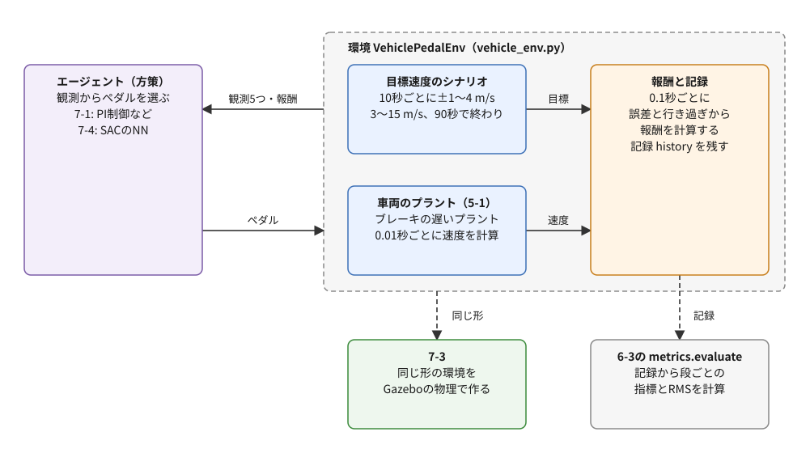
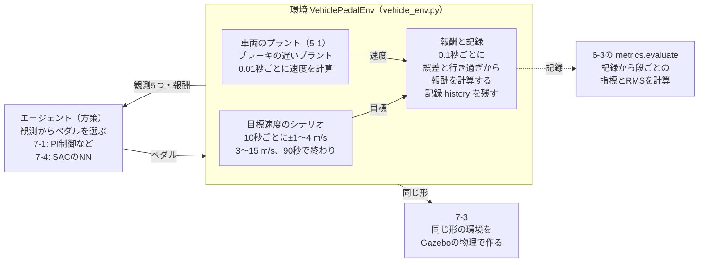

# フェーズ7-1 手順書: 車両の環境を作る（ペダルを選ぶ環境）

[`docs/learning_plan.md`](learning_plan.md) フェーズ7の7-1（[`docs/idea_origin.md`](idea_origin.md) ステップ6）に対応する。フェーズ5-1の車両のプラントを、Gymnasiumの環境として包む。方策（エージェント）は、0.1秒ごとにペダルの指令（−1〜1）を直接選び、環境は追従の良し悪しを報酬として返す。目標速度は、10秒ごとにランダムな幅で上がったり下がったりする。このページでは、環境を作ってSB3の `check_env` で点検し、PI制御を方策として当てはめたものや、ペダルを一定にした方策、でたらめな方策で動かして、報酬の性質を確かめ、SB3の学習の流れにつながることを確かめるところまでを扱う。次の7-3では、同じ形の環境を、フェーズ5-4のGazeboの物理で作り、7-4で、その環境でNNの方策を学習させる。

- 想定環境: WSL2 + Ubuntu 24.04 + ROS2 Jazzy（このページはROS2を使わず、ワークスペースのコードだけを借りる）
- 前提: フェーズ7-0（[`docs/phase7_0_rl_intro.md`](phase7_0_rl_intro.md)）。フェーズ6-3（[`docs/phase6_3_metrics.md`](phase6_3_metrics.md)）までを終え、`~/ros2_ws` の `learn_py` に、5-1の `vehicle_model.py`・5-2の `pi_control.py`・6-3の `metrics.py` があり、ビルドしてあること
- 所要目安: 2コマ
- 言語: Python（ROS2のノードは書かない）

> **この手順書の位置づけ**: フェーズ7（7-0〜7-6）は、ひととおり作成を終えた段階である。今後の見直しで、内容を改めることがある。このページは、2026-10-11に、PI制御のゲインを選ぶ環境から、ペダルを直接選ぶ環境に作り直した（最終ゴールまでの道筋を短くするため）。ゲインを選ぶ環境は、任意の7-2（[`docs/phase7_2_gain_tuning.md`](phase7_2_gain_tuning.md)）に移した。

> **進め方**: 1節で全体像を見て、2節で環境の設計（何を観測し、何を選ばせ、どんな目標速度で走らせ、何を報酬にするか）を決める。3節で、ワークスペースのコードを仮想環境から読み込めるようにする。4節で環境のクラスを書き、5節で点検して動かす。サンプルは学習の手がかりとして最小限に書いたもので、公式の文書の転載ではない。Gymnasiumの環境の決まりごとは、公式の文書（Create a Custom Environment）を自分の言葉でまとめた。

> **期待する結果の出どころ**: **筆者の環境（2026-10-11。SB3 2.9.0・Gymnasium 1.3.0・PyTorch 2.14.1（CPU版）。導入は [`docs/setup_rl_sb3.md`](setup_rl_sb3.md)）で、各スクリプトを実際に実行した表示**である。作成時は、ワークスペースをビルドする代わりに、5-1・5-2・6-3の手順書のコードと同じ3つのファイルを置いたフォルダを、環境変数 `PYTHONPATH` に加えて読み込んだ（3節の `source` が行うのと同じ仕組み）。目標速度のシナリオは乱数の種で決まるので、5-1節の報酬と指標の値は、同じ版なら何度実行しても同じになる。5-2節の学習の途中経過の表は、PCとライブラリの版によって変わることがあり、同じPCと同じ版なら `rollout/`・`train/` の値は同じになるが、`time/` の行（かかった時間と速さ）は実行ごとに変わる。

## 0. 学習目標と完了条件

1. Gymnasiumの環境のクラスが持つべきもの（観測と行動の空間、`reset`、`step`）を説明し、自分で書ける。
2. 車両の環境の観測・行動・報酬・エピソードを、フェーズ5・6の部品に当てはめて説明できる。
3. 目標速度をランダムに変えるシナリオにする理由と、乱数の種でシナリオを再現する方法を説明できる。
4. 観測に「前回のペダル」と「次に目標が変わるまでの時間」を入れる理由と、観測と行動の大きさをそろえる理由を説明できる。
5. 報酬の合計（収益）が、フェーズ6-3のRMSと、どう関係するかを説明できる。
6. SB3の `check_env` で環境を点検し、PI制御を方策として当てはめたものと、ほかの方策の収益を、複数のシナリオで比べられる。

完了条件: 5-1節で、`check_env` が通り、1つのシナリオをPI制御で走らせた結果を、6-3の指標で読める。そのうえで、ブレーキの遅いプラントでは、PI制御が減速の段で大きく行き過ぎることと、収益の内訳（最初の加速の段・RMSにあたる分・行き過ぎの減点）を説明できる。5-2節で、SB3のSACの学習がこの環境で動くことを確かめる。

## 1. 全体像

フェーズ5-2では、PI制御のゲインを、式から目安を立て、シミュレーションで確かめながら手で決めた。PI制御は、「偏差に比例して踏み、偏差の積み重ねに応じて踏み足す」という決まった式でペダルを計算する。フェーズ7の最終ゴールは、この式をやめ、強化学習で学習させたニューラルネットワーク（NN）に、観測から直接ペダルを選ばせることである。NNなら、目標との差や、目標が次に変わるまでの時間など、そのときの状況に応じて、毎回違うペダルを出せる。PI制御の式に縛られないので、うまく学べば、PI制御よりよい追従ができるかもしれない。

エージェントに試行錯誤させるには、まず「試す場所」が要る。フェーズ7-0の振り子では、Gymnasiumが環境を用意してくれていた。車両では、自分で環境を作る。と言っても、プラントの計算（5-1の `VehicleModel`）は、ROS2を使わないクラスとしてすでにある。このページでは、それを「エージェントが行動（ペダル）を選び、環境が観測と報酬を返す」という強化学習の形に包む。

環境は、次の7-3で、フェーズ5-4のGazeboの物理を使っても作る。最終ゴールに向けた学習（7-4）は、Gazeboの環境で行う。それでも、先にPythonの式で同じ形の環境を作るのは、式なら1エピソード（90秒分）を0.1秒程度で計算できるからである。Gazeboでは、1エピソードに40秒程度かかる（7-3の5節で測る）。環境の設計（観測・行動・報酬）を確かめ、方策をいろいろ当てはめて報酬の性質をつかむのは、すぐに結果が出る式の環境のほうが向いている。7-3では、同じ方策（PI制御）を式とGazeboの両方で走らせ、物理の違いで収益がどれだけ変わるかも比べる。

題材にするのは、ブレーキの時定数を1.0秒にした、**ブレーキの遅いプラント**である。フェーズ5-2の6-5節では、ブレーキの時定数を1.0秒にすると、同じゲインのPI制御でも、減速の段で目標より下まで落ちる（行き過ぎる）ことを見た。手で決めたPI制御が苦手とするプラントなので、NNがPI制御を上回る余地があるかもしれない（結果は7-4と7-5で確かめる）。

もう1つ考えるのが、どんな目標速度で走らせるかである。フェーズ6で記録した目標速度の階段（10 m/sまで加速し、5 m/s、0 m/sと下げる）は、毎回同じ1通りだった。同じ1通りの走り方だけで学ばせると、その走り方にだけ合った方策になりかねない。実際の道では、前の車に合わせて、速度を少し上げたり下げたりすることが多い。そこでこのページでは、走るたびに、目標速度が10秒ごとにランダムな幅で上下する「シナリオ」を作る。



<details>
<summary>同じ図（mermaid版）</summary>



</details>

- エージェントが選ぶのは、**ペダル**である。PI制御の式は使わない。このページでは、比べる基準として、PI制御の計算を「観測からペダルを返す方策」の形にして当てはめる（5-1節）。
- 環境の中のプラントの計算は、フェーズ5-2の4-2節の `closed_loop_sim.py` と同じく、0.01秒ずつ進める。エージェントが選んだペダルは、次に選ぶまでの0.1秒（10回分）の間、そのまま使う。
- 環境は、計算した速度の並びを、フェーズ6-3の4節の `metrics.py` と同じ形（時刻・目標・速度・ペダル）で残す。こうしておくと、6-3の指標の関数をそのまま当てはめて、段ごとの行き過ぎ量や整定時間を読める（このページの5-1節）。

## 2. 環境の設計

### 2-1. Gymnasiumの環境の決まりごと

Gymnasiumの環境は、クラス `gymnasium.Env` を受け継いだクラスとして書く。フェーズ7-0の3節で、用意された環境を `reset` と `step` で動かした。自分で環境を書くときは、その2つと、観測・行動の範囲を、自分で用意する。公式の文書（Create a Custom Environment）が示す決まりごとを、このページに要る範囲でまとめる。

| 用意するもの | 役割 |
|---|---|
| `self.observation_space` | 観測の形と範囲。連続値なら `spaces.Box(low, high, shape, dtype)` |
| `self.action_space` | 行動の形と範囲。同じく `spaces.Box` |
| `reset(seed=None, options=None)` | 新しいエピソードを始め、`(最初の観測, info)` を返す。最初に `super().reset(seed=seed)` を呼ぶ（環境の乱数 `self.np_random` の種が決まる） |
| `step(action)` | 行動を1回受け取って環境を進め、`(観測, 報酬, terminated, truncated, info)` の5つを返す（7-0の3-1節と同じ） |

`info` は、学習には使わない付加的な情報を入れる辞書である。このページでは、報酬の内訳を入れる。

環境の中で乱数を使うときは、Pythonの `random` やnumpyの共通の乱数ではなく、`self.np_random` を使う。`reset(seed=0)` のように種を渡すと `self.np_random` が作り直され、同じ種なら同じ乱数の並びになる。このページの環境は、目標速度のシナリオをこの乱数で作るので、種を決めれば同じシナリオを何度でも再現できる（2-4節）。

環境を書いたら、SB3の **`check_env`** で点検する。`check_env` は、空間の定義、`reset`・`step` の戻り値の形、観測が空間の範囲に収まっているかを確かめ、決まりごとから外れていればエラーで、SB3で学習しにくい作りなら警告で知らせる（SB3の公式の文書「Using Custom Environments」）。

### 2-2. 観測・行動・報酬・エピソード

フェーズ7-0の2-2節の用語の表に、このページの環境を当てはめる。

| 用語 | このページの環境 |
|---|---|
| エージェント | ペダルを選ぶもの（このページでは、PI制御を当てはめた方策、ペダルを一定にした方策、でたらめな方策。7-4でSACに学習させる） |
| 環境 | 目標速度のシナリオと車両のプラントを、まとめて計算するもの |
| 行動 | ペダルの指令1つ（−1〜1。正がアクセル、負がブレーキ。フェーズ5-1） |
| 観測 | 目標速度・現在速度（どちらも10 m/sで割る）、偏差（m/sのまま）、前回のペダル、次に目標が変わるまでの時間（10秒で割る）の5つ |
| 報酬 | 0.1秒ごとに、誤差の二乗と行き過ぎの二乗から計算する負の数（2-5節） |
| ステップ | 0.1秒（ペダルを選ぶ間隔） |
| エピソード | 1つのシナリオを最後まで走る、90秒（900ステップ）。走り切ると `terminated`（課題の終わり）で終わる（2-6節） |
| 方策 | 観測からペダルを選ぶ規則（このページでは、PI制御の計算、一定のペダル、でたらめ。7-4ではSACのNN） |
| 収益 | 1エピソード（900ステップ）の報酬の合計（2-5節で、RMSとの関係を示す） |

**なぜペダルを直接選ばせるのか**: 強化学習を制御に使う形は、大きく2つある。1つは、PI制御の式は残し、そのゲインだけを選ばせる形である。制御の仕組みは人が理解できるまま残るが、選ぶのは2つの数だけで、強化学習を使わずに格子状に全部試しても足りることが多い（任意の7-2で、この形を試し、格子の探索と比べる）。もう1つは、式そのものをやめ、観測からペダルを直接選ばせる形である。状況に応じて毎回違うペダルを出せるが、「偏差に応じてどう踏むか」という構造も、試行錯誤から学ぶことになる。最終ゴールでは、後者の形のNNを、ROS2のノードとしてPI制御の代わりに置く。

**なぜ0.1秒ごとに選ぶのか**: 5-2のPI制御は、0.02秒ごとにペダルを計算した。同じ間隔にすると、1エピソードが4500ステップになり、学習にかかる時間が延びる。アクセルとブレーキの遅れ（5-1の時定数。アクセル0.5秒、このページのブレーキ1.0秒）に比べれば、0.1秒は十分に短い。PI制御を0.1秒ごとに計算しても、目標を追いかけられることは、5-1節で確かめる。

**観測に前回のペダルを入れる理由**: PI制御には、偏差の積分という**記憶**がある（フェーズ5-2の2-1節）。積分の項が、これまでの偏差の積み重ねを覚えていて、その分だけペダルを足し引きするので、定常偏差（段の最後に残る目標との差。6-3）が0に近づく。NNの方策（SB3の既定の `MlpPolicy`）は、その時点の観測だけからペダルを決め、記憶を持たない。そこで、記憶の代わりになる手がかりとして、前回のペダルを観測に入れる。車両の駆動力と制動力は、ペダルに少し遅れて追いつく（フェーズ5-1の時定数）ので、今の速度だけでは、車両がこれから加速するのか減速するのかが分からない。前回のペダルは、その手がかりになる。偏差の積分そのものを観測に入れる方法もある（作成時の予備の試行で試した。[没案として残したページの7節](archive/phase7_3_pedal_policy_v1.md)）。

**観測に、次に目標が変わるまでの時間を入れる理由**: 目標速度は10秒ごとに変わり、90秒でエピソードが終わる。時刻が観測に無いと、エージェントは、例えば12秒と18秒の状態（どちらも目標に近づいた車両）を区別できない。しかし、次の変わり目までの長さが違うので、その先に受け取る報酬も違う。Gymnasiumの公式の文書（Handling Time Limits）は、長さの決まった課題では、残りの時間を観測に入れる必要があると述べている。この環境では、次に目標が変わるか、エピソードが終わるまでの秒数を10で割って、0〜1の数として入れる。

**観測の大きさをそろえる理由**: SB3の公式の文書（Reinforcement Learning Tips and Tricks）は、範囲が分かっているなら観測を正規化（およそ−1〜1の大きさにそろえること）するよう勧めている。NNは、入力の大きさがそろっているほうが学びやすいためである。目標と速度は0〜20 m/s程度なので10で割る。前回のペダルは、もともと−1〜1である。偏差だけは、割らずにm/sのまま渡す。10で割ると、0.1 m/sのずれはNNには0.01にしか見えず、目標の近くでの細かな差が埋もれやすいからである（作成時に、10で割った場合とm/sのままの場合を比べ、m/sのままのほうがNNの学習が進みやすかった。[没案として残したページの3-3節](archive/phase7_3_pedal_policy_v1.md)）。偏差は、目標が変わった直後でも±4 m/s程度に収まる。観測の空間は、余裕をみて−5〜5とし、外に出た値は−5〜5に切りそろえる（止まった状態から始めた直後は、偏差が5 m/sを超えるので、5になる。5-1節の最初の観測）。

### 2-3. 行動を−1〜1にそろえる

SB3の公式の文書（Tips and Tricks）は、連続値の行動の範囲を、−1〜1の対称な範囲にそろえるよう勧めている。範囲がそろっていないと、学習の初めの探索がかたよったり、範囲の端に張り付いたりして、学習がうまく進まないことがあり、原因にも気づきにくいからである。範囲が違う量（例えば、0〜2の値）を選ばせたいときも、環境が受け取る行動は−1〜1にし、環境の中で引き延ばす（任意の7-2では、ゲインをこの形で選ばせる）。

ペダルの指令は、フェーズ5-1で決めたとおり、もともと−1〜1（−1がブレーキ全開、1がアクセル全開）なので、そのまま行動にできる。`check_env` は、行動の範囲が−1〜1でなければ警告を出す（このページの5-1節の末尾の課題1で確かめる）。

### 2-4. 目標速度のシナリオ

1つのエピソードの目標速度は、次のように作る。

- 最初の目標を、5〜12 m/sの間でランダムに決める。車両は、止まった状態から始める。
- 10秒、20秒、…、80秒の8回、目標を、1〜4 m/sのランダムな幅で、ランダムな向き（上げるか下げるか）に変える。
- 目標は3〜15 m/sの範囲に収める。変えた先が範囲から出るなら、向きを逆にする。
- 90秒で終わる。

この形にした理由は3つある。

- **毎回違う走り方にする**: 1通りのシナリオだけで学ばせると、その走り方にだけ合った方策になりかねない。シナリオを乱数で作れば、上げる段と下げる段、小さな段と大きな段が混ざった、いろいろな走り方で良し悪しを測れる。
- **方策の差が表れる大きさの段にする**: 0 → 10 m/sのような大きな段では、アクセルを踏み切っている（ペダルが+1に張り付いている）時間が長い（フェーズ6-3の7-2節の比較表で、6.08秒）。張り付いている間は、どんな方策でも、それ以上は速く加速できないので、その間の誤差は方策では減らせない。段の幅を1〜4 m/sにすると、張り付く時間が短くなり、方策の良し悪しが追従に表れやすい（段の幅を大きくした場合は、このページの5-1節の末尾の課題2で確かめる）。
- **止まった状態から始める**: 7-3のGazeboの車両は、エピソードの始めに速度を与えるのが難しいので、止まった状態から始める。このページの環境も同じにして、式とGazeboで、同じシナリオを同じ条件で比べられるようにした。最初の10秒は、止まった状態から最初の目標へ加速する段になる。

シナリオの乱数には、2-1節の `self.np_random` を使う。`reset(seed=0)` で始めれば、何度実行しても、同じ種のシナリオは同じになる。このページでは、方策の良し悪しを、種0〜19の20通りのシナリオの収益の平均で比べる。

### 2-5. 報酬

報酬は、フェーズ6-3の9節で考えた2つの案を合わせた形にした。全体の1つの数（RMSの二乗にあたる、誤差の二乗の平均）に、行き過ぎの減点を重み付きで足す。0.1秒（1ステップ）ごとに、その0.1秒の間の誤差 $e = r - v$（目標 − 速度）と、行き過ぎ $o$ を、0.01秒ごとに積み上げる。

$$
\text{報酬} = -\frac{10}{90} \sum_{\text{その0.1秒の間}} \left( e^2 + 20 o^2 \right) \Delta t
$$

- $\Delta t$ はプラントの刻み幅（0.01秒）、90はエピソードの長さ（秒）、10は報酬に掛ける数（`reward_scale`。この節の末尾）である。
- **行き過ぎ** $o$ は、目標が変わった向きに、速度が目標を超えた量である（超えていなければ0）。目標を上げた段では「速度 − 目標」、下げた段では「目標 − 速度」の正の部分になる。フェーズ6-3の2-2節の行き過ぎ量と同じ向きの考え方で、こちらは割合ではなく速度の差（m/s）のまま使う。最初の10秒は、目標がまだ変わっていない（止まった状態から最初の目標へ加速する段で、上げる・下げるの向きが無い）ので、行き過ぎは数えない。
- 目標を超えた側の誤差は、 $e^2 + 20 o^2 = 21 e^2$ となり、21倍重く数えることになる。目標に届かない側の誤差は、 $o = 0$ なので $e^2$ のままである。

**収益とRMSの関係**: 1エピソードの報酬を全部足すと、90秒全体で $e^2 + 20 o^2$ を積み上げて90で割り、10を掛けた量のマイナスになる。

$$
\text{収益} = -10 \times \left( \text{誤差の二乗の平均} + 20 \times \text{行き過ぎの二乗の平均} \right)
$$

平均は、どちらも90秒の平均である。収益が大きい（0に近い）ほど、追従がよい。報酬を90で割ったのは、収益を、エピソードの長さによらない「平均」の大きさにそろえるためである。フェーズ6-3のRMSは、最初に目標が変わった10秒からの80秒で数える（6-3の2-2節の表）ので、収益には、RMSに入らない最初の10秒の加速の段の誤差も入る。実際の値での内訳は、このページの5-1節で確かめる。

**報酬に10を掛ける理由**: 0.1秒ごとの1ステップの報酬は、10を掛けないと、とても小さい（目標と1 m/sずれていても、 $1^2 \times 0.1 \div 90 \approx 0.0011$ ）。値が小さすぎると、追従のよしあしの差が、NNの学習の中で埋もれやすい。作成時に、Pythonの式の環境で比べると、報酬を10倍にし、偏差をm/sのまま渡す組み合わせで、NNの学習が進みやすかった（[没案として残したページの3-3節](archive/phase7_3_pedal_policy_v1.md)）。掛ける数は、引数 `reward_scale` で変えられる。報酬の内訳（`info`）は、掛ける前の値で返すので、掛ける数を変えても、同じ物差しで比べられる。

> **補足: 報酬の重みの決め方**
>
> - **一般的な考え方**: 報酬に複数の項を足し合わせるとき、それぞれの重みは「何をどれだけ嫌うか」という設計者の判断である。強化学習のエージェントは、報酬を大きくすることだけを目指すので、報酬に入れなかった性質（例: 乗り心地）は気にしないし、重みの比のとおりに性質を取引する。
> - **この環境で重みを20にした理由**: フェーズ6-3の7-2節の比較表のとおり、RMSだけでは「行き過ぎるが速い」と「行き過ぎないが遅い」の区別がつかない。車両では、目標を超える（前の車に近づきすぎる）ほうが、届かないより困ることが多い。そこで、行き過ぎを大きく減点するように、筆者が目安として20を選んだ。重みを変えると、学習した方策の行き過ぎの大きさが変わる。これは7-4で確かめる（任意の7-2では、ゲインを選ぶ形で、追従の速さと行き過ぎのバランスがどう変わるかを、より詳しく確かめる）。
> - **実務の目安**: 重みは、学習させた結果の振る舞い（行き過ぎ量・整定時間などの指標）を見て調整する。報酬の値だけを見ていると、重みを変えたことによる見かけの改善と、本当の改善を取り違えやすい。そのため、報酬とは別に、6-3の指標のような「人が読める数」で結果を確かめる。

### 2-6. エピソードの終わり方

この環境には、失敗して終わる条件（フェーズ7-0の3-1節のCartPoleで、棒が倒れる、のようなもの）が無い。エピソードは常に、シナリオを最後まで走り切った90秒で終わる。このとき、`step` は `terminated`（課題の終わり）を `True` にして返す。

フェーズ7-0の2-3節で見たとおり、Gymnasiumは終わり方を2つに分け、学習のアルゴリズムはこの2つを違うものとして扱う。振り子は、本来はいつまでも続けられる課題を、200ステップで区切っているだけなので、`truncated`（時間切れ）だった。アルゴリズムは「この先も報酬が続いていたはず」とみなし、終わりの観測からの見込み（その先の収益の見積もり）を収益に足し込んで学ぶ。一方、この環境の90秒は、走るシナリオそのものの終わりで、その先に続きは無い。そのため `terminated` にする。2-2節で、残りの時間を観測に入れたのも、この終わり方に合わせたものである。エージェントは、観測から「あと何秒で終わるか」が分かる。

## 3. ワークスペースのコードを読み込めるようにする

環境は、5-1の `vehicle_model.py` を、`learn_py` パッケージから読み込む。5節の点検のスクリプトは、5-2の `pi_control.py` と6-3の `metrics.py` も読み込む。この3つは `rclpy` を使わないので、ROS2のノードを起動しなくても、Pythonの普通のモジュールとして読み込める。ROS2の一式（5-3・5-4）と同じファイルを使うので、強化学習の側とROS2の側で、計算の食い違いが起きない。

`learn_py` を読み込めるようにするのは、ワークスペースの `install/setup.bash` である。`source` すると、環境変数 `PYTHONPATH`（Pythonがモジュールを探す場所の一覧）に、ワークスペースのPythonのパッケージの場所が加わる。仮想環境を有効にしても `PYTHONPATH` は残るので、仮想環境のPythonからも `learn_py` が見える（[強化学習の環境構築の5節](setup_rl_sb3.md)）。

ビルドは、これまでどおり、仮想環境を有効に**していない**ターミナルで行う（環境構築の5節）。5-1・5-2・6-3のファイルをビルド済みなら、ビルドし直す必要はない。強化学習のスクリプトを動かすターミナルでは、次のように準備する。

```bash
source ~/ros2_ws/install/setup.bash

source ~/rl_venv/bin/activate

cd ~/rl_practice

python -c "from learn_py.vehicle_model import VehicleModel; from learn_py.pi_control import PIController; from learn_py.metrics import evaluate; print('learn_py: OK')"
```

**期待する結果**:

```text
learn_py: OK
```

プロンプトの先頭に `(rl_venv)` が付き、`learn_py: OK` と表示されれば、仮想環境のPythonから、ワークスペースの3つのモジュールを読み込めている。このページのスクリプトは、7-0と同じ練習用のフォルダ `~/rl_practice` に置く。新しいターミナルを開いたら、最初の2つの `source` からやり直す。

## 4. 環境のクラス（`vehicle_env.py`）

ファイル: `~/rl_practice/vehicle_env.py`（ファイルの置き方は [サンプルコードを練習環境に置く方法](howto_place_code.md)）

```python
# 5-1の車両のプラントを、方策がペダル（-1〜1）を0.1秒ごとに直接選ぶ、Gymnasiumの環境として包む（ROS2を使わない）。
# 目標速度は10秒ごとにランダムな幅で変わる。7-3では、同じ形の環境を、Gazeboの物理で作る。
import gymnasium as gym
import numpy as np
from gymnasium import spaces

from learn_py.vehicle_model import VehicleModel, VehicleParams

PLANT_DT = 0.01         # プラントの計算の刻み幅 [s]（5-2の closed_loop_sim と同じ）
CONTROL_INTERVAL = 0.1  # ペダルを選ぶ間隔 [s]（90秒で900回）
EPISODE_LENGTH = 90.0   # エピソードの長さ [s]
CHANGE_INTERVAL = 10.0              # 目標速度を変える間隔 [s]（10秒、20秒、…、80秒の8回）
FIRST_TARGET = (5.0, 12.0)          # 最初の目標速度の範囲 [m/s]
TARGET_MIN, TARGET_MAX = 3.0, 15.0  # 目標速度の範囲 [m/s]


# 乱数 rng で、目標速度の並び（最初の目標と、10秒ごとに変わった後の目標）を作る。
def make_targets(rng, step_range):
    targets = [rng.uniform(*FIRST_TARGET)]
    for _ in range(round(EPISODE_LENGTH / CHANGE_INTERVAL) - 1):
        delta = rng.uniform(*step_range) * rng.choice([-1.0, 1.0])
        if not TARGET_MIN <= targets[-1] + delta <= TARGET_MAX:
            delta = -delta  # 範囲から出るなら、向きを逆にする
        # 逆にしても出る（幅が大きい）ときは、範囲の端にそろえる
        targets.append(float(np.clip(targets[-1] + delta, TARGET_MIN, TARGET_MAX)))
    return targets


# 車両のペダルを選ぶ環境。観測は目標・速度・偏差・前回のペダル・次の変わり目までの時間の5つ、行動はペダル1つ。
class VehiclePedalEnv(gym.Env):
    # overshoot_weight は行き過ぎの重み、reward_scale は報酬に掛ける数、error_scale は偏差を割る数 [m/s]、
    # step_range は目標を変える幅 [m/s]、params はプラントのパラメータ（既定はブレーキの遅いプラント）。
    def __init__(self, overshoot_weight=20.0, reward_scale=10.0, error_scale=1.0,
                 step_range=(1.0, 4.0), params=None):
        self.overshoot_weight = overshoot_weight
        self.reward_scale = reward_scale
        self.error_scale = error_scale
        self.step_range = step_range
        self.params = params if params is not None else VehicleParams(tau_brake=1.0)
        self.observation_space = spaces.Box(low=-5.0, high=5.0, shape=(5,), dtype=np.float32)
        self.action_space = spaces.Box(low=-1.0, high=1.0, shape=(1,), dtype=np.float32)

    # 目標速度の並びを乱数で作り、止まった車両から、新しいエピソードを始める。
    def reset(self, seed=None, options=None):
        super().reset(seed=seed)
        self.targets = make_targets(self.np_random, self.step_range)
        self.plant = VehicleModel(self.params)  # 速度0・力0の、止まった状態
        self.pedal = 0.0
        self.step_count = 0  # プラントを進めた回数（時刻は step_count × PLANT_DT）
        self.history = []    # (時刻, 目標, 速度, ペダル) の並び。6-3の metrics.evaluate に渡せる
        return self._observation(), {}

    # 時刻 t の段の番号（最初の段が0、10秒からが1、…、80秒からが8）。
    def _segment(self, t):
        return min(int((t + 1e-9) // CHANGE_INTERVAL), len(self.targets) - 1)

    # ペダルを行動のとおりにして、CONTROL_INTERVAL 秒分を計算し、報酬を返す。
    def step(self, action):
        self.pedal = float(np.clip(action[0], -1.0, 1.0))
        squared_error = 0.0
        squared_overshoot = 0.0
        for _ in range(round(CONTROL_INTERVAL / PLANT_DT)):
            t = self.step_count * PLANT_DT
            k = self._segment(t)
            target = self.targets[k]
            self.history.append((round(t, 2), target, self.plant.velocity, self.pedal))
            error = target - self.plant.velocity
            # 目標が変わった向き（最初の段は変わっていないので0）に、速度が目標を超えた量
            direction = 0.0 if k == 0 else np.sign(target - self.targets[k - 1])
            overshoot = max(0.0, -error * direction)
            squared_error += error ** 2 * PLANT_DT
            squared_overshoot += overshoot ** 2 * PLANT_DT
            self.plant.step(self.pedal, PLANT_DT)
            self.step_count += 1
        # 報酬: 誤差の二乗と、目標を超えた分の二乗（重み付き）の、エピソードの長さあたりの量のマイナスに、reward_scale を掛ける
        reward = -(squared_error + self.overshoot_weight * squared_overshoot) / EPISODE_LENGTH
        terminated = self.step_count * PLANT_DT >= EPISODE_LENGTH - 1e-9
        info = {'squared_error': squared_error / EPISODE_LENGTH,
                'squared_overshoot': squared_overshoot / EPISODE_LENGTH}
        return self._observation(), float(reward * self.reward_scale), terminated, False, info

    # 観測: 目標・速度（10 m/sで割る）、偏差（error_scale で割る）、前回のペダル、次の変わり目までの時間（10秒で割る）。
    def _observation(self):
        t = self.step_count * PLANT_DT
        target = self.targets[self._segment(t)]
        v = self.plant.velocity
        remaining = (min(EPISODE_LENGTH, (self._segment(t) + 1) * CHANGE_INTERVAL) - t) / CHANGE_INTERVAL
        obs = np.array([target / 10.0, v / 10.0, (target - v) / self.error_scale,
                        self.pedal, remaining], dtype=np.float32)
        return np.clip(obs, -5.0, 5.0)
```

**`vehicle_env.py` の解説**

- **定数**: `PLANT_DT` は、フェーズ5-2の4-2節の `closed_loop_sim.py` と同じ値。`CONTROL_INTERVAL` は、ペダルを選ぶ間隔（2-2節）。`EPISODE_LENGTH` から `TARGET_MIN`・`TARGET_MAX` までが、2-4節のシナリオの決まりである。7-3のGazeboの環境と、任意の7-2のゲインを選ぶ環境も、このファイルから、シナリオの決まりと `make_targets` を読み込んで使う。
- **`make_targets`**: 2-4節のシナリオの目標の並び（最初の目標と、8回変わった後の目標の、9つの数）を作る。`rng.uniform(a, b)` はa〜bの一様な乱数、`rng.choice([-1.0, 1.0])` は向きを決める。幅が1〜4 m/sなら、向きを逆にすれば必ず3〜15 m/sに収まる。逆にしても出るのは、幅を範囲の半分（6 m/s）より大きくした場合だけで、そのときは `np.clip` で範囲の端にそろえる（このページの5-1節の末尾の課題2）。
- **`__init__`**: 2-1節の表の2つの空間を作る。観測は5つの数で範囲は−5〜5、行動は1つの数で範囲は−1〜1。`overshoot_weight` は2-5節の重み、`reward_scale` は2-5節の報酬に掛ける数、`error_scale` は観測の偏差を割る数（既定の1 m/sなら、m/sのまま。2-2節）、`step_range` は2-4節の段の幅で、引数で変えられる。`params` で、プラントのパラメータ（5-1の `VehicleParams`。時定数など）を変えられる。渡さなければ、ブレーキの時定数を1.0秒にした、ブレーキの遅いプラントになる（1節）。
- **`reset`**: 最初に `super().reset(seed=seed)` を呼び、その後の `self.np_random` で、シナリオの目標の並びを作る（2-1節）。プラントは、5-1の `VehicleModel` を作り直すだけで、速度0・力0の止まった状態から始まる。最初の観測の「前回のペダル」は0にする。
- **`_segment`**: 時刻 `t` が何番目の段かを返す。10秒で割った商が段の番号で、80秒より後（と、終わりの90秒ちょうど）は最後の段（8）にする。`1e-9` は、小数の計算の誤差で、10秒ちょうどがわずかに前の段に入るのを防ぐ。
- **`step`**: 2-5節の報酬を計算する部分が、`closed_loop_sim.py` の `simulate` に加わったものである。
  - 最初に、行動のペダルを−1〜1に収める（`np.clip`。範囲の外の行動が来ても、プラントには範囲の中の値を渡す）。
  - 0.1秒分（10回）、プラントを0.01秒ずつ進める。ペダルは、その間ずっと同じ値を使う。
  - 0.01秒ごとに、誤差の二乗と行き過ぎの二乗を、刻み幅を掛けて積み上げる（2-5節の式の $\sum (\cdots) \Delta t$）。`direction` は、その段で目標が変わった向き（上げたら1、下げたら−1、最初の段は0）で、行き過ぎ `overshoot` は `-error * direction` の正の部分である。最初の段は `direction` が0なので、行き過ぎは数えない。
  - `terminated` は、時刻が90秒に達したら `True` にする（2-6節）。`truncated` は、常に `False`。
  - `info` には、報酬の内訳（誤差の二乗の分と、行き過ぎの二乗の分。どちらも90で割った値。重みと `reward_scale` は掛けていない）を入れる。
- **`_observation`**: 観測の5つの数を作る（2-2節）。5つめの `remaining` は、次の段の始まり（最後の段では、エピソードの終わりの90秒）までの秒数を10で割ったもので、段の始まりで1、終わりで0に近づく。`np.float32` で作り、`np.clip` で観測の空間（−5〜5）に収める。観測が空間の外に出ると、`check_env` が誤りとして知らせる。

## 5. 点検して動かす

### 5-1. `check_env` で点検し、方策を比べる

PI制御を、観測を受け取ってペダルを返す「方策」の形にして、この環境に当てはめる。比べる相手として、ペダルを一定（0.5）にした方策と、でたらめな方策も動かす。

ファイル: `~/rl_practice/check_vehicle_env.py`

```python
# 車両のペダルの環境を check_env で点検し、PI制御・ペダルを一定にした方策・でたらめな方策で動かして比べる。
import numpy as np
from stable_baselines3.common.env_checker import check_env

from learn_py.metrics import evaluate, format_report
from learn_py.pi_control import PIController
from vehicle_env import CONTROL_INTERVAL, VehiclePedalEnv

SEEDS = range(20)  # 比べるシナリオ（乱数の種）の並び


# 5-2のPI制御を、観測からペダルを返す方策の形にする（0.1秒ごとに計算する）。
class PIPolicy:
    # ゲインを受け取り、積分の項が0のPI制御器を作る。
    def __init__(self, kp=0.5, ki=0.1):
        self.controller = PIController(kp=kp, ki=ki)

    # 観測 obs の目標と速度（10で割ったもの）を戻して偏差を計算し、ペダル（1つの数のリスト）を返す。
    def __call__(self, obs):
        return [self.controller.update(obs[0] * 10.0 - obs[1] * 10.0, CONTROL_INTERVAL)]


# 方策 policy で、種 seed のシナリオを1エピソード動かし、収益を返す。
def run_episode(env, policy, seed):
    obs, info = env.reset(seed=seed)
    total = 0.0
    while True:
        obs, reward, terminated, truncated, info = env.step(np.asarray(policy(obs), dtype=np.float32))
        total += reward
        if terminated or truncated:
            return total


# 点検 → 種0のシナリオをPI制御で1エピソード → 20通りのシナリオでの方策の比較、の順に行う。
def main():
    env = VehiclePedalEnv()
    check_env(env)
    print('check_env: OK')
    print('observation_space:', env.observation_space)
    print('action_space     :', env.action_space)
    obs, info = env.reset(seed=0)
    print('targets          :', np.round(env.targets, 2))
    print('first observation:', obs)

    total = run_episode(env, PIPolicy(), seed=0)
    print(f'\nseed 0, PI (kp=0.5, ki=0.1): return {total:.2f}')
    times, targets, velocities, pedals = (list(c) for c in zip(*env.history))
    for line in format_report(*evaluate(times, targets, velocities, pedals)):
        print('  ' + line)

    env.action_space.seed(0)
    policies = {  # 方策を作る関数（PI制御は、エピソードごとに積分の項を0から始める）
        'PI (0.5, 0.1)': PIPolicy,
        'pedal 0.5': lambda: (lambda obs: [0.5]),
        'random': lambda: (lambda obs: env.action_space.sample()),
    }
    print(f'\npolicy          return (mean, std over {len(SEEDS)} seeds)')
    for name, make_policy in policies.items():
        returns = [run_episode(env, make_policy(), seed) for seed in SEEDS]
        print(f'{name:14s} {np.mean(returns):9.2f}  {np.std(returns):8.2f}')
        if name.startswith('PI'):
            pi_returns = returns
    print('PI, seeds 0-2  :', np.round(pi_returns[:3], 2))


if __name__ == '__main__':
    main()
```

- **`PIPolicy`**: 5-2の `PIController`（既定のゲイン `kp` 0.5・`ki` 0.1）を、0.1秒ごとに計算する。観測の1つめと2つめは、目標と速度を10で割ったものなので、10を掛けて戻し、偏差を求める。`__call__` を書いたクラスの値は、関数のように `policy(obs)` で呼べる。方策がNNでも、PI制御でも、「観測を受け取ってペダルを返すもの」という同じ形なので、同じ環境で比べられる。
- **`run_episode`**: フェーズ7-0の3-2節の同じ名前の関数と同じ形で、種 `seed` のシナリオで1エピソード動かし、収益を返す。方策が返したペダルを、`np.asarray(..., dtype=np.float32)` で、行動の空間と同じ形の配列にしてから渡す。
- `main` の前半で、`check_env` で点検し、種0のシナリオの目標の並びと、最初の観測を表示する。続けて、そのシナリオをPI制御で1エピソード動かし、フェーズ6-3の `evaluate`・`format_report` で段ごとの指標を表示する。
- 後半で、3つの方策の収益を、種0〜19の20通りのシナリオで測り、平均と標準偏差（ばらつきの大きさ）を表示する。`policies` の値は、方策そのものではなく、方策を**作る関数**である。PI制御は積分の項を持つので、エピソードごとに作り直して、積分の項を0から始める。`lambda: (lambda obs: [0.5])` は、「いつもペダル0.5を返す方策」を作る関数である。`env.action_space.sample()` は、行動の空間からでたらめに1つ選ぶ。`env.action_space.seed(0)` は、7-0の3-2節と同じく、でたらめな行動の並びを毎回同じにするためのものである。
- 最後の行は、PI制御の種0〜2の収益で、7-3の5-2節で、Gazeboの環境の同じシナリオの収益と比べるのに使う。

```bash
python check_vehicle_env.py
```

5秒程度で終わる。

**期待する結果**:

```text
check_env: OK
observation_space: Box(-5.0, 5.0, (5,), float32)
action_space     : Box(-1.0, 1.0, (1,), float32)
targets          : [ 9.46  7.65  6.6  10.04 12.86  9.67 13.48 10.03  6.46]
first observation: [0.9458732 0.        5.        0.        1.       ]

seed 0, PI (kp=0.5, ki=0.1): return -46.61
  step          over[%]  rise[s]  settle[s]  error  sat[s]
   9.5 ->  7.6    38.94    1.04     9.61   +0.04    0.00
   7.6 ->  6.6    19.44    1.16     6.81   +0.01    0.00
   6.6 -> 10.0     0.00    2.89     8.88   +0.06    2.50
  10.0 -> 12.9     0.00    3.24        -   +0.07    2.90
  12.9 ->  9.7    35.16    0.86     6.98   -0.03    0.40
   9.7 -> 13.5     0.00    4.21        -   +0.10    4.10
  13.5 -> 10.0    31.39    0.90     7.16   -0.03    0.80
  10.0 ->  6.5    28.18    0.89        -   -0.14    0.40
  RMS error: 1.033 m/s

policy          return (mean, std over 20 seeds)
PI (0.5, 0.1)     -40.11     16.21
pedal 0.5        -369.59    246.33
random          -6492.94   2765.30
PI, seeds 0-2  : [-46.61 -35.45 -23.51]
```

- **1〜3行目**: `check_env` が、警告も誤りも出さずに通った。観測と行動の空間は、4節の `__init__` で決めたとおりである。
- **`targets`**: 種0のシナリオの目標の並び。最初は9.46 m/sで、10秒ごとに7.65、6.6、10.04…と変わる。上げる段と下げる段が混ざり、幅は1〜4 m/sの間にある。
- **`first observation`**: 最初の観測は、目標0.946（9.46 m/s ÷ 10）、速度0（止まった状態）、偏差5.0、前回のペダル0、次の変わり目まで1.0（10秒 ÷ 10）。偏差は9.46 m/sだが、観測の空間の上限（5）で切りそろえられている（2-2節）。
- **段ごとの指標（下げる段）**: ブレーキの遅いプラントなので、PI制御は、どの下げる段でも、19〜39%と大きく行き過ぎる（目標より下まで落ちる）。ブレーキの効きが遅れる間に速度が下がり続け、ブレーキを緩めても、効きが抜けるのにも時間がかかるためである。フェーズ5-2の6-5節と同じ現象である（5-2は0.02秒ごとの計算で、このページは0.1秒ごと）。
- **段ごとの指標（上げる段）**: 上げる段（6.6 → 10.0など）では、行き過ぎは無いが、アクセルを踏み切る時間（`sat[s]`）が2.5〜4.1秒ある。10.0 → 12.9と9.7 → 13.5の段は、10秒の間に落ち着かない（整定時間が `-`）。速度が高いほど抵抗が大きく、アクセルの余力が小さいので、加速に時間がかかるためである。
- **`return -46.61` の内訳**: 2-5節のとおり、収益には、6-3のRMSに入らない最初の10秒（止まった状態から9.46 m/sへの加速）も入る。作成時に内訳を計算すると、最初の10秒の誤差の分が約−24.61、10秒からの80秒の誤差の分が約−9.48、行き過ぎの減点が約−12.51だった。真ん中の値は、RMSから $-10 \times \frac{80}{90} \times 1.033^2 \approx -9.48$ と計算でき、6-3のRMSとちょうど対応する。最初の加速の段は、止まった状態から目標まで速度を上げるしかなく、アクセルを踏み切っても時間がかかるので、この分の多くは、どの方策でも減らしにくい（どこまで減らせるかの下限は、作成時には確かめていない）。
- **最後の表**: 20通りのシナリオの平均で比べると、PI制御（−40.11）が最もよく、ペダル0.5を踏み続ける方策（−369.59）、でたらめな方策（−6492.94）の順に、桁違いに悪くなる。ペダル0.5のままでは、駆動力（1500 N）と抵抗が釣り合う約9.14 m/sで頭打ちになり（5-1の2-3節の定常速度）、目標の上げ下げを追いかけない。でたらめな方策は、ブレーキとアクセルを0.1秒ごとにでたらめに踏み、ほとんど走れない。ペダルを直接選ぶ形では、方策がまずいと、収益がとても悪くなる。7-4で学習させるNNは、学習の初めは、このでたらめな方策に近いところから始まる。
- **`PI, seeds 0-2`**: PI制御の、種0・1・2のシナリオの収益である。シナリオによって、−23.51〜−46.61と違う。7-3の5-2節で、同じシナリオをGazeboの環境で走らせた収益と比べる。

> 課題1: `main` の `env = VehiclePedalEnv()` の次の行に、`env.action_space = gym.spaces.Box(low=0.0, high=2.0, shape=(1,), dtype=np.float32)` を足し（ファイルの先頭に `import gymnasium as gym` も足す）、行動の範囲を−1〜1でなくした環境を `check_env` で点検する。`UserWarning: We recommend you to use a symmetric and normalized Box action space (range=[-1, 1])` という警告が出る（2-3節）。確かめたら、足した2行を消して元に戻す。
>
> 課題2: `main` の `env = VehiclePedalEnv()` を `env = VehiclePedalEnv(step_range=(3.0, 8.0))` に変え、段の幅を3〜8 m/sに大きくする。種0のシナリオの目標は `[ 9.46  5.11  8.19  3.  9.03  3.  10.68  3.6  10.88]` になり、3.0 m/sで範囲の端にそろえられた段がある（4節の `make_targets` の解説）。PI制御の収益は−46.61から−97.40に悪くなり、アクセルやブレーキを踏み切る時間（`sat[s]`）が最大5.40秒に延びる。20通りの平均は、PI制御が−91.82、ペダル0.5が−265.60、でたらめな方策が−5340.03になる。PI制御とペダル0.5の比は、幅が1〜4 m/sのときの約9倍（−40.11と−369.59）から約3倍に縮む。段が大きいと、ペダルを踏み切っている間の、方策では減らせない誤差が収益の大部分を占め、方策の差が埋もれやすい（2-4節）。確かめたら、`VehiclePedalEnv()` に戻す。
>
> 課題3: ブレーキの遅いプラントを題材にした理由（1節）を確かめる。ファイルの先頭の `from vehicle_env import ...` の前の行に `from learn_py.vehicle_model import VehicleParams` を足し、`env = VehiclePedalEnv()` を `env = VehiclePedalEnv(params=VehicleParams())`（ブレーキの時定数が既定の0.2秒のプラント）に変える。種0のシナリオのPI制御の収益は−33.78になり、下げる段の行き過ぎ量は0.06〜20.15%（ブレーキの遅いプラントでは19.44〜38.94%）に収まる。20通りの平均は−30.58で、ブレーキの遅いプラントの−40.11は、これより約31%悪い。確かめたら、2か所を元に戻す。

### 5-2. SB3の学習につなぐ

最後に、この環境で、SB3のSACの学習がそのまま動くことを確かめる。学習の成果を見るのは7-4（Gazeboの環境）なので、ここでは5エピソード分だけ動かす。

ファイル: `~/rl_practice/smoke_sac.py`

```python
# 車両のペダルの環境で、SB3のSACを少しだけ動かし、学習の流れにつながることを確かめる（学習の成果は見ない）。
from stable_baselines3 import SAC

from vehicle_env import VehiclePedalEnv


# 5エピソード分（4500ステップ）だけ学習させ、途中経過の表を出す。
def main():
    model = SAC('MlpPolicy', VehiclePedalEnv(), verbose=1, seed=0)
    model.learn(total_timesteps=4500, log_interval=5)


if __name__ == '__main__':
    main()
```

フェーズ7-0の4-2節の `train_sac_pendulum.py` と同じ形で、環境を `gym.make('Pendulum-v1')` から `VehiclePedalEnv()` に差し替え、ステップ数を4500（900ステップ × 5エピソード）に減らし、モデルの保存と評価を省いたものである。自分で作った環境も、Gymnasiumの決まりごとに従っていれば、用意された環境と同じようにSB3に渡せる。`seed=0` を渡すと、SB3が環境の乱数の種も決めるので、エピソードごとに違うシナリオが、毎回同じ順に出てくる。

```bash
python smoke_sac.py
```

1分程度かかる。

**期待する結果**（数は、PCとライブラリの版によって変わる。`time/` の行は実行ごとに変わる）:

```text
Using cpu device
Wrapping the env with a `Monitor` wrapper
Wrapping the env in a DummyVecEnv.
----------------------------------
| rollout/           |           |
|    ep_len_mean     | 900       |
|    ep_rew_mean     | -4.92e+03 |
| time/              |           |
|    episodes        | 5         |
|    fps             | 88        |
|    time_elapsed    | 50        |
|    total_timesteps | 4500      |
| train/             |           |
|    actor_loss      | 92.2      |
|    critic_loss     | 113       |
|    ent_coef        | 0.357     |
|    ent_coef_loss   | -0.643    |
|    learning_rate   | 0.0003    |
|    n_updates       | 4399      |
----------------------------------
```

- 途中経過の表は、5エピソードごとに出る（`log_interval=5`）。表の読み方は、フェーズ7-0の4-2節と同じである。
- **`ep_len_mean` 900**: 1エピソードが900ステップ（0.1秒ごとに90秒分）で終わっている。
- **`ep_rew_mean` −4.92e+03**: 5エピソードの収益の平均（約−4920）である。学習の初めは、SACがほぼでたらめに行動を選ぶので、5-1節のでたらめな方策（20通りの平均で約−6490）に近い、とても悪い値になる。5エピソードでは、まだ学習の成果は見えない。
- **`n_updates` 4399**: NNを更新した回数である。SB3のSACは、最初の100ステップは経験をためるだけで更新せず（`learning_starts` の既定）、その後は1ステップごとに1回更新するので、4500 − 100 = 4400回に近い数になる。
- **`fps` 88**: 1秒あたりのステップの数で、1ステップに約11ミリ秒かかっている。式の環境は1エピソードを約0.1秒で計算できるので、この時間のほとんどは、NNの更新にかかっている。7-3の5-2節で、Gazeboの環境で学習させる時間を見積もるときの参考になる。
- この表が出て、誤りなく終われば、環境はSB3の学習の流れにつながっている。

## 6. 本フェーズのまとめ

- Gymnasiumの環境は、観測と行動の空間、`reset`、`step` を用意したクラスとして書く。書いたら、SB3の `check_env` で点検する。乱数は `self.np_random` を使い、種でシナリオを再現できるようにする。
- 車両の環境では、方策が0.1秒ごとにペダルを直接選び、環境の中では、5-1のプラントが0.01秒ずつ進む。目標速度は、止まった状態から、10秒ごとに1〜4 m/sのランダムな幅で上下する。題材は、PI制御が減速で大きく行き過ぎる、ブレーキの遅いプラントである。
- 観測は、目標・速度・偏差・前回のペダル・次に目標が変わるまでの時間の5つ。記憶を持たない方策のために前回のペダルを、長さの決まった課題なので残りの時間を入れる。観測と行動は、大きさがおよそ−1〜1になるようにそろえる（偏差は、細かな差が埋もれないようにm/sのまま）。
- 報酬は、誤差の二乗と、重み20を付けた行き過ぎの二乗のマイナスに、10を掛けたもの。収益には、6-3のRMSにあたる分と、行き過ぎの減点に加えて、RMSに入らない最初の加速の段の誤差も入る。
- PI制御を、観測からペダルを返す方策の形にすれば、同じ環境でNNの方策と比べられる。PI制御（既定のゲイン）の収益は、20通りのシナリオの平均で−40.11で、一定のペダルやでたらめな方策より桁違いによい。
- この環境で、SB3のSACの学習が動く。式の環境では、学習の時間のほとんどが、NNの更新にかかる。

## 7. つまずきやすい点

| 症状 | 確認すること |
|---|---|
| `ModuleNotFoundError: No module named 'learn_py'` | このターミナルで `source ~/ros2_ws/install/setup.bash` をしたか（3節）。5-1・5-2・6-3のファイルを置いて、`colcon build` をしたか |
| `ModuleNotFoundError: No module named 'gymnasium'`（または `stable_baselines3`） | 仮想環境を有効にしたか（プロンプトに `(rl_venv)` があるか） |
| `No module named 'vehicle_env'` | `~/rl_practice` で実行しているか（`pwd`）。`vehicle_env.py` が同じフォルダにあるか |
| `check_env` が、観測が空間に含まれないという誤りを出す | `_observation` で `dtype=np.float32` にしているか、`np.clip` で−5〜5に収めているか |
| `check_env` が、行動の形について誤りや警告を出す | `action_space` の `shape` が `(1,)` で、範囲が−1〜1か。`run_episode` で、方策の返したペダルを `np.asarray(..., dtype=np.float32)` で配列にしているか |
| `targets` や収益が、このページの5-1節の期待する結果と違う | `reset` で `super().reset(seed=seed)` を最初に呼び、シナリオを `self.np_random` で作っているか。`make_targets` の乱数の呼び方の順（最初の目標 → 幅 → 向き）を変えていないか。定数（`CHANGE_INTERVAL`・`FIRST_TARGET` など）や引数の既定値（`overshoot_weight`・`reward_scale`・`step_range`・ブレーキの時定数）を変えていないか |
| ROS2のノードが、ビルドし直した後に動かなくなった | 仮想環境を有効にしたまま `colcon build` しなかったか（[強化学習の環境構築の5節](setup_rl_sb3.md)） |

## 8. 次へ

最終ゴールへの道筋では、次は7-3（[`docs/phase7_3_gazebo_env.md`](phase7_3_gazebo_env.md)）である。7-3では、このページと同じ形の環境を、フェーズ5-4のGazeboの物理で作り、同じシナリオをPI制御で走らせて、式の環境との違いを比べる。次の7-4で、その環境で、ペダルを直接選ぶNNを学習させる。

任意の寄り道の7-2（[`docs/phase7_2_gain_tuning.md`](phase7_2_gain_tuning.md)）では、ペダルではなくPI制御のゲインを選ぶ環境を、このページの `vehicle_env.py` のシナリオを使って作り、SACにゲインを学習させる。強化学習を使わない格子の探索や、手で決めた既定のゲインと、収益とフェーズ6-3の指標で比べ、報酬の重みを変えると、追従の速さと行き過ぎのバランスが変わることを確かめる。

## 9. 公式ドキュメント・参考資料

確認状況（2026-10-03。2026-10-11に作り直したときも、下の各ページの用途は変わっていない）: 下のページは、実在を確認した（HTTP 200）。2-2節・2-3節のSB3の勧め（観測の正規化、行動を−1〜1にそろえる）は、Tips and Tricksのページの本文で、`check_env` の警告は、導入したSB3 2.9.0のソース（`stable_baselines3/common/env_checker.py`）と実行した表示で確かめた。2-2節の残りの時間を観測に入れることは、Handling Time Limitsのページの本文で確かめた。

- [Gymnasium — Create a Custom Environment](https://gymnasium.farama.org/introduction/create_custom_env/)（2-1節の環境の決まりごと）
- [Gymnasium — Env](https://gymnasium.farama.org/api/env/)（`reset`・`step` の引数と戻り値、`np_random` の詳しい説明）
- [Gymnasium — Handling Time Limits](https://gymnasium.farama.org/tutorials/gymnasium_basics/handling_time_limits/)（2-2節・2-6節の、長さの決まった課題の終わり方と、残りの時間を観測に入れること）
- [Stable-Baselines3 — Using Custom Environments](https://stable-baselines3.readthedocs.io/en/master/guide/custom_env.html)（自作の環境をSB3で使う方法と `check_env`）
- [Stable-Baselines3 — Env Checker](https://stable-baselines3.readthedocs.io/en/master/common/env_checker.html)（`check_env` の引数）
- [Stable-Baselines3 — Reinforcement Learning Tips and Tricks](https://stable-baselines3.readthedocs.io/en/master/guide/rl_tips.html)（自作の環境の注意。観測と行動の正規化、報酬の設計）

> 出典: 2-1節のGymnasiumの環境の決まりごとと、2-2節・2-6節のGymnasiumの時間の扱い、2-2節・2-3節のSB3の勧めは、それぞれの公式の文書を自分の言葉で要約・再構成したもので、逐語の転載ではない。このページの5-1節の課題1の警告の文面は、SB3（Copyright (c) 2019 Antonin Raffin, MIT License）の `check_env` の表示である（MIT Licenseの全文は [`LICENSE-MIT-THIRD-PARTY`](../LICENSE-MIT-THIRD-PARTY)）。このページのサンプルコード（`vehicle_env.py`・`check_vehicle_env.py`・`smoke_sac.py`）は独自に書いたもので、フェーズ5-1・5-2・6-3のサンプルを読み込んで使う。
