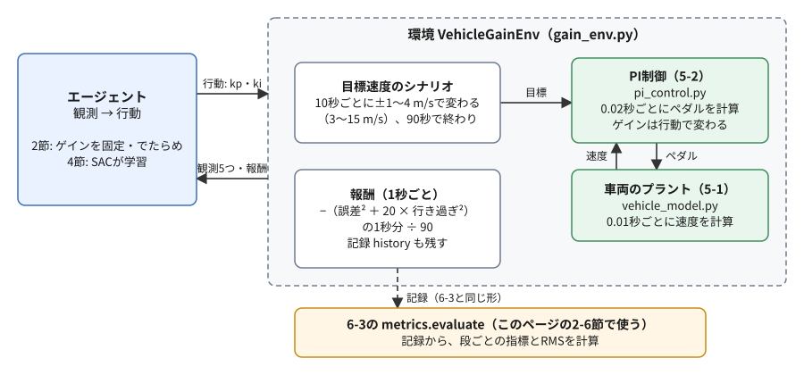
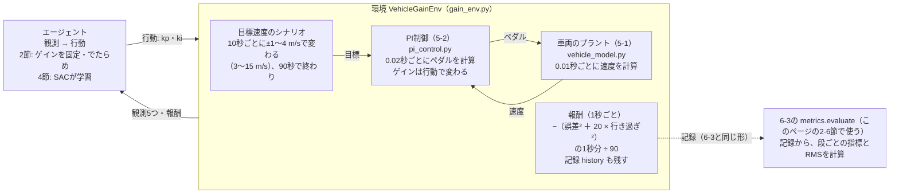
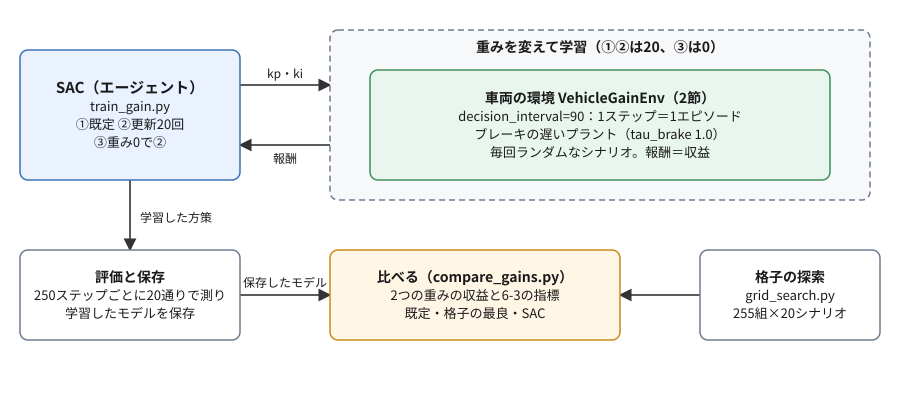
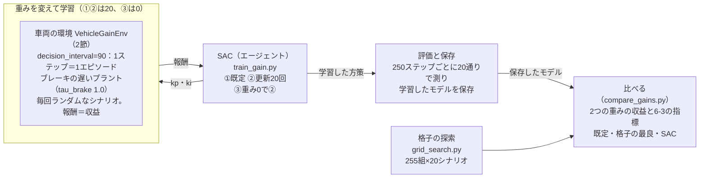

# フェーズ7-2 手順書: 強化学習でゲインを調整する（任意）

[`docs/learning_plan.md`](learning_plan.md) フェーズ7の7-2（[`docs/idea_origin.md`](idea_origin.md) ステップ6）に対応する。フェーズ7-1の目標速度のシナリオを使って、PI制御のゲインを選ぶ環境を作り、SB3のSACにゲインを選ばせて学習させる。フェーズ7-1の環境では、方策がペダルを直接選んだ。このページの環境では、ペダルはこれまでどおりPI制御の式が計算し、エージェントはそのゲインだけを選ぶ。学習させる前に、強化学習を使わない探索（格子の探索）で、手で決めたゲインにどれだけ改善の余地があるかを確かめる。学習は、初めは思うように進まない。設定を見直して学習が進むようになるまでを体験した後、報酬の重みを変えると、追従の速さと行き過ぎのバランスがどう変わるかを、フェーズ6-3の指標で確かめる。

- 想定環境: WSL2 + Ubuntu 24.04 + ROS2 Jazzy（学習はROS2を使わず、ワークスペースのコードだけを借りる）
- 前提: フェーズ7-1（[`docs/phase7_1_vehicle_env.md`](phase7_1_vehicle_env.md)。`~/rl_practice` に `vehicle_env.py` があり、フェーズ7-1の3節の準備で `learn_py` を読み込める）
- 所要目安: 3〜4コマ（計算を待つ時間が、課題を除いて17分程度ある）
- 言語: Python（ROS2のノードは書かない）

> **この手順書の位置づけ**: このページは**任意の寄り道**である。最終ゴール（フェーズ7-5）までの道筋は、フェーズ7-1から7-3へ進む。フェーズ7-3以降は、このページを読んでいなくても進められる（このページで扱うことのうち、フェーズ7-4で要るもの（エントロピーの係数、評価の仕方、報酬の重みと追従の速さのトレードオフ）は、フェーズ7-4でも説明する）。PI制御のゲインのように、選ぶ数が少ない問題を強化学習に任せるとどうなるかを、強化学習を使わない探索と比べて確かめたい場合に読む。2026-10-11に、ゲインを選ぶ環境（もとはフェーズ7-1で作っていた）を、このページの2節に移した。フェーズ7（7-0〜7-6）は、ひととおり作成を終えた段階である。今後の見直しで、内容を改めることがある。

> **進め方**: 1節で全体像を見る。2節で、ゲインを選ぶ環境を作って点検し、ゲインと収益の表を作る。3節で、学習の形と、比べる基準（格子の探索）を用意する。4節で学習のスクリプトを書き、①既定の設定、②NNの更新の回数を増やす、の順に学習させる。5節で、③行き過ぎの重みを0にして学習させ、②と、フェーズ6-3の指標で比べる。6節で、強化学習と格子の探索を、試行の数で比べる。サンプルは学習の手がかりとして最小限に書いたもので、公式の文書の転載ではない。

> **期待する結果の出どころ**: **筆者の環境（2026-10-03。SB3 2.9.0・Gymnasium 1.3.0）で、各スクリプトを実際に実行した表示**である。2026-10-11に、環境のクラスをフェーズ7-1の `vehicle_env.py` から、このページの `gain_env.py` に移したときに、すべてのスクリプトと課題を実行し直し、同じ値になることを確かめた（`time[s]` などの時間を除く）。フェーズ7-1と同じく、`learn_py` はワークスペースをビルドする代わりに、同じファイルを置いたフォルダを `PYTHONPATH` に加えて読み込んだ。環境を点検するスクリプト、格子の探索と比べるスクリプトの値は、同じ版なら何度実行しても同じになる。学習は乱数の種を固定しているので、同じPC・同じ版・同じ設定なら、ゲイン・収益・エントロピーの係数の値は何度実行しても同じになる。PCや版、計算に使うスレッドの数が違うと、学習の途中経過は変わることがある。`time[s]` の列（学習を始めてからの秒数）と、2-8節の表の `time/` の行は、実行ごとに変わる。

## 0. 学習目標と完了条件

1. フェーズ7-1のペダルを選ぶ環境と、このページのゲインを選ぶ環境の違い（選ぶもの・選ぶ間隔・観測・始め方）を説明できる。
2. 行動（−1〜1）をゲインに引き延ばす方法と、最初の目標の速度で落ち着いた状態から始める方法を説明し、ゲインを選ぶ環境を書ける。
3. ゲインと収益の表から、プラントによって最もよいゲインが変わることを説明できる。
4. 学習させる前に、手で決めたゲインと格子の探索の最良を比べて、改善の余地を確かめられる。
5. エピソードの始めにゲインを1組選ぶ形で、SACにゲインを学習させられる。
6. 学習が進まないときに、NNの更新の回数（`gradient_steps`）を見直し、エントロピーの係数の変化と合わせて、その理由を説明できる。
7. 行き過ぎの重みを変えると、最もよいゲインと追従の様子が変わること（追従の速さと行き過ぎのトレードオフ。一方をよくすると他方が悪くなる関係）を、格子の探索とフェーズ6-3の指標で説明できる。あわせて、収益の地形が平らに近いと、学習がよい組を見つけにくいことを説明できる。
8. 強化学習と格子の探索を比べ、選ぶ数が2つだけの問題では格子の探索で十分なことと、強化学習が向く場面を説明できる。

完了条件: 2節で、環境を点検し、ゲインと収益の表から、既定のプラントでは既定のゲインが最もよい組に近いのに対し、ブレーキの遅いプラントでは最もよいゲインが大きく変わることを説明できる。3節で改善の余地を確かめ、4節の①と②の途中経過の違いを説明できる。そのうえで、5節の比較表から、重みを変えると、最もよいゲインと、行き過ぎ量・RMSがどう変わるかを、格子の最良どうしで説明できる。

## 1. 全体像

フェーズ7-1では、方策がペダルを直接選ぶ環境を作った。最終ゴールまでの道筋（フェーズ7-3〜7-5）は、その形で、PI制御の式そのものをNNに置き換える。このページでは、寄り道として、もう1つの形を試す。PI制御の式は残し、そのゲインだけを強化学習で選ばせる形である。

フェーズ5-2では、PI制御のゲインを、式から目安を立て、シミュレーションで確かめながら手で決めた。フェーズ5-2の6-5節では、ブレーキの時定数を変えると、同じゲインでも減速で行き過ぎることを見た。プラントが変わって、手で決めたゲインが合わなくなったとき、人がゲインを調整し直すのは手間がかかる。この調整を、強化学習のエージェントに任せられないか。これが、このページの題材である。題材にするのは、フェーズ7-1と同じく、ブレーキの時定数を1.0秒にした、ブレーキの遅いプラントの1つである（時定数が変わるたびに選び直す形を扱わない理由は、このページの2-7節）。

ただし、学習させる前に、確かめておくことがある。手で決めたゲインが、すでに最もよい組とほとんど同じなら、どんなに学習がうまくいっても、得られるものは小さい。そこで、まず強化学習を使わずに、ゲインを格子状に全部試して、「手で決めたゲイン」と「最もよい組」の差を測る（2-7節で粗く、3-2節で細かく）。そのうえで学習させ、学習したゲインを、収益とフェーズ6-3の指標で、手で決めたゲインや格子の最良と比べる。

学習させるのは、走り始めにゲインを1組だけ選び、走り切るまで変えない形である。これは、フェーズ5-2で人が行った調整（ゲインを決めて、走らせて、結果を見る）と同じで、得られるのは固定のゲインである。2節の環境は、ゲインを選ぶ間隔を変えられるように作り、既定の1秒ごとに選び直す形で、環境が学習の流れにつながることも確かめる（その理由と、実用での扱いとの違いは、2-2節）。



<details>
<summary>同じ図（mermaid版）</summary>



</details>

- エージェントが選ぶのは、ペダルではなく**ゲイン**である。ペダルは、これまでどおりPI制御が0.02秒ごとに計算する。エージェントは1秒ごとに、そのPI制御のゲインを選び直す（既定の間隔。3節以降の学習では、走り始めに1組だけ選ぶ）。
- 環境の中の計算は、フェーズ5-2の4-2節の `closed_loop_sim.py` と同じ（プラントを0.01秒、制御を0.02秒ごとに進める）。違うのは、目標速度をシナリオから取ることと、1秒ごとに外からゲインを受け取ることと、報酬を計算して返すことである。
- 環境は、フェーズ7-1の環境と同じく、計算した速度の並びを、フェーズ6-3の4節の `metrics.py` と同じ形（時刻・目標・速度・ペダル）で残す（このページの2-6節で使う）。

学習の流れは、次の図のとおりである（3節〜5節）。



<details>
<summary>同じ図（mermaid版）</summary>



</details>

## 2. ゲインを選ぶ環境

### 2-1. ペダルを選ぶ環境との違い

このページの環境（`VehicleGainEnv`）も、フェーズ7-1の環境（`VehiclePedalEnv`）と同じく、Gymnasiumの決まりごと（フェーズ7-1の2-1節）に従って書く。目標速度のシナリオ（フェーズ7-1の2-4節）、報酬の形（誤差の二乗と、重み20を掛けた行き過ぎの二乗の、エピソードの長さあたりの量のマイナス。フェーズ7-1の2-5節）、エピソードの終わり方（90秒で `terminated`。フェーズ7-1の2-6節）は、フェーズ7-1と同じである。そのため、フェーズ7-1の `vehicle_env.py` から、シナリオの決まりの定数と `make_targets` を読み込んで使う。違う点は、次の表のとおりである。

| | フェーズ7-1の環境（`VehiclePedalEnv`） | このページの環境（`VehicleGainEnv`） |
|---|---|---|
| エージェントが選ぶもの（行動） | ペダル1つ（−1〜1） | PI制御のゲイン `kp`（0〜2）と `ki`（0〜0.5）。環境には−1〜1の2つの数で渡す（2-3節） |
| ペダルを決めるもの | 方策 | 環境の中のPI制御（フェーズ5-2の `PIController`）。0.02秒ごとに計算する |
| 選ぶ間隔（1ステップ） | 0.1秒 | 既定は1秒。引数 `decision_interval` で変えられる（2-2節） |
| 観測の4つ目 | 前回のペダル | PI制御の積分の項 |
| 観測の偏差 | m/sのまま | 目標・速度と同じく、10 m/sで割る |
| エピソードの始め | 止まった状態 | 最初の目標の速度で落ち着いた状態（2-4節） |
| 報酬に掛ける数 | 10 | 1（掛けない。2-4節） |
| 既定のプラント | ブレーキの遅いプラント | フェーズ5-1の既定のプラント（引数 `params` で変える。2-7節では既定のプラントとブレーキの遅いプラントを比べ、3節以降はブレーキの遅いプラントを使う。6節の末尾の課題4だけは既定のプラント） |

**なぜペダルではなくゲインを選ばせるのか**: ゲインを選ばせる形なら、制御の仕組み（PI制御）は人が理解できるまま残り、エージェントはその調整だけを受け持つ。フェーズ5-2で人が行った調整を、エージェントに置き換える形である。ペダルを直接選ばせる形（フェーズ7-1の環境。最終ゴールまでの道筋のフェーズ7-3〜7-5）との違いは、フェーズ7-1の2-2節の「なぜペダルを直接選ばせるのか」にまとめた。

**観測に積分の項を入れる理由**: PI制御は、積分の項という「記憶」を持っている（フェーズ5-2の2-1節）。同じ目標と速度でも、積分の項が違えば、PI制御が出すペダルは違う。エージェントがゲインを選ぶときに、その記憶の状態を見られるように、観測に入れた。積分の項は、もともとペダルと同じ−1〜1程度の大きさなので、そのまま使う。フェーズ7-1の環境の「前回のペダル」は、記憶を持たない方策のための手がかりだったが、この環境では、PI制御そのものが記憶を持っている。

**観測の残りの3つ**: 目標速度・現在速度・偏差（どれも10 m/sで割る）と、次に目標が変わるまでの時間（10秒で割る）である。残りの時間を入れる理由と、観測の大きさをそろえる理由は、フェーズ7-1の2-2節と同じである。偏差は、目標と速度と同じく10 m/sで割った（フェーズ7-1の環境では、NNが目標の近くの細かな差を見分けやすいように、m/sのまま渡した）。観測の空間は、余裕をみて−5〜5とした。

### 2-2. ゲインを選ぶ間隔

**なぜ一定の間隔ごとに選び直すのか**: 間隔を1秒にすると、エージェントは、走っている途中の状況（目標が変わった直後か、落ち着いた後か）を見てゲインを変えられる。間隔をエピソード全体（90秒）にすれば、エピソードの始めに1組だけ選ぶ形になる（このページの2-7節と、3節以降の学習で使う）。1つの環境で、両方の形を試せる。この教材では、1秒ごとに選び直す形は、環境が学習の流れにつながることを確かめる（このページの2-6節・2-8節）のに使う。

> **補足: 走行中にゲインを変えることについて**
>
> - **一般的なこと**: PI制御のゲインは、事前に調整して、固定して使うのがふつうである。走行中に変えるのは、ゲインスケジューリング（速度や負荷など、測れる運転の状態に応じて、事前に決めたゲインの表から切り替える）や、適応制御（プラントの性質の変化に合わせて、ゆっくり調整する）のように、プラントの性質が変わる場合が多い。
> - **このサンプルの扱い**: 1秒ごとに選び直す形は、プラントは同じまま、場面（目標が変わった直後か、落ち着いた後か）に応じてゲインを変える形である。環境が学習の流れにつながることを確かめるためのもので、実用的な調整の形ではない。このページの学習（3節以降）は、走り始めに1組だけ選ぶ形で行う。実用で、目標の変化に合わせて応答を整えたいときは、PI制御とゲインはそのままにして、目標値に重みを掛ける2自由度のPI制御や、目標の変化から操作の量を前もって足すフィードフォワードを使うのがふつうである。この教材では、場面に応じて出力を変える形を、学習の題材として、ペダルを直接NNに選ばせる形（フェーズ7-4）で扱う（フェーズ7-4・7-5のとおり、NNはPI制御に届かない）。
> - **実務の目安**: 走行中にゲインを切り替えるときは、切り替えたときの安定性（どの組も単独では安定でも、切り替え続けると不安定になることがある）と、出力の段差に配慮する。フェーズ5-2の `PIController` は、積分の項を、 $K_i$ を掛けた後の値で積み上げるので、 $K_i$ を変えても積分の項は跳ばない。一方、 $K_p$ を変えると、次にペダルを計算したときに、ペダルが（ $K_p$ の変化）×（偏差）だけ跳ぶ（ペダルが範囲の端（±1）で切りそろえられる場合は、それより小さい）。

### 2-3. 行動をゲインに引き延ばす

ゲインの範囲は `kp` が0〜2、`ki` が0〜0.5だが、環境が受け取る行動は、どちらも−1〜1の数にする（行動を−1〜1にそろえる理由は、フェーズ7-1の2-3節）。環境の中で、次の式でゲインに引き延ばす。

$$
K_p = \frac{a_0 + 1}{2} \times 2.0, \qquad K_i = \frac{a_1 + 1}{2} \times 0.5
$$

$a_0$・ $a_1$ が行動の2つの数である。−1が下限（0）、1が上限、0がちょうど真ん中にあたる。既定のゲイン（`kp` 0.5・`ki` 0.1）は、行動では $a_0 = -0.5$ 、 $a_1 = -0.6$ になる。範囲をそろえても、環境の中で引き延ばせば、選べるゲインは制限されない。

選べる範囲を `kp` 0〜2、`ki` 0〜0.5にしたのは、既定のゲイン（0.5・0.1）を含み、フェーズ5-2の4-2節で振動した `kp` 5.0・`ki` 2.0は含まない範囲にするためである。範囲を広げすぎると、エージェントは意味の無い領域の試行に時間を使う。

### 2-4. 落ち着いた状態から始め、報酬は1倍にする

**落ち着いた状態から始める**: フェーズ7-1の環境は、Gazeboの環境（フェーズ7-3）と比べられるように、止まった状態から始めた。その場合、最初の10秒は、止まった状態から最初の目標へ加速する大きな段になり、どのエピソードにも入る。この段では、アクセルを踏み切るしかないので、ゲインの良し悪しはほとんど表れない（フェーズ7-1の5-1節の収益の内訳では、収益の約半分がこの段だった）。そこで、この環境は、最初の目標の速度で落ち着いた状態（速度が変わらず、ペダルが一定）から始める。すべての段が「走っている途中の、目標の変更」になり、ゲインの差が収益に表れやすい。式の環境なら、プラントの速度と力を、始めから好きな値にできる（作り方は2-5節の `reset`）。

**報酬は1倍にする**: 報酬は、フェーズ7-1の2-5節の式で、10を掛けない形にする。

$$
\text{報酬} = -\frac{1}{90} \sum_{\text{その1ステップの間}} \left( e^2 + 20 o^2 \right) \Delta t
$$

**収益とRMSの関係**: 1エピソードの報酬を全部足すと、次のようになる。

$$
\text{収益} = -\left( \text{誤差の二乗の平均} + 20 \times \text{行き過ぎの二乗の平均} \right)
$$

平均は、どちらも90秒の平均である。落ち着いた状態から始めるので、最初の10秒は、誤差がほぼ0である。フェーズ6-3のRMSは、10秒からの80秒で数える（フェーズ6-3の2-2節の表）ので、行き過ぎが無ければ、収益は $-\frac{80}{90} \times \text{RMS}^2$ になる。実際の値での対応は、このページの2-6節で確かめる。フェーズ7-1の環境の収益とは、報酬に掛ける数も、始め方も違うので、比べられない。

### 2-5. 環境のクラス（`gain_env.py`）

ファイル: `~/rl_practice/gain_env.py`（ファイルの置き方は [サンプルコードを練習環境に置く方法](howto_place_code.md)）

```python
# フェーズ5-1の車両のプラントとフェーズ5-2のPI制御を、PI制御のゲイン（kp・ki）を選ぶGymnasiumの環境として包む（ROS2を使わない）。
# 目標速度のシナリオは、フェーズ7-1の vehicle_env.py と同じ。エージェントは、決めた間隔ごとにゲインを選び直す。
import gymnasium as gym
import numpy as np
from gymnasium import spaces

from learn_py.pi_control import PIController
from learn_py.vehicle_model import GRAVITY, VehicleModel, VehicleParams
from vehicle_env import CHANGE_INTERVAL, EPISODE_LENGTH, PLANT_DT, make_targets

CONTROL_PERIOD = 0.02  # 制御の周期 [s]（フェーズ5-2の closed_loop_sim と同じ）
KP_MAX = 2.0           # 選べる kp の上限（下限は0）
KI_MAX = 0.5           # 選べる ki の上限（下限は0）


# 行動（-1〜1の2つの数）を、ゲイン（kp・ki）に引き延ばす。
def action_to_gains(action):
    a = np.clip(action, -1.0, 1.0)
    return (a[0] + 1.0) / 2.0 * KP_MAX, (a[1] + 1.0) / 2.0 * KI_MAX


# ゲイン（kp・ki）を、行動（-1〜1の2つの数）に直す。action_to_gains の逆。
def gains_to_action(kp, ki):
    return np.array([kp / KP_MAX * 2.0 - 1.0, ki / KI_MAX * 2.0 - 1.0], dtype=np.float32)


# 車両のPI制御のゲインを選ぶ環境。観測は目標・速度・偏差・積分の項・次の変わり目までの時間の5つ、行動はゲイン2つ。
class VehicleGainEnv(gym.Env):
    # decision_interval 秒ごとにゲインを選ぶ。overshoot_weight は行き過ぎの重み、step_range は目標を変える幅 [m/s]。
    def __init__(self, decision_interval=1.0, overshoot_weight=20.0, step_range=(1.0, 4.0), params=None):
        self.decision_interval = decision_interval
        self.overshoot_weight = overshoot_weight
        self.step_range = step_range
        self.params = params if params is not None else VehicleParams()
        self.observation_space = spaces.Box(low=-5.0, high=5.0, shape=(5,), dtype=np.float32)
        self.action_space = spaces.Box(low=-1.0, high=1.0, shape=(2,), dtype=np.float32)

    # 目標速度の並びを乱数で作り、最初の目標の速度で落ち着いた車両から、新しいエピソードを始める。
    def reset(self, seed=None, options=None):
        super().reset(seed=seed)
        self.targets = make_targets(self.np_random, self.step_range)
        p = self.params
        self.plant = VehicleModel(p)
        self.plant.velocity = self.targets[0]
        # 速度が変わらない釣り合い: 駆動力 = 転がり抵抗 + 速度に比例する抵抗（フェーズ5-1の2節の式）
        self.plant.drive_force = p.rolling_coeff * p.mass * GRAVITY + p.drag_coeff * self.targets[0]
        self.controller = PIController(kp=0.0, ki=0.0)
        self.controller.integral = self.plant.drive_force / p.drive_force_max  # 釣り合いのペダル
        self.step_count = 0  # プラントを進めた回数（時刻は step_count × PLANT_DT）
        self.pedal = self.controller.integral
        self.history = []    # (時刻, 目標, 速度, ペダル) の並び。フェーズ6-3の metrics.evaluate に渡せる
        return self._observation(), {}

    # 時刻 t の段の番号（最初の段が0、10秒からが1、…、80秒からが8）。
    def _segment(self, t):
        return min(int((t + 1e-9) // CHANGE_INTERVAL), len(self.targets) - 1)

    # ゲインを行動のとおりに変え、decision_interval 秒分を計算して、報酬を返す。
    def step(self, action):
        kp, ki = action_to_gains(action)
        self.controller.kp = kp
        self.controller.ki = ki
        steps_per_control = round(CONTROL_PERIOD / PLANT_DT)
        squared_error = 0.0
        squared_overshoot = 0.0
        for _ in range(round(self.decision_interval / PLANT_DT)):
            t = self.step_count * PLANT_DT
            k = self._segment(t)
            target = self.targets[k]
            if self.step_count % steps_per_control == 0:
                self.pedal = self.controller.update(target - self.plant.velocity, CONTROL_PERIOD)
            self.history.append((round(t, 2), target, self.plant.velocity, self.pedal))
            error = target - self.plant.velocity
            # 目標が変わった向き（最初の段は変わっていないので0）に、速度が目標を超えた量
            direction = 0.0 if k == 0 else np.sign(target - self.targets[k - 1])
            overshoot = max(0.0, -error * direction)
            squared_error += error ** 2 * PLANT_DT
            squared_overshoot += overshoot ** 2 * PLANT_DT
            self.plant.step(self.pedal, PLANT_DT)
            self.step_count += 1
        # 報酬: 誤差の二乗と、目標を超えた分の二乗（重み付き）の、エピソードの長さあたりの量のマイナス
        reward = -(squared_error + self.overshoot_weight * squared_overshoot) / EPISODE_LENGTH
        terminated = self.step_count * PLANT_DT >= EPISODE_LENGTH - 1e-9
        info = {'kp': kp, 'ki': ki,
                'squared_error': squared_error / EPISODE_LENGTH,
                'squared_overshoot': squared_overshoot / EPISODE_LENGTH}
        return self._observation(), float(reward), terminated, False, info

    # 観測: 目標・速度・偏差（どれも10 m/sで割る）、PI制御の積分の項、次に目標が変わるかエピソードが終わるまでの時間（10秒で割る）。
    def _observation(self):
        t = self.step_count * PLANT_DT
        target = self.targets[self._segment(t)]
        v = self.plant.velocity
        remaining = (min(EPISODE_LENGTH, (self._segment(t) + 1) * CHANGE_INTERVAL) - t) / CHANGE_INTERVAL
        obs = np.array([target / 10.0, v / 10.0, (target - v) / 10.0,
                        self.controller.integral, remaining], dtype=np.float32)
        return np.clip(obs, -5.0, 5.0)
```

**`gain_env.py` の解説**

- **読み込むもの**: フェーズ7-1の `vehicle_env.py` から、プラントの計算の刻み幅 `PLANT_DT`、エピソードの長さ `EPISODE_LENGTH`、目標を変える間隔 `CHANGE_INTERVAL` と、目標の並びを作る `make_targets` を読み込む。シナリオがフェーズ7-1と同じになるので、同じ種なら、同じ目標の並びになる。
- **定数**: `CONTROL_PERIOD` は、フェーズ5-2の4-2節の `closed_loop_sim.py` と同じ値。`KP_MAX`・`KI_MAX` は、選べるゲインの上限（2-3節）である。
- **`action_to_gains`・`gains_to_action`**: 2-3節の式と、その逆。`gains_to_action` は、「このゲインを選ぶ行動」を作るときに使う（2-6節で、ゲインを固定した方策を作るのに使う）。`action_to_gains` の `np.clip` は、範囲の外の行動が来ても、ゲインを範囲の端に収める。
- **`__init__`**: 観測と行動の2つの空間を作る（フェーズ7-1の2-1節）。観測は5つの数で範囲は−5〜5、行動は2つの数で範囲は−1〜1。`decision_interval` はゲインを選ぶ間隔（2-2節）、`overshoot_weight` は報酬の重み（フェーズ7-1の2-5節）、`step_range` は段の幅（フェーズ7-1の2-4節）で、引数で変えられる。`params` で、プラントのパラメータ（フェーズ5-1の `VehicleParams`。時定数など）を変えられる（このページの2-7節で、ブレーキの遅いプラントを作るのに使う）。
- **`reset`**:
  - 最初に `super().reset(seed=seed)` を呼び、その後の `self.np_random` で、シナリオの目標の並びを作る（フェーズ7-1の2-1節）。
  - 車両を、最初の目標の速度で落ち着いた状態にする。速度が変わらないのは、フェーズ5-1の2節の式で、駆動力が抵抗（転がり抵抗と、速度に比例する抵抗）とちょうど釣り合うときである。そこで、プラントの速度と駆動力をその値にそろえる。
  - PI制御器の積分の項も、釣り合いの駆動力を出すペダル（駆動力 ÷ 最大の駆動力）にそろえる。偏差が0なら、PI制御器のペダルは積分の項そのもの（フェーズ5-2の4-1節）なので、最初の計算からこのペダルが出て、車両は落ち着いたまま走る。ゲインは、最初の `step` で行動から決まるので、ここでは0にしておく。
- **`_segment`**: 時刻 `t` が何番目の段かを返す。10秒で割った商が段の番号で、80秒より後（と、終わりの90秒ちょうど）は最後の段（8）にする。`1e-9` は、小数の計算の誤差で、10秒ちょうどがわずかに前の段に入るのを防ぐ。
- **`step`**: 2-4節の報酬を計算する部分が、`closed_loop_sim.py` の `simulate` に加わったものである。
  - 最初に、行動からゲインを求め、PI制御器の `kp`・`ki` を書き換える。フェーズ5-2の4-1節の `PIController` は、積分の項に $K_i$ を掛けた値を持っているので、ここで `ki` を変えても、それまでに育った積分の項は変わらず、ペダルが急に跳ねない（フェーズ5-2の4-1節の解説の最後の項目）。
  - `decision_interval` 秒分（既定では100回）、プラントを0.01秒ずつ進める。2回に1回（0.02秒ごと）だけ、PI制御器がペダルを計算し直す。
  - 0.01秒ごとに、誤差の二乗と行き過ぎの二乗を、刻み幅を掛けて積み上げる（2-4節の式の $\sum (\cdots) \Delta t$）。`direction` は、その段で目標が変わった向き（上げたら1、下げたら−1、最初の段は0）で、行き過ぎ `overshoot` は `-error * direction` の正の部分である。最初の段は `direction` が0なので、行き過ぎは数えない。
  - `terminated` は、時刻が90秒に達したら `True` にする（フェーズ7-1の2-6節）。`truncated` は、常に `False`。
  - `info` には、選んだゲインと、報酬の内訳（誤差の二乗の分と、行き過ぎの二乗の分。どちらも90で割った値。重みは掛けていない）を入れる。
- **`_observation`**: 観測の5つの数を作る（2-1節）。5つめの `remaining` は、次の段の始まり（最後の段では、エピソードの終わりの90秒）までの秒数を10で割ったもので、段の始まりで1、終わりで0に近づく。`np.float32` で作り、`np.clip` で観測の空間（−5〜5）に収める。観測が空間の外に出ると、`check_env` が誤りとして知らせる。

### 2-6. `check_env` で点検し、方策を比べる

ファイル: `~/rl_practice/check_gain_env.py`

```python
# 車両の環境を check_env で点検し、ゲインを固定した方策とでたらめな方策で動かして比べる。
import numpy as np
from stable_baselines3.common.env_checker import check_env

from learn_py.metrics import evaluate, format_report
from gain_env import VehicleGainEnv, gains_to_action

SEEDS = range(20)  # 比べるシナリオ（乱数の種）の並び


# 方策 policy で、種 seed のシナリオを1エピソード動かし、収益を返す。
def run_episode(env, policy, seed):
    obs, info = env.reset(seed=seed)
    total = 0.0
    while True:
        obs, reward, terminated, truncated, info = env.step(policy(obs))
        total += reward
        if terminated or truncated:
            return total


# 点検 → 種0のシナリオを既定のゲインで1エピソード → 20通りのシナリオでの方策の比較、の順に行う。
def main():
    env = VehicleGainEnv()
    check_env(env)
    print('check_env: OK')
    print('observation_space:', env.observation_space)
    print('action_space     :', env.action_space)
    obs, info = env.reset(seed=0)
    print('targets          :', np.round(env.targets, 2))
    print('first observation:', obs)

    kp0, ki0 = 0.5, 0.1  # 比べる基準のゲイン（フェーズ5-2の既定）
    default = gains_to_action(kp0, ki0)
    total = run_episode(env, lambda obs: default, seed=0)
    print(f'\nseed 0, kp={kp0}, ki={ki0}: return {total:.3f}')
    times, targets, velocities, pedals = (list(c) for c in zip(*env.history))
    for line in format_report(*evaluate(times, targets, velocities, pedals)):
        print('  ' + line)

    env.action_space.seed(0)
    policies = {
        f'kp={kp0}, ki={ki0}': lambda obs: default,
        'kp=0.2, ki=0.05': lambda obs: gains_to_action(0.2, 0.05),
        'kp=2.0, ki=0.5': lambda obs: gains_to_action(2.0, 0.5),
        'random': lambda obs: env.action_space.sample(),
    }
    print(f'\npolicy           return (mean, std over {len(SEEDS)} seeds)')
    for name, policy in policies.items():
        returns = [run_episode(env, policy, seed) for seed in SEEDS]
        print(f'{name:15s} {np.mean(returns):7.3f}  {np.std(returns):6.3f}')


if __name__ == '__main__':
    main()
```

- `run_episode` は、フェーズ7-0の3-2節の同じ名前の関数と同じ形で、種 `seed` のシナリオで1エピソード動かし、収益を返す。
- `main` の前半で、`check_env` で点検し、種0のシナリオの目標の並びと、最初の観測を表示する。続けて、そのシナリオを既定のゲインで1エピソード動かし、フェーズ6-3の `evaluate`・`format_report` で段ごとの指標を表示する。記録は落ち着いた状態から始まり、10秒で最初に目標が変わるので、フェーズ6-3の4節の `main` のように、先頭にサンプルを足す必要はない。
- 後半で、3通りのゲインの組と、でたらめな方策（`env.action_space.sample()`。1秒ごとに、でたらめなゲインを選ぶ）の収益を、種0〜19の20通りのシナリオで測り、平均と標準偏差（ばらつきの大きさ）を表示する。`env.action_space.seed(0)` は、フェーズ7-0の3-2節と同じく、でたらめな行動の並びを毎回同じにするためのものである。

```bash
python check_gain_env.py
```

**期待する結果**:

```text
check_env: OK
observation_space: Box(-5.0, 5.0, (5,), float32)
action_space     : Box(-1.0, 1.0, (2,), float32)
targets          : [ 9.46  7.65  6.6  10.04 12.86  9.67 13.48 10.03  6.46]
first observation: [0.9458732  0.9458732  0.         0.51498246 1.        ]

seed 0, kp=0.5, ki=0.1: return -0.853
  step          over[%]  rise[s]  settle[s]  error  sat[s]
   9.5 ->  7.6     6.79    1.27     5.57   +0.02    0.00
   7.6 ->  6.6    11.78    1.38     8.72   +0.02    0.00
   6.6 -> 10.0     0.00    2.93     8.69   +0.06    2.46
  10.0 -> 12.9     0.00    3.27     9.83   +0.06    2.82
  12.9 ->  9.7     5.13    1.02     4.80   +0.02    0.00
   9.7 -> 13.5     0.00    4.27        -   +0.10    4.04
  13.5 -> 10.0     4.63    1.01     4.55   +0.02    0.06
  10.0 ->  6.5     0.00    0.94     1.79   -0.02    0.22
  RMS error: 0.959 m/s

policy           return (mean, std over 20 seeds)
kp=0.5, ki=0.1   -0.571   0.188
kp=0.2, ki=0.05  -1.574   0.345
kp=2.0, ki=0.5   -0.731   0.212
random           -1.283   1.247
```

- **1〜3行目**: `check_env` が、警告も誤りも出さずに通った。観測と行動の空間は、2-5節の `__init__` で決めたとおりである。
- **`targets`**: 種0のシナリオの目標の並び。最初は9.46 m/sで、10秒ごとに7.65、6.6、10.04…と変わる。上げる段と下げる段が混ざり、幅は1〜4 m/sの間にある。
- **`first observation`**: 最初の観測は、目標0.946（9.46 m/s ÷ 10）、速度も0.946（落ち着いた状態）、偏差0、積分の項0.515（9.46 m/sで釣り合うペダル）、次の変わり目まで1.0（10秒 ÷ 10）。
- **段ごとの指標（下げる段）**: 最後の段（10.0 → 6.5）を除く下げる段（9.5 → 7.6など）では、既定のプラントでも、4〜12%の行き過ぎがある。
  - 既定のゲインの `ki` 0.1は、フェーズ5-2の2-3節で式から求めた目安（`kp` 0.5に対して `ki` 約0.047）の約2倍である。ペダルが張り付かない小さな段では、積分の項が速く育ちすぎて、目標を越えてしまうと考えられる。実際、`ki` を0.047に下げて同じシナリオを走らせると、小さな下げる段（9.5 → 7.6、7.6 → 6.6）の行き過ぎは2%以下になった（筆者が確かめた値）。
  - フェーズ6-3の比較表では、既定のプラントの10 → 5の段の行き過ぎは0%だった。行き過ぎるかどうかは、段の大きさや、そのときの速度によって変わり、この種0のシナリオでも、最後の10.0 → 6.5の段は0%である。
- **段ごとの指標（上げる段）**: 上げる段（6.6 → 10.0など）では、行き過ぎは無いが、アクセルを踏み切る時間（`sat[s]`）が2〜4秒ある。9.7 → 13.5の段は、10秒の間に落ち着かない（整定時間が `-`）。速度が高いほど抵抗が大きく、アクセルの余力が小さいので、加速に時間がかかるためである。
- **`return -0.853` とRMS**: フェーズ6-3のRMSは、最初に目標が変わった10秒からの80秒で数える（フェーズ6-3の2-2節の表）。収益は、誤差が0の最初の10秒も含めて90で割る。そのため、行き過ぎが無ければ、収益は $-\frac{80}{90} \times \text{RMS}^2 = -0.889 \times 0.959^2 \approx -0.818$ になるはずである。実際の収益−0.853との差の約0.035が、下げる段の行き過ぎの減点（2-4節の報酬の、重み20の項）にあたる。
- **最後の表**: 20通りのシナリオの平均で比べると、既定のゲイン（−0.571）が最もよく、`kp` 2.0・`ki` 0.5（−0.731）、でたらめな方策（−1.283）、`kp` 0.2・`ki` 0.05（−1.574）と続く。ゲインが小さすぎると、目標に近づくのが遅く、誤差が長く残る。でたらめな方策は、標準偏差（1.247）が大きく、シナリオによって結果が大きくばらつく。1秒ごとに極端なゲインを選んでしまうと、大きく行き過ぎることがあるためである。

> 課題1: `main` の `env = VehicleGainEnv()` を `env = VehicleGainEnv(step_range=(3.0, 8.0))` に変え、段の幅を3〜8 m/sに大きくする。種0のシナリオの目標は `[ 9.46  5.11  8.19  3.  9.03  3.  10.68  3.6  10.88]` になり、3.0 m/sで範囲の端にそろえられた段がある（フェーズ7-1の4節の `make_targets` の解説）。既定のゲインの収益は−0.853から−4.392に悪くなり、上げる段でアクセルを踏み切る時間が最大5.36秒に延びる。20通りの平均は、既定のゲイン−3.714、`kp` 2.0・`ki` 0.5が−4.022、でたらめな方策−4.316、`kp` 0.2・`ki` 0.05が−5.238になる。既定のゲインと `kp` 2.0・`ki` 0.5の差（0.31）は、幅が1〜4 m/sのときの差（0.16）より大きいが、収益の大きさ（−3.7）に比べると約8%で、1〜4 m/sのとき（約28%）より小さい。段が大きいと、ペダルを踏み切っている間の、ゲインでは減らせない誤差が収益の大部分を占め、ゲインの差が埋もれやすい（フェーズ7-1の2-4節）。確かめたら、`VehicleGainEnv()` に戻す。

### 2-7. ゲインと収益の表を作る

2-6節で、ゲインによって収益が変わることが分かった。ゲインの組を格子状に変えて、収益がどう変わるかを表にする。ここでは、`decision_interval` をエピソードの長さ（90秒）にして、エピソードの始めにゲインを1組だけ選ぶ形にする（2-2節）。プラントは、既定のものと、ブレーキの時定数を1.0秒に遅くしたもの（フェーズ5-2の6-5節、フェーズ6-3の比較表の `tau_brake` 1.0）の2つで比べる。

ファイル: `~/rl_practice/gain_landscape.py`

```python
# エピソード全体で1組のゲインを使う形にして、ゲインの組ごとの収益（20通りのシナリオの平均）を表にする。
import numpy as np

from learn_py.vehicle_model import VehicleParams
from gain_env import EPISODE_LENGTH, VehicleGainEnv, gains_to_action

KP_LIST = [0.1, 0.2, 0.3, 0.5, 0.7, 1.0, 2.0]
KI_LIST = [0.0, 0.025, 0.05, 0.1, 0.2, 0.5]
SEEDS = range(20)


# ゲイン kp・ki のまま、20通りのシナリオを1エピソードずつ動かし、収益の平均を返す。
def mean_return(env, kp, ki):
    returns = []
    for seed in SEEDS:
        env.reset(seed=seed)
        obs, reward, terminated, truncated, info = env.step(gains_to_action(kp, ki))
        returns.append(reward)
    return float(np.mean(returns))


# 既定のプラントと、ブレーキの遅いプラントで、ゲインの組ごとの収益を表にし、最もよい組を示す。
def main():
    for name, params in [('default', VehicleParams()),
                         ('tau_brake=1.0', VehicleParams(tau_brake=1.0))]:
        env = VehicleGainEnv(decision_interval=EPISODE_LENGTH, params=params)
        table = {(kp, ki): mean_return(env, kp, ki) for kp in KP_LIST for ki in KI_LIST}
        print(name)
        print('  kp \\ ki' + ''.join(f'{ki:8.3f}' for ki in KI_LIST))
        for kp in KP_LIST:
            print(f'  {kp:6.2f} ' + ''.join(f'{table[(kp, ki)]:8.3f}' for ki in KI_LIST))
        best = max(table, key=table.get)
        print(f'  best: kp={best[0]}, ki={best[1]} ({table[best]:.3f})')


if __name__ == '__main__':
    main()
```

- `mean_return` は、20通りのシナリオのそれぞれで `step` を1回だけ呼び、収益の平均を返す。`decision_interval` が90秒なので、1回の `step` で90秒分を計算し、エピソードが終わる（`terminated` が `True` になる）。1ステップしか無いので、その報酬がそのまま収益になる。
- `'  kp \\ ki'` の `\\` は、文字の `\` を1つ表示するための書き方である（表の左上に「行が `kp`、列が `ki`」と示す）。
- `max(table, key=table.get)` は、辞書 `table` の中で、値（収益）が最も大きいキー（ゲインの組）を返す。

7×6の42組を、20通りのシナリオと2つのプラントで試すので、1分半程度かかる。

```bash
python gain_landscape.py
```

**期待する結果**:

```text
default
  kp \ ki   0.000   0.025   0.050   0.100   0.200   0.500
    0.10   -3.602  -1.940  -6.092 -11.053 -11.371 -15.012
    0.20   -1.705  -0.910  -1.574  -3.369  -4.488  -7.492
    0.30   -1.126  -0.681  -0.740  -1.193  -2.090  -3.839
    0.50   -0.748  -0.564  -0.553  -0.571  -0.693  -1.223
    0.70   -0.642  -0.544  -0.531  -0.529  -0.548  -0.680
    1.00   -0.617  -0.571  -0.560  -0.555  -0.559  -0.588
    2.00   -0.754  -0.747  -0.743  -0.739  -0.734  -0.731
  best: kp=0.7, ki=0.1 (-0.529)
tau_brake=1.0
  kp \ ki   0.000   0.025   0.050   0.100   0.200   0.500
    0.10   -3.602  -1.940  -6.307 -13.736 -22.736 -40.894
    0.20   -1.709  -0.917  -1.623  -4.014  -8.760 -26.075
    0.30   -1.161  -0.731  -0.893  -1.811  -4.542 -15.017
    0.50   -1.075  -0.943  -1.009  -1.253  -2.016  -5.754
    0.70   -1.423  -1.346  -1.359  -1.439  -1.699  -2.948
    1.00   -2.201  -2.162  -2.154  -2.166  -2.239  -2.608
    2.00   -4.098  -4.091  -4.084  -4.073  -4.058  -4.067
  best: kp=0.3, ki=0.025 (-0.731)
```

行が `kp`、列が `ki` で、各欄がそのゲインでの収益（20通りのシナリオの平均）である。最後の `best` が、表の中で最もよい組である。

- **既定のプラント（上の表）**: 最もよいのは `kp` 0.7・`ki` 0.1（−0.529）で、既定のゲイン（`kp` 0.5・`ki` 0.1、−0.571）との差は約7%である。`kp` 0.5〜1.0・`ki` 0.025〜0.2の範囲は、−0.53〜−0.69の間に収まる。既定のゲインは、フェーズ5-2でこのプラントに合わせて決めたので、最もよい組に近い。
- **右上の隅**: `kp` が0.1〜0.2と小さいのに `ki` が大きい組は、とても悪い（例: `kp` 0.1・`ki` 0.5で−15.0）。比例の項が弱いまま積分の項が育ち、ゆっくり大きく行き過ぎては戻る動きになるためである。
- **左の列（`ki` 0）**: `ki` が0でも、P制御だけ（フェーズ5-2の2-2節。目標に届かない偏差が残る）とは少し違う。この環境は、積分の項を最初の目標の速度で釣り合うペダルにそろえて始める（2-5節の `reset`）。`ki` が0なら積分の項はその値のまま変わらないので、前もって決めた一定の踏み込みとして働く。目標が最初の速度から離れるほど、その踏み込みは合わなくなり、偏差が残る。
- **ブレーキの遅いプラント（下の表）**: 最もよいのは `kp` 0.3・`ki` 0.025（−0.731）で、既定のゲイン（−1.253）より約42%よい。逆に、既定のプラントで最もよかった `kp` 0.7・`ki` 0.1は−1.439で、このプラントの最もよい組の約2倍悪い。`kp` を上げるほど悪くなり、`kp` 2.0では−4.1前後になる。ブレーキの効きが遅れる間に、下げる段で目標を下回り（行き過ぎ）、2-4節の報酬の、重み20の減点を受けるためである。
- **読み取れること**: この2つのプラントでは、最もよいゲインが大きく違う。あるプラントに合わせて手で決めたゲインは、時定数が大きく変わると、最もよい組から大きく外れる。このページでは、表を作って最もよい組を見つけた。
- **2つの端だけで比べないこと**: ここで比べたのは、ブレーキの時定数の0.2秒（既定）と1.0秒の2つだけである。作成時に、ブレーキの時定数を0.2〜1.0秒の5通りに変えて調べると、どの時定数にもそこそこ効く1組の固定のゲイン（`kp` 0.4・`ki` 0.025）が改善の大部分を取り、時定数ごとに最もよいゲインを選び直しても、5通りの平均の収益は約5%しかよくならなかった（[試行錯誤の間章](interlude_trial_and_error.md)の6節）。間の時定数では、真ん中あたりのゲインがどちらにもそこそこ効くためである。そこで、この教材では、時定数が変わるたびにゲインを選び直す題材は扱わない。このページの3節以降では、ブレーキの遅いプラント1つで、表を作らずに、試行錯誤だけでよいゲインにたどり着けるかを、強化学習のエージェントに任せる。

> 課題2: ブレーキの遅いプラントで最もよかった `kp` 0.3・`ki` 0.025は、どんな追従か。2-6節の `check_gain_env.py` を、次の3か所で変えて実行する。ファイルの先頭の `from gain_env import ...` の前の行に `from learn_py.vehicle_model import VehicleParams` を足す。`env = VehicleGainEnv()` を `env = VehicleGainEnv(params=VehicleParams(tau_brake=1.0))` にする。`kp0, ki0 = 0.5, 0.1` を `kp0, ki0 = 0.3, 0.025` にする。種0のシナリオの段ごとの指標は、次のようになる。
>
> ```text
> seed 0, kp=0.3, ki=0.025: return -1.080
>   step          over[%]  rise[s]  settle[s]  error  sat[s]
>    9.5 ->  7.6     0.00    2.70     4.93   -0.02    0.00
>    7.6 ->  6.6     0.00    2.85     7.92   -0.02    0.00
>    6.6 -> 10.0     0.00    4.13        -   +0.18    1.68
>   10.0 -> 12.9     0.00    7.88        -   +0.27    1.98
>   12.9 ->  9.7     4.39    2.01     6.62   +0.03    0.00
>    9.7 -> 13.5     0.00    6.19        -   +0.30    3.14
>   13.5 -> 10.0     5.06    1.96     6.66   +0.03    0.00
>   10.0 ->  6.5     4.29    1.62        -   -0.15    0.00
>   RMS error: 1.085 m/s
> ```
>
> 下げる段の行き過ぎ量は約5%以下に抑えられているが、上げる段（6.6 → 10.0、10.0 → 12.9、9.7 → 13.5）は10秒の間に落ち着かず（整定時間が `-`）、段の最後の1秒の速度が、目標に0.18〜0.30 m/s届いていない（`error`）。最後の下げる段（10.0 → 6.5）は、目標を4.29%下回った後に戻りすぎて（段の最後の1秒の速度が目標より0.15 m/s高い）、10秒の間に落ち着かない。重み20の報酬は、行き過ぎを避ける代わりに、目標にゆっくり近づくゲインを選ばせている。追従の速さと行き過ぎのどちらを重く見るかは、重みで変わる（5節で確かめる）。確かめたら、3か所を元に戻す。

### 2-8. SB3の学習につなぐ

最後に、この環境で、SB3のSACの学習がそのまま動くことを確かめる。学習の成果を見るのは4節なので、ここでは10エピソード分だけ動かす。

ファイル: `~/rl_practice/smoke_gain_sac.py`

```python
# 車両の環境で、SB3のSACを少しだけ動かし、学習の流れにつながることを確かめる（学習の成果は見ない）。
from stable_baselines3 import SAC

from gain_env import VehicleGainEnv


# 10エピソード分（900ステップ）だけ学習させ、途中経過の表を出す。
def main():
    model = SAC('MlpPolicy', VehicleGainEnv(), verbose=1, seed=0)
    model.learn(total_timesteps=900, log_interval=5)


if __name__ == '__main__':
    main()
```

フェーズ7-0の4-2節の `train_sac_pendulum.py` と同じ形で、環境を `gym.make('Pendulum-v1')` から `VehicleGainEnv()` に差し替え、ステップ数を900に減らし、モデルの保存と評価を省いたものである。自分で作った環境も、Gymnasiumの決まりごとに従っていれば、用意された環境と同じようにSB3に渡せる。`seed=0` を渡すと、SB3が環境の乱数の種も決めるので、エピソードごとに違うシナリオが、毎回同じ順に出てくる。

```bash
python smoke_gain_sac.py
```

**期待する結果**（最初の3行と、最後の途中経過の表の抜粋。数は、PCとライブラリの版によって変わる。`time/` の行は実行ごとに変わる）:

```text
Using cpu device
Wrapping the env with a `Monitor` wrapper
Wrapping the env in a DummyVecEnv.
...
| rollout/           |          |
|    ep_len_mean     | 90       |
|    ep_rew_mean     | -1.65    |
| time/              |          |
|    episodes        | 10       |
|    fps             | 85       |
|    time_elapsed    | 10       |
|    total_timesteps | 900      |
| train/             |          |
|    actor_loss      | -5.91    |
|    critic_loss     | 0.0532   |
|    ent_coef        | 0.787    |
|    ent_coef_loss   | -0.804   |
|    learning_rate   | 0.0003   |
|    n_updates       | 799      |
---------------------------------
```

- 途中経過の表は、5エピソードごとに出る（`log_interval=5`）。表の読み方は、フェーズ7-0の4-2節と同じである。
- **`ep_len_mean` 90**: 1エピソードが90ステップ（1秒ごとに90回ゲインを選ぶ）で終わっている。
- **`ep_rew_mean` −1.65**: 10エピソードの収益の平均である。学習の初めは、SACがほぼでたらめに行動を選ぶので、2-6節のでたらめな方策（20通りの平均で−1.283、標準偏差1.247）と同じくらいの値になる。10エピソードでは、まだ学習の成果は見えない。
- この表が出て、誤りなく終われば、環境はSB3の学習の流れにつながっている。学習させてゲインを調整するのは、4節で行う。

## 3. 学習の形と、比べる基準

### 3-1. エピソードの始めにゲインを1組選ぶ

2節の環境は、ゲインを選ぶ間隔を `decision_interval` で変えられる（2-2節）。このページでは、間隔をエピソードの長さ（90秒）にして、エピソードの始めにゲインを1組だけ選ぶ形にする。フェーズ5-2で人が行ったこと（ゲインを決めて、走らせて、結果を見る）と同じ形である。

この形では、1回の `step` で90秒分を計算し、シナリオを走り切って、エピソードが終わる（`terminated`。フェーズ7-1の2-6節）。1ステップが1エピソードで、そのステップの報酬がそのまま収益になる（2-7節の `gain_landscape.py` と同じ）。エージェントは、最初の観測（最初の目標の速度で落ち着いた車両）を見て、行動（ゲイン）を1つ選び、その収益を受け取る。シナリオは毎回ランダムに変わるので、同じゲインを選んでも、収益は毎回少し違う。エージェントが学ぶのは、「いろいろなシナリオで、平均して収益が大きくなるのは、どのゲインか」である。走っている途中の状況に応じてゲインを変える形（1秒ごとに選ぶ）は、この教材では扱わない。ゲインを選ぶ代わりに、ペダルそのものをNNに選ばせる形を、フェーズ7-4で扱う（ペダルを選ぶ環境はフェーズ7-1で作り、同じ形の環境をフェーズ7-3でGazeboの物理で作る）。

題材は、ブレーキの遅いプラント（フェーズ5-1の `tau_brake` を1.0秒にしたもの）にする。2-7節の表のとおり、このプラントでは、手で決めたゲインが、最もよい組から大きく外れるからである（既定のプラントは、6節の末尾の課題4で試す）。

### 3-2. 格子の探索で、比べる基準を作る

学習の結果がよいかどうかを判断するには、基準が要る。ここでは、強化学習を使わずに、ゲインの組を細かい格子で全部試して、最もよいゲインを探す（**格子の探索**、グリッドサーチ）。2-7節の表を、刻みを細かくしたものである。行き過ぎの重みは、2節の環境の既定の20と、行き過ぎを減点しない0の2通りで、最もよい組を求める（0は5節で使う）。

ファイル: `~/rl_practice/grid_search.py`（ファイルの置き方は [サンプルコードを練習環境に置く方法](howto_place_code.md)）

```python
# 強化学習を使わずに、ゲインを細かい格子で全部試し、行き過ぎの重みごとに最もよいゲインを探す（ブレーキの遅いプラント）。
import numpy as np

from learn_py.vehicle_model import VehicleParams
from gain_env import EPISODE_LENGTH, VehicleGainEnv, gains_to_action

PLANTS = {'default': VehicleParams(), 'slow_brake': VehicleParams(tau_brake=1.0)}
SEEDS = range(20)          # 比べるシナリオ（フェーズ7-1と同じ種0〜19）
WEIGHTS = [0.0, 20.0]      # 行き過ぎの重み
KP_GRID = np.round(np.arange(0.1, 1.5001, 0.1), 2)     # 15通り
KI_GRID = np.round(np.arange(0.0, 0.2001, 0.0125), 4)  # 17通り


# ゲイン kp・ki のまま20通りのシナリオを走らせ、収益の内訳（誤差の二乗の分・行き過ぎの二乗の分）の平均を返す。
def mean_terms(env, kp, ki):
    errors, overshoots = [], []
    for seed in SEEDS:
        env.reset(seed=seed)
        obs, reward, terminated, truncated, info = env.step(gains_to_action(kp, ki))
        errors.append(info['squared_error'])
        overshoots.append(info['squared_overshoot'])
    return float(np.mean(errors)), float(np.mean(overshoots))


# 格子の全部の組で内訳を求め、重みごとに、既定のゲインと最もよいゲインの収益を表示する。
def main():
    env = VehicleGainEnv(decision_interval=EPISODE_LENGTH, params=PLANTS['slow_brake'])
    terms = {(kp, ki): mean_terms(env, kp, ki) for kp in KP_GRID for ki in KI_GRID}
    for w in WEIGHTS:
        def mean_return(gains):
            error, overshoot = terms[gains]
            return -(error + w * overshoot)
        best = max(terms, key=mean_return)
        print(f'weight {w:4.0f}: default (kp=0.50, ki=0.1000) {mean_return((0.5, 0.1)):.4f}  '
              f'best (kp={best[0]:.2f}, ki={best[1]:.4f}) {mean_return(best):.4f}  ({len(terms)} pairs)')


if __name__ == '__main__':
    main()
```

- `PLANTS` は、2つのプラントのパラメータを名前で引けるようにした辞書、`SEEDS` は、比べる20通りのシナリオの種（2-6節と同じ0〜19）である。どちらも4節の `train_gain.py` からも使う。
- `KP_GRID`・`KI_GRID` は、`kp` を0.1〜1.5の0.1刻み（15通り）、`ki` を0〜0.2の0.0125刻み（17通り）にした並びである。2-7節の表で、ブレーキの遅いプラントのよい組は、この範囲にあった。`np.arange` の終わりを少し大きくし（1.5001・0.2001）、`np.round` で丸めているのは、小数の誤差で、端の値が抜けたり、0.30000000000000004 のような値になったりしないようにするためである。
- `mean_terms` は、1組のゲインで20通りのシナリオを走らせ、2節の環境が `info` に入れる、収益の内訳（誤差の二乗の分 `squared_error` と、行き過ぎの二乗の分 `squared_overshoot`。どちらも重みを掛ける前の値。2-5節の解説）の平均を返す。
- `main` は、255組の内訳を辞書 `terms` に求めておき、重みごとに、収益 $-(\text{誤差の二乗の分} + w \times \text{行き過ぎの二乗の分})$ を計算し直す。内訳を覚えておけば、重みを変えるたびに走らせ直さなくてよい。`max(terms, key=mean_return)` は、収益が最も大きい組を返す。

仮想環境を有効にし、`learn_py` を読み込めるようにしたターミナル（フェーズ7-1の3節の2つの `source`）で、`~/rl_practice` から実行する。255組を20通りのシナリオで走らせるので、4分半程度かかる。

```bash
python grid_search.py
```

**期待する結果**:

```text
weight    0: default (kp=0.50, ki=0.1000) -0.6265  best (kp=0.60, ki=0.0250) -0.6074  (255 pairs)
weight   20: default (kp=0.50, ki=0.1000) -1.2525  best (kp=0.30, ki=0.0250) -0.7312  (255 pairs)
```

各行は、行き過ぎの重み（`weight`）ごとの、既定のゲイン（`default`）の収益と、最もよいゲイン（`best`）とその収益である（どちらも20通りのシナリオの平均）。

- **重み20（2行目）**: 最もよいのは `kp` 0.30・`ki` 0.0250で、収益は−0.7312。既定のゲイン（−1.2525）より約42%よい。2-7節の表の最もよい組と同じである。手で決めたゲインには、大きな改善の余地がある。
- **重み0（1行目）**: 最もよいのは `kp` 0.60・`ki` 0.0250で、収益は−0.6074。既定のゲイン（−0.6265）との差は約3%しかない。行き過ぎを減点しなければ、手で決めたゲインで、ほぼ十分ということである。
- そこで、4節では、改善の余地が大きい重み20で学習させる。重み0は、5節で、重みによる違いを見るのに使う。
- 255組 × 20通りのシナリオで、合わせて5100エピソードを走らせた。この数は、6節で強化学習と比べる。
- 最もよい組は、比べる20通りのシナリオ（種0〜19）の上で選んだものである。別のシナリオでも同じようによいかは、5-2節で確かめる。

## 4. SACでゲインを学習させる

### 4-1. 学習のスクリプト（`train_gain.py`）

条件を、コマンドの引数で切り替えられるようにした学習のスクリプトを作る。

ファイル: `~/rl_practice/train_gain.py`

```python
# 車両の環境で、エピソードの始めにゲインを1組選ぶ形のSACを学習させ、途中経過を表示して保存する。
import argparse
import time

import numpy as np
from stable_baselines3 import SAC

from grid_search import PLANTS, SEEDS
from gain_env import EPISODE_LENGTH, VehicleGainEnv, action_to_gains


# 方策 model を、評価用の環境の20通りのシナリオで1エピソードずつ動かし、選んだゲインの平均と収益の平均を返す。
def evaluate(model, env):
    gains, returns = [], []
    for seed in SEEDS:
        obs, info = env.reset(seed=seed)
        action, _ = model.predict(obs, deterministic=True)
        obs, reward, terminated, truncated, info = env.step(action)
        gains.append(action_to_gains(action))
        returns.append(reward)
    kp, ki = np.mean(gains, axis=0)
    return kp, ki, float(np.mean(returns))


# 引数で選んだ条件で学習させ、250ステップごとに、方策が選ぶゲイン・収益・エントロピーの係数を表示する。
def main():
    parser = argparse.ArgumentParser()
    parser.add_argument('--plant', choices=list(PLANTS), default='slow_brake')
    parser.add_argument('--weight', type=float, default=20.0)
    parser.add_argument('--steps', type=int, default=1000)
    parser.add_argument('--gradient-steps', type=int, default=1)
    args = parser.parse_args()

    params = PLANTS[args.plant]
    env = VehicleGainEnv(decision_interval=EPISODE_LENGTH, overshoot_weight=args.weight, params=params)
    eval_env = VehicleGainEnv(decision_interval=EPISODE_LENGTH, overshoot_weight=args.weight, params=params)
    model = SAC('MlpPolicy', env, verbose=0, seed=0, gradient_steps=args.gradient_steps)

    start = time.time()
    print(' steps     kp      ki    return  ent_coef  time[s]')
    for k in range(args.steps // 250):
        model.learn(total_timesteps=250, reset_num_timesteps=False)
        kp, ki, mean_return = evaluate(model, eval_env)
        print(f'{(k + 1) * 250:6d}  {kp:5.2f}  {ki:6.3f}  {mean_return:8.4f}'
              f'  {model.log_ent_coef.detach().exp().item():8.3f}  {time.time() - start:7.0f}')
    model.save(f'gain_sac_{args.plant}_w{args.weight:g}')


if __name__ == '__main__':
    main()
```

**`train_gain.py` の解説**

- **引数（`argparse`）**: Python標準の `argparse` で、コマンドの引数を受け取る。`--plant` はプラント（`slow_brake` が既定、`default` も選べる）、`--weight` は行き過ぎの重み（既定20）、`--steps` は学習のステップ数（既定1000。250の倍数で指定する。端数は切り捨てられる）、`--gradient-steps` はNNの更新の回数（4-3節。既定1）である。
- **2つの環境**: 学習用の `env` と、評価用の `eval_env` を別々に作る。学習用の環境は、SB3が中で使っていて、エピソードが終わるとすぐに次のエピソードを始めている。それを途中で評価に使うと、SB3が知らないうちに環境の状態が進み、次の学習のステップが、終わったエピソードの続き（90秒より後）を計算してしまう。SB3の公式の文書（Tips and Tricks）も、学習とは別に、評価用の環境で定期的に評価するよう勧めている。
- **`evaluate`**: 評価用の環境で、3-2節と同じ20通りのシナリオを1エピソードずつ走らせ、方策が選んだゲインの平均と、収益の平均を返す。`deterministic=True`（フェーズ7-0の4-1節。探索のばらつきを入れない）で行動を選ぶ。最初の観測（最初の目標の速度）はシナリオごとに違うので、方策は、シナリオごとに少し違うゲインを選ぶことがある。そこで、ゲインは平均で示す。フェーズ7-0の4-2節では、評価をSB3の `evaluate_policy` に任せたが、このページでは、決まった20通りのシナリオで、格子の探索と同じ物差しで比べたいので、自分で書いた。
- **`SAC(..., gradient_steps=...)`**: フェーズ7-0の4-2節と同じSACに、NNの更新の回数を渡す（4-3節）。
- **学習と評価の繰り返し**: `model.learn(total_timesteps=250, reset_num_timesteps=False)` で250ステップずつ学習させ、そのたびに評価する。`reset_num_timesteps=False` は、ステップ数を0に戻さずに、続きから数えさせる指定である。
- **エントロピーの係数（`ent_coef` の列）**: SACが、探索のばらつき（エントロピー。フェーズ7-0の2-4節）をどれだけ重く見るかを表す数である。SB3のSACは、既定ではこの係数を1.0から始め、学習の中で自動で調整する。調整の向きは、方策のばらつきを測った数（エントロピー）が目標の値（既定では、行動の数のマイナス。この環境では−2）より大きければ係数を下げ、小さければ上げる、というものである。連続の値の行動では、ばらつきが小さいとエントロピーは負の数になるので、目標も負の数で表す。`model.log_ent_coef` は係数の対数（log）なので、`exp()` で元の数に戻す。`detach()` と `item()` は、NNの学習の計算から切り離して、ふつうの数として取り出すための書き方である。
- **`model.save`**: 学習したモデルを、`gain_sac_slow_brake_w20.zip` のように、プラントと重みの入った名前のファイルに保存する（5-2節で読み込む）。`{args.weight:g}` は、20.0を `20` のように、余分な0を付けずに書く指定である。

### 4-2. ① 既定の設定で学習させる

まず、引数を何も付けずに、SB3のSACの既定の設定で学習させる。1分程度かかる。

```bash
python train_gain.py
```

**期待する結果**（`time[s]` の列は実行ごとに変わる）:

```text
 steps     kp      ki    return  ent_coef  time[s]
   250   1.76   0.115   -3.7342     0.959       18
   500   1.30   0.145   -2.9192     0.896       36
   750   1.11   0.169   -2.5043     0.833       54
  1000   1.05   0.182   -2.3677     0.774       72
```

各行は、そのステップ数まで学習した方策が選ぶゲイン（`kp`・`ki`。20通りのシナリオの平均）と、その収益（`return`。20通りのシナリオの平均）、その時点のエントロピーの係数（`ent_coef`）である。

- 1000ステップ（1000エピソード）学習しても、収益は−2.37にとどまる。3-2節の既定のゲイン（−1.25）よりも悪く、格子の最良（−0.73）には遠く及ばない。
- 選ぶゲインは、`kp` 1.76から1.05へ、少しずつ下がっている。2-7節の表のとおり、ブレーキの遅いプラントでは `kp` が大きいほど行き過ぎて悪くなるので、学習は正しい向きに進んでいるが、遅い。
- エントロピーの係数は、0.959から0.774へ、ゆっくりとしか下がっていない。方策は、まだ大きくばらつかせながら探索している。

学習が遅い理由として、NNの更新が少ないことが考えられる。SB3のSACは、既定では、環境を1ステップ進めるごとに、NNを1回だけ更新する（`gradient_steps=1`）。しかも、最初の100ステップは経験をためるだけで更新しない（SB3のSACの既定の `learning_starts=100`）。1000ステップでは、更新は約900回しかない（2-8節の途中経過の表の `n_updates`（900ステップで799回）と同じ数え方）。フェーズ7-0の振り子は、20,000ステップで約20,000回更新していた。

### 4-3. ② NNの更新の回数を増やす

この環境の1ステップは、90秒分のシミュレーション（プラントの計算9000回）で、時間がかかる。一方、NNの更新は、リプレイバッファ（フェーズ7-0の2-4節）にためた経験を使い回すだけなので、環境を進めるより安く済む。そこで、環境を1ステップ進めるごとに、NNを20回更新する（`gradient_steps=20`）。ステップ数は1000のまま、NNの更新は約18,000回（最初の100ステップを除いた900ステップ × 20）になる。5分程度かかる。

```bash
python train_gain.py --gradient-steps 20
```

**期待する結果**（`time[s]` の列は実行ごとに変わる）:

```text
 steps     kp      ki    return  ent_coef  time[s]
   250   0.58   0.051   -1.0759     0.441       51
   500   0.43   0.023   -0.8172     0.191      125
   750   0.39   0.022   -0.7698     0.187      201
  1000   0.41   0.026   -0.8038     0.182      275
```

- 250ステップで、もう収益−1.08と、既定のゲイン（−1.25）を上回った。500ステップ以降は−0.77〜−0.82の間にあり、1000ステップで選ぶゲインは `kp` 0.41・`ki` 0.026になった。
- 1000ステップの収益（−0.8038）は、既定のゲインより約36%よく、格子の最良（−0.7312）との差は約10%である（750ステップの時点では約5%）。選ぶゲインは格子の最良（`kp` 0.30・`ki` 0.025）に近いが、`kp` が0.1ほど大きい。2-7節の表で、`kp` を0.3から0.5に上げると収益が−0.731から−0.943に悪くなるとおり、このあたりでは、`kp` の小さなずれが収益の差になる。
- エントロピーの係数は、更新の回数が増えた分だけ速く下がり、0.18前後で落ち着いた。ばらつかせる価値が小さくなり、報酬の差が効くようになったと考えられる。
- ただし、時間は①の約4倍かかる。NNの更新が20倍になったためで、環境の計算（90秒のシミュレーション）の時間は変わらないので、20倍にはならない。

> **補足: 更新の回数の増やし方**
>
> - **一般的な考え方**: 1回の経験から何回NNを更新するかは、学習の速さと安定さの取り引きである。環境を動かすのに時間がかかるときは、更新の回数を増やすと、同じ数の経験から多くを学べる。ただし、増やしすぎると、ためた経験に合わせすぎて、学習が不安定になることがある。
> - **このページで20回にした理由**: 1000ステップで更新が約18,000回になり、フェーズ7-0の振り子（約20,000回）と同じくらいの回数になるようにした。
> - **実務の目安**: 1回、数回、十数回のように変えて、途中経過の表と時間を見比べて決める。

## 5. 重みを変えて、追従の速さと行き過ぎのバランスを見る

### 5-1. ③ 行き過ぎの重みを0にして学習させる

報酬の重みは、「何をどれだけ嫌うか」という設計の判断である（フェーズ7-1の2-5節の補足）。3-2節で見たとおり、重みを20から0に変えると、格子の最良は `kp` 0.30・`ki` 0.025から `kp` 0.60・`ki` 0.025に変わる。強化学習でも、重みを変えれば、選ぶゲインが変わるはずである。②と同じ設定で、行き過ぎの重みだけを0にして学習させる。5分程度かかる。

```bash
python train_gain.py --gradient-steps 20 --weight 0
```

**期待する結果**（`time[s]` の列は実行ごとに変わる。`return` は、重み0の報酬での収益）:

```text
 steps     kp      ki    return  ent_coef  time[s]
   250   1.14   0.240   -0.6720     0.408       49
   500   1.00   0.208   -0.6567     0.093      124
   750   0.77   0.179   -0.6279     0.025      199
  1000   0.93   0.167   -0.6429     0.017      272
```

- 選ぶゲインは `kp` 0.93・`ki` 0.167と、②（`kp` 0.41・`ki` 0.026）よりずっと大きい。行き過ぎを減点しないので、大きなゲインを避ける理由が無い。
- ただし、この学習はうまくいっていない。収益（−0.6429）は、重み0の既定のゲイン（−0.6265）より悪く、格子の最良（−0.6074。`kp` 0.60・`ki` 0.025で、大きなゲインではない）にも届かない。3-2節で見たとおり、重み0では、既定のゲインから最良のあたりで収益の差が約3%しかなく、収益の地形が平らに近い。こうした地形では、どのゲインがよいかを、ばらつく1回ごとの結果から見分けにくい。学習の途中で、選ぶゲインが行き来している（750ステップで `kp` 0.77、1000ステップで0.93）のも、このためと考えられる。

### 5-2. 重みによる違いを、指標で比べる

②（重み20）と③（重み0）で学習したモデルが選ぶゲインを、既定のゲイン・2つの重みの格子の最良と比べる。収益は2つの重みの両方で計算し、フェーズ6-3の指標も並べる。最後の列には、格子の探索にも学習の評価にも使っていない、別の20通りのシナリオ（種20〜39）での重み20の収益を出す。

ファイル: `~/rl_practice/compare_gains.py`

```python
# ブレーキの遅いプラントで、既定・格子の最良・学習したSACのゲインを、20通りのシナリオの収益とフェーズ6-3の指標で比べる。
import numpy as np
from stable_baselines3 import SAC

from grid_search import PLANTS, SEEDS
from learn_py.metrics import evaluate
from gain_env import EPISODE_LENGTH, VehicleGainEnv, action_to_gains, gains_to_action

TEST_SEEDS = range(20, 40)  # 格子の探索にも学習の評価にも使っていない、確かめ用のシナリオ


# 方策 policy（観測 → 行動）で、種 seeds のシナリオを走らせ、ゲイン・2つの重みでの収益・RMS・行き過ぎ量・定常偏差の大きさの平均を返す。
def summarize(env, policy, seeds):
    rows = []
    for seed in seeds:
        obs, info = env.reset(seed=seed)
        action = policy(obs)
        obs, reward, terminated, truncated, info = env.step(action)
        steps, rms = evaluate(*(list(c) for c in zip(*env.history)))
        kp, ki = action_to_gains(action)
        rows.append([kp, ki,
                     -info['squared_error'],
                     -(info['squared_error'] + 20.0 * info['squared_overshoot']),
                     rms,
                     np.mean([s.overshoot for s in steps]),
                     np.mean([abs(s.steady_error) for s in steps])])
    return np.mean(rows, axis=0)


# 5つの方策を比べる表を表示する。最後の列は、確かめ用のシナリオでの重み20の収益。
def main():
    env = VehicleGainEnv(decision_interval=EPISODE_LENGTH, params=PLANTS['slow_brake'])
    sac_w0 = SAC.load('gain_sac_slow_brake_w0')
    sac_w20 = SAC.load('gain_sac_slow_brake_w20')
    policies = {
        'default': lambda obs: gains_to_action(0.5, 0.1),
        'grid best w=0': lambda obs: gains_to_action(0.6, 0.025),
        'grid best w=20': lambda obs: gains_to_action(0.3, 0.025),
        'SAC w=0': lambda obs: sac_w0.predict(obs, deterministic=True)[0],
        'SAC w=20': lambda obs: sac_w20.predict(obs, deterministic=True)[0],
    }
    print('policy            kp     ki   ret(w=0)  ret(w=20)  RMS[m/s]  over[%]  |error|  test(w=20)')
    for name, policy in policies.items():
        kp, ki, ret0, ret20, rms, over, error = summarize(env, policy, SEEDS)
        test20 = summarize(env, policy, TEST_SEEDS)[3]
        print(f'{name:15s} {kp:5.2f}  {ki:5.3f}  {ret0:8.4f}  {ret20:8.4f}  {rms:8.3f}  {over:7.2f}  {error:6.3f}  {test20:9.4f}')


if __name__ == '__main__':
    main()
```

- `summarize` は、方策 `policy` で、種 `seeds` のシナリオを走らせ、選んだゲイン・2つの重みでの収益・フェーズ6-3の指標の平均を返す。2つの重みでの収益は、`info` の内訳から計算し直す（3-2節と同じ）。
- `evaluate(*(list(c) for c in zip(*env.history)))` は、環境の記録（時刻・目標・速度・ペダルの組の並び）を、4つの並びに分けてフェーズ6-3の `evaluate` に渡す書き方で、2-6節の `check_gain_env.py` と同じ取り出し方である。`evaluate` は、段ごとの指標（`steps`）とRMSを返すので、段ごとの行き過ぎ量（`overshoot`）と、定常偏差の大きさ（`steady_error` の絶対値）を、段について平均する。
- `TEST_SEEDS` は、確かめ用のシナリオの種（20〜39）である。格子の最良は、比べる20通りのシナリオ（種0〜19）の上で選んだ組なので、そのシナリオに合わせた分だけ有利かもしれない。別のシナリオでも同じ順になるかを確かめるために使う。
- `main` は、②と③で保存したモデルを `SAC.load` で読み込み、5つの方策を比べる。格子の最良のゲイン（0.6・0.025と、0.3・0.025）は、3-2節の期待する結果の値である。

```bash
python compare_gains.py
```

**期待する結果**:

```text
policy            kp     ki   ret(w=0)  ret(w=20)  RMS[m/s]  over[%]  |error|  test(w=20)
default          0.50  0.100   -0.6265   -1.2525     0.828    13.87   0.044    -1.3296
grid best w=0    0.60  0.025   -0.6074   -1.1100     0.816    12.24   0.122    -1.2134
grid best w=20   0.30  0.025   -0.7012   -0.7312     0.878     1.80   0.097    -0.7820
SAC w=0          0.93  0.167   -0.6429   -1.9537     0.839    21.29   0.038    -2.2390
SAC w=20         0.41  0.026   -0.6303   -0.8038     0.832     5.65   0.121    -0.9226
```

各行は、方策が選んだゲインの平均、重み0と重み20での収益、RMS、行き過ぎ量（`over[%]`。段について平均）、定常偏差の大きさ（`|error|`。フェーズ6-3の2-2節の定常偏差、つまり段の最後の1秒の速度と目標の差を、段について平均したもの）、確かめ用のシナリオでの重み20の収益（`test(w=20)`）である。最後の列のほかは、比べる20通りのシナリオの平均である。

- **格子の最良どうし（2行目と3行目）**: 重みを0から20にすると、行き過ぎ量は12.24%から1.80%に大きく減る。その代わり、目標へゆっくり近づくので、RMSは0.816から0.878に増える。行き過ぎを嫌えば、追従は遅くなる。これが、追従の速さと行き過ぎのトレードオフである。
- **定常偏差は、主に `ki` で決まる**: `ki` が0.025の組（格子の最良の2つと、②）は、重みによらず、段の最後に0.1 m/s前後届いていない（`|error|` 0.097〜0.122）。`ki` が大きい既定のゲイン（0.100）と③（0.167）は、0.04 m/s前後まで届いている。積分の項が速く育つほど、10秒の段の間に目標に届ききる（2-7節の末尾の課題2で見た、ゆっくり近づく追従は、`ki` が小さいためである）。
- **SACどうし（4行目と5行目）**: ②（重み20で学習）は、行き過ぎ量が5.65%で、重み20の格子の最良に近い追従である。③（重み0で学習）は、行き過ぎ量が21.29%と大きいうえに、重み0の物差し（`ret(w=0)`）でも−0.6429で、②の−0.6303より悪い。学習に使った報酬の上でさえ、別の重みで学習した②に負けている。5-1節で見た、平らな地形で学習がよい組を見つけられなかった例である。学習の結果は、報酬の地形によっては、よい組から外れる。学習させたら、格子の探索のような基準と比べて確かめる。
- **重みを取り違えると**: ③のゲインを重み20の物差しで測ると、収益は−1.9537で、既定のゲイン（−1.2525）よりも悪い。報酬の値は、同じ重みの物差しの上でだけ比べられる。
- **確かめ用のシナリオ（最後の列）**: どの方策も、比べる20通りのシナリオより少し悪い（こちらのシナリオが少し厳しい）。重み20の格子の最良（−0.7820）と②（−0.9226）の順は変わらず、差はむしろ広がった。格子の最良は、選ぶのに使ったシナリオにだけ合っていたわけではない。②は、確かめ用のシナリオでも、既定のゲイン（−1.3296）より約31%よい。

> **補足: 報酬の重みと、指標での確認**
>
> - **一般的な考え方**: 強化学習のエージェントは、報酬を大きくすることだけを目指す。重みは、追従の速さと行き過ぎのように、両立しない性質のどちらをどれだけ優先するかを決める。重みを変えれば、最もよい答えも変わる。
> - **このページで2つの重みを比べた理由**: 重みだけで、最もよいゲインと追従の様子が大きく変わることを、格子の最良とフェーズ6-3の指標で確かめるためである。あわせて、重みによっては収益の地形が平らになり、学習がうまくいかないことも確かめた。
> - **実務の目安**: 重みは、学習させた結果を、報酬とは別の「人が読める数」（このページではフェーズ6-3の指標）で確かめながら決める。報酬の値を、重みの違う学習どうしで直接比べてはいけない（この節の「重みを取り違えると」の項目のように、物差しが違う）。

## 6. 強化学習と格子の探索を比べる

ブレーキの遅いプラント・重み20で、2通りの格子の探索と、②の学習（4-3節）を比べる。

| | 粗い格子（2-7節） | 細かい格子（3-2節） | SAC（4-3節の②） |
|---|---|---|---|
| 走らせたエピソードの数 | 840（42組 × 20通りのシナリオ） | 5100（255組 × 20通りのシナリオ） | 1000（評価に、ほかに80） |
| 結果のゲイン | `kp` 0.3・`ki` 0.025 | `kp` 0.30・`ki` 0.0250 | `kp` 0.41・`ki` 0.026 |
| 結果の収益（比べる20通りのシナリオの平均） | −0.731 | −0.7312 | −0.8038（750ステップで−0.7698） |
| 必要な設定 | 刻みの幅と範囲 | 刻みの幅と範囲 | 更新の回数など |

- **結果の収益**は、格子の探索のほうがよい。強化学習は、格子の最良との差を5〜10%まで縮めたが、同じにはならなかった。
- **エピソードの数**も、この問題では、格子の探索で足りる。細かい格子は5100エピソードかかったが、2-7節の粗い格子は、840エピソードで同じ最良の組にたどり着いている。選ぶ数が `kp`・`ki` の2つだけなら、粗い格子で当たりをつけ、その付近を細かく調べれば、強化学習より少ない試行で、よりよい答えが出る。
- **かかった時間**は、細かい格子と②で、どちらも4分半程度だった。このページの環境ではシミュレーションが速く、強化学習の時間の多くがNNの更新に使われている。

ゲインのように選ぶ数が2つなら、格子の探索でも、まだ扱える。選ぶ数が増えると、格子の組の数は急に増える（10個の数をそれぞれ10通り試すだけで100億通り）。こうした場合は、格子の探索の代わりに、もっと賢い探索の方法（ベイズ最適化など。Optunaのようなライブラリがある）や、強化学習を使う。

強化学習ならではの力が生きるのは、選ぶものが多い場合や、**状況に応じて選び直す**場合である。その最も進んだ形が、PI制御の式そのものをやめ、観測からペダルを直接選ぶ方策（NN）を学ばせることである。NNの方策は、走っている途中の状況（目標との差、速度、目標が変わってからの時間など）に応じて、毎回違うペダルを出せる。「どの状況で、どのペダルか」という対応は、表や格子では表しきれない。これは、フェーズ7-4（[`docs/phase7_4_gz_nn_policy.md`](phase7_4_gz_nn_policy.md)。ペダルを選ぶ環境はフェーズ7-1で作り、フェーズ7-3でGazeboの物理で作り直す）で扱う。

> 課題3: 重みを4にして、②と同じ設定で学習させる（`python train_gain.py --gradient-steps 20 --weight 4`。5分程度かかる）。途中経過は次のようになる（`return` は重み4の報酬での収益）。
>
> ```text
>  steps     kp      ki    return  ent_coef  time[s]
>    250   0.99   0.194   -0.9542     0.409       50
>    500   0.54   0.053   -0.6920     0.108      124
>    750   0.50   0.055   -0.6846     0.042      199
>   1000   0.51   0.035   -0.6779     0.033      274
> ```
>
> 選ぶゲインは `kp` 0.51・`ki` 0.035で、重み0（③の0.93・0.167）と重み20（②の0.41・0.026）の間に入る。既定のゲインの重み4での収益は、3-2節の期待する結果の2つの値から計算できる。重み0の収益−0.6265が誤差の二乗の分、重み20との差（−1.2525 − (−0.6265) = −0.626）を20で割った約0.0313が行き過ぎの二乗の分なので、 $-(0.6265 + 4 \times 0.0313) \approx -0.752$ になる。学習したゲインの−0.6779は、これより約10%よい。学習したモデルは `gain_sac_slow_brake_w4.zip` に保存され、5-2節で使う2つのファイルは上書きされない。
>
> 課題4: 既定のプラントで、②と同じ設定で学習させる（`python train_gain.py --gradient-steps 20 --plant default`。5分程度かかる）。途中経過は次のようになる。
>
> ```text
>  steps     kp      ki    return  ent_coef  time[s]
>    250   1.20   0.236   -0.5859     0.405       51
>    500   1.06   0.219   -0.5657     0.093      125
>    750   0.88   0.195   -0.5470     0.024      199
>   1000   0.83   0.156   -0.5437     0.009      274
> ```
>
> 1000ステップで選ぶゲインは `kp` 0.83・`ki` 0.156、収益は−0.5437になる。2-7節の表の、既定のプラントでの既定のゲイン（−0.571）より約5%よく、表の最もよい組（`kp` 0.7・`ki` 0.1、−0.529）に近い。既定のプラントでは、もともと改善の余地が小さい（2-7節）ので、学習で得られるものも小さい。学習したモデルは `gain_sac_default_w20.zip` に保存される。

## 7. 本フェーズのまとめ

- ゲインを選ぶ環境は、フェーズ7-1のペダルを選ぶ環境と、シナリオ・報酬の形・終わり方を共有し、エージェントが選ぶもの（ゲイン2つ）・選ぶ間隔・観測（PI制御の積分の項）・始め方（落ち着いた状態）が違う。行動は−1〜1にそろえ、環境の中でゲインに引き延ばす。
- 落ち着いた状態から始めるので、行き過ぎが無ければ、収益は「フェーズ6-3のRMSの二乗 × 80/90」のマイナスになる。
- ゲインと収益の表から、既定のプラントでは既定のゲインが最もよい組に近いが、ブレーキの遅いプラントでは最もよいゲインが大きく変わり、既定のゲインの収益はその約1.7倍悪いことが分かった。
- 学習させる前に、格子の探索で、手で決めたゲインと最もよい組の差（改善の余地）を測った。ブレーキの遅いプラントでは、重み20なら約42%、重み0なら約3%の余地があった。
- エピソードの始めにゲインを1組選ぶ形で、SACにゲインを学習させた。既定の設定（NNの更新が1ステップに1回）では、学習は正しい向きに進むが遅い。1ステップに時間がかかる環境では、NNの更新の回数（`gradient_steps`）を増やすと、同じ試行の数から多くを学べる。
- 重み20で学習したゲインは、既定のゲインより約36%よく、格子の最良との差を5〜10%まで縮めた。別のシナリオでも、既定のゲインより約31%よかった。
- 行き過ぎの重みを変えると、最もよいゲインが変わる。格子の最良どうしで比べると、重みを上げるほど、行き過ぎは減る代わりに、目標へ近づくのが遅くなる。重み0のように収益の地形が平らに近いと、学習はよい組を見つけにくい。報酬の重みは設計の判断であり、結果は報酬とは別の指標と、格子の探索のような基準で確かめる。
- ゲインのように選ぶ数が2つだけで、毎回同じように1組を選ぶ問題では、粗い格子から始める格子の探索で十分である。強化学習は、選ぶものが多い場合や、状況に応じて選び直す場合（フェーズ7-4のNNの方策）に力を発揮する。

## 8. つまずきやすい点

| 症状 | 確認すること |
|---|---|
| `ModuleNotFoundError: No module named 'learn_py'` や `'vehicle_env'`・`'gain_env'` | フェーズ7-1の3節の準備（2つの `source`）をしたか。`~/rl_practice` で実行しているか。フェーズ7-1の `vehicle_env.py` と、2-5節の `gain_env.py` が同じフォルダにあるか |
| `ImportError: cannot import name 'GRAVITY'` | フェーズ5-1の `vehicle_model.py` に、重力加速度の定数 `GRAVITY` があるか（フェーズ5-1の手順書のコードを写したか） |
| `targets` や収益が、このページの2-6節の期待する結果と違う | フェーズ7-1の `vehicle_env.py` の定数（`CHANGE_INTERVAL`・`FIRST_TARGET` など）や `make_targets` を変えていないか。`gain_env.py` の `reset` で `super().reset(seed=seed)` を最初に呼んでいるか。引数の既定値（`overshoot_weight`・`step_range`）を変えていないか |
| `No module named 'grid_search'` | 3-2節の `grid_search.py` を、同じフォルダに置いたか（`train_gain.py`・`compare_gains.py` が `PLANTS`・`SEEDS` を読み込む） |
| `compare_gains.py` で `gain_sac_slow_brake_w0.zip`（または `_w20`）が見つからない | 5-1節（または4-3節）の `train_gain.py` を、`--plant` を付けずに最後まで実行したか |
| `compare_gains.py` の `SAC w=20` の行が、5-2節の期待する結果と違う | `gain_sac_slow_brake_w20.zip` は、最後に実行した重み20の学習のもので上書きされる。4-2節の①（`--gradient-steps` なし）を後から実行した場合は、4-3節のコマンドで学習し直す |
| 学習の途中経過の値が、期待する結果と違う | `gain_env.py`（2-5節）の定数（`KP_MAX`・`KI_MAX` など）や引数の既定値（`overshoot_weight`・`step_range`）を変えていないか。PCや版、計算に使うスレッドの数が違うと、値が変わることがある。特に③（重み0）は、収益の地形が平らなので、選ぶゲインが変わりやすい |
| 学習に時間がかかりすぎる | `--gradient-steps` を大きくするほど時間がかかる。途中で止める場合は `Ctrl+C`（モデルは保存されない） |

## 9. 次へ

最終ゴールへの道筋に戻り、次のフェーズ7-3（[`docs/phase7_3_gazebo_env.md`](phase7_3_gazebo_env.md)）へ進む。フェーズ7-3では、フェーズ7-1と同じ形のペダルを選ぶ環境を、フェーズ5-4のGazeboの物理で作る。その次のフェーズ7-4（[`docs/phase7_4_gz_nn_policy.md`](phase7_4_gz_nn_policy.md)）で、その環境で、観測から直接ペダルを選ぶNNを学習させ、PI制御とフェーズ6-3の指標で比べる。

## 10. 公式ドキュメント・参考資料

確認状況（2026-10-03）: 下のページは、実在を確認した（HTTP 200）。4-2節・4-3節の `gradient_steps` の意味はSACのページの引数の説明で、`learning_starts` の既定値（100）と、エントロピーの係数の初期値（1.0）・調整の目標（行動の数のマイナス）・調整の向きは、導入したSB3 2.9.0のソース（`stable_baselines3/sac/sac.py`）で、4-1節の評価の注意は、Tips and Tricksのページの本文で確かめた。環境の作り方の参考資料は、フェーズ7-1の9節にある。

- [Stable-Baselines3 — SAC](https://stable-baselines3.readthedocs.io/en/master/modules/sac.html)（`gradient_steps` などの引数の説明）
- [Stable-Baselines3 — Reinforcement Learning Tips and Tricks](https://stable-baselines3.readthedocs.io/en/master/guide/rl_tips.html)（評価の仕方、報酬の設計）

> 出典: 4-1節〜4-3節のSB3の説明は、公式の文書とソースを自分の言葉で要約・再構成したもので、逐語の転載ではない。このページのサンプルコード（`gain_env.py`・`check_gain_env.py`・`gain_landscape.py`・`smoke_gain_sac.py`・`grid_search.py`・`train_gain.py`・`compare_gains.py`）は独自に書いたもので、フェーズ7-1の `vehicle_env.py` と、フェーズ5-1・5-2・6-3のサンプルを読み込んで使う。
